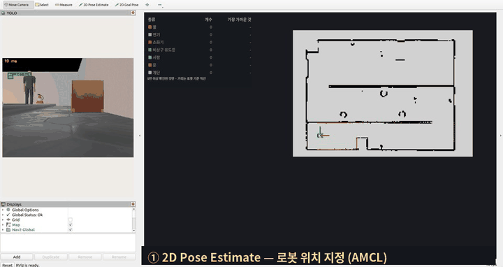
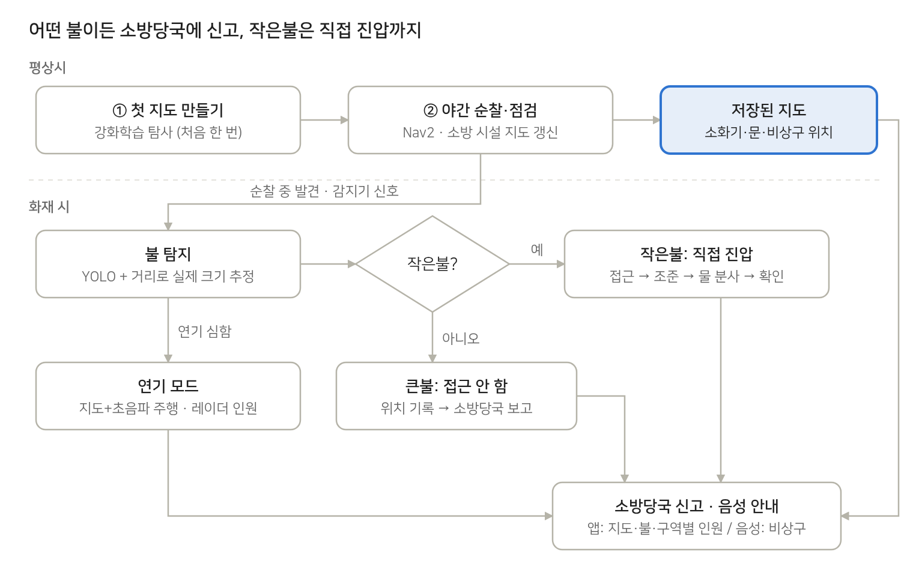
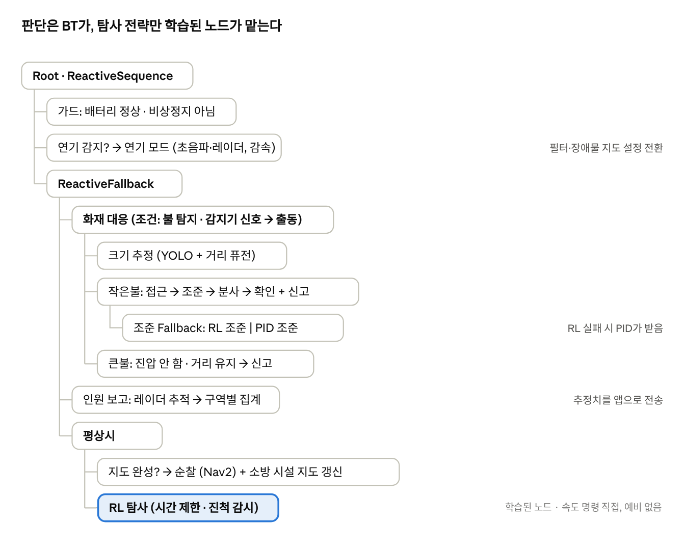
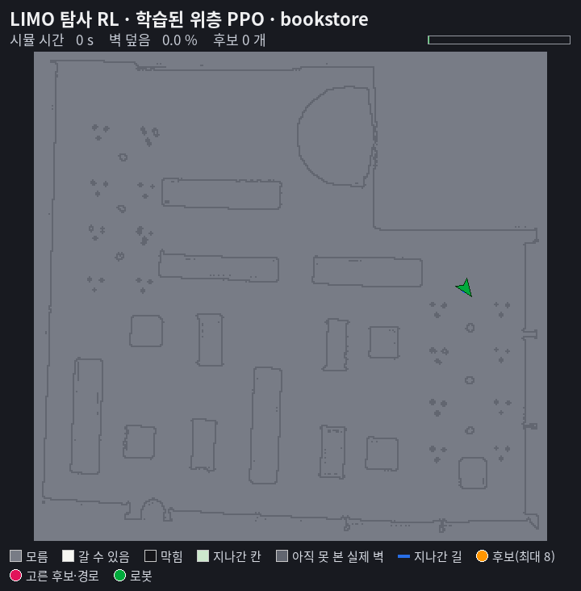
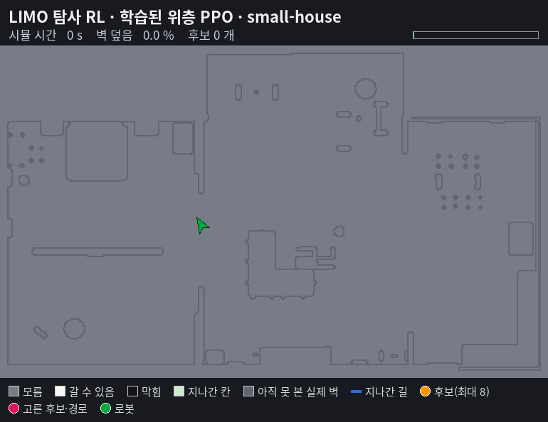
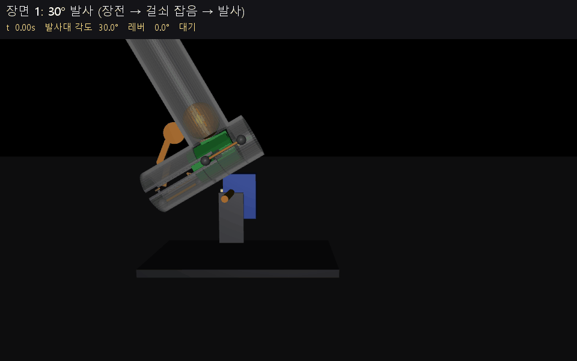
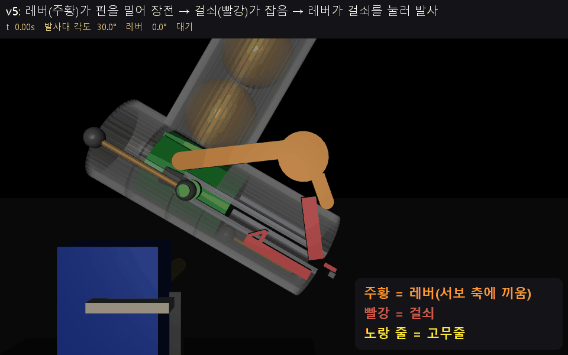
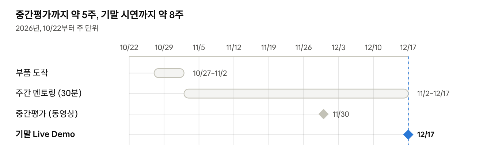

<div align="center">

<h1>🔥 LIMO Pro 화재 대응 로봇</h1>

<b>화재를 먼저 찾아내고, 먼저 대응한다.</b><br>
밤마다 순찰하며 소방 시설 지도를 만들어 두고, 불이 나면 신고·진압·인원 파악·대피 안내까지 하는 로봇

<br><br>

<a href="https://plausible-hallway-e4f.notion.site/3eb454b08de28190b2e8e321a33a9371">팀 노션</a> &nbsp;·&nbsp;
<a href="CHANGELOG.md">변경 기록</a>

<br><br>


<br><br>



<sub>Webots 덕트호스 미로(시연장 추정 모양) — RViz 에서 처음 위치를 찍고 목표를 주면 Nav2 가 미로를 돌아가며, YOLO 가 찾은 불·소화기·문·사람·계단을 지도에 올린다 (10 배속)</sub>

<br><br>



<sub>서비스 흐름 — 평상시에 만든 지도가 화재 시 주행·신고·안내의 바탕이 된다</sub>

</div>

<br>

한국항공대학교 로봇프로그래밍(0533) 조별 프로젝트. 기말 시연은 2026-12-17, 덕트호스로 만든 미로에서 Live Demo로 한다.

## 무엇을 하나

| 상황 | 로봇이 하는 일 |
|---|---|
| 처음 설치 | 강화학습 탐사로 건물을 빈 곳 없이 돌며 지도를 만들고, 소화기·문·비상구 위치를 등록 |
| 매일 밤 | 지도 위를 순찰·점검하며 소방 시설 지도를 갱신 |
| 순찰 중 불 발견, 또는 화재 감지기 신호 | 그 위치로 출동해 YOLO + 거리로 불의 실제 크기를 추정 |
| 작은불 | 소방당국에 신고하고, 열화상으로 확인한 뒤 노즐을 조준해 물로 끔 |
| 큰불 | 접근하지 않고 위치와 크기를 소방당국에 신고 |
| 연기가 짙을 때 | 저장된 지도 + 초음파로 주행하고, 레이더로 구역별 인원을 집계 |
| 건물 안 사람 발견 | 가장 가까운 비상구·소화기를 음성으로 안내 |

소방당국은 웹 앱에서 지도, 불 위치, 구역별 인원(추정치), 막힌 통로를 본다.

## 시스템 구조

<div align="center">


<sub>임무 행동 트리 — 판단은 BT가, 탐사 전략만 학습된 노드가 맡고, 학습이 실패하면 고전 방식으로 넘어간다</sub>
</div>

<br>

| 모듈 | 방법 |
|---|---|
| 임무·판단 | Nav2 BehaviorTree.CPP 플러그인 |
| 첫 지도 탐사 | 강화학습(PPO, GPU 학습) 두 층: 위층이 1 초마다 갈 곳을 고르고 아래층이 속도를 직접 냄(아래층은 만드는 중 — 지금은 Nav2 가 주행). 실패하면 프론티어 탐사로 Fallback |
| 불 탐지·크기 | YOLO + 거리(depth → 라이다 → 바닥 평면 가정) |
| 조준 | 강화학습 첫 시도, 비교 대상은 PID + 거리별 보정 |
| 연기 모드 | 오도메트리·IMU + 초음파 거리로 AMCL 보정, 초음파로 장애물 재계획 |
| 인원 집계 | 레이더 표적을 지도 좌표에서 칼만필터로 추적, 정지한 사람 유지 |
| 보고·안내 | rosbridge 웹 앱, 오프라인 음성 안내 |

자세한 설계와 실험 계획은 [스펙·구현 방향](docs/spec.md)에 있다.

### 탐사 강화학습 (시뮬)




<sub>처음 보는 시험 맵 두 곳(서점 6 배속 · 작은 집 5 배속, 사람 없음). 학습된 위층(PPO)이 1 초마다 주황 후보 중 하나(분홍)를 고르고, 아래층은 아직 규칙 주행이다.
학습으로 빠르게 달리는 아래층은 따로 만드는 중이라 여기에는 들어 있지 않다. 32 판 가운데 걸린 시간이 중간인 판을 골랐다. 자세한 것은 [train/explore](train/explore/README.md).</sub>

<br>

## 하드웨어

AgileX LIMO Pro(라이다, depth 카메라, IMU) 위에 ESP32로 제어하는 모듈을 올린다. 추가 부품비 95,127원.

| 부품 | 역할 |
|---|---|
| 열화상 MLX90640 (32×24) | 작은불 열원 확인 |
| 24GHz 레이더 HLK-LD2450 | 연기 속 사람 감지 |
| 초음파 HC-SR04 ×2 (앞 좌우 ±20°) | 연기 속 장애물, 위치 보정 |
| 서보 DS3218 + MG996R | 노즐 팬·틸트 조준 |
| 12V 다이어프램 펌프 + MOSFET | 물 분사 |

전체 목록과 전원 확인 사항은 [부품 목록](docs/parts.md)에 있다.

### 탁구공 발사대

LIMO 지붕 나사 구멍에 고정하는 3D 출력(PLA) 발사대. 서보 두 개로 장전·발사와 각도를 자동으로 바꾼다.

<div align="center">


<sub>MuJoCo 시뮬 — 30° 한 발, 15° 에서 장전한 뒤 5° 로 내려 두 발. 초록 = 플런저, 주황 = 레버, 빨강 = 걸쇠, 노랑 선 = 고무줄, 파랑 = 각도 서보 (발사 순간은 느린 화면)</sub>
</div>

| 동작 | 하는 일 |
|---|---|
| 장전 | DS3218 레버가 66° 돌아 플런저를 뒤로 밀고, 걸쇠가 핀을 잡는다. 공 통(5 발)의 맨 아래 공이 플런저 앞으로 내려온다 |
| 각도 | MG996R 이 발사대 축을 돌려 5~30° 로 맞춘다. 장전은 15° 이상에서 하고 천천히 내린다 |
| 발사 | 레버를 반대로 18° 돌리면 걸쇠가 열리고, 고무줄이 플런저를 당겨 공을 친다 |

시뮬 값 중 고무줄 세기는 잠정(실물 측정 전)이다. 출력 파일·설계 문서·시뮬은 `3d-modeling` 저장소 `탁구공발사대/` 에 있다.

#### v5 — 물리 최적화판 (시뮬 검증, 출력 전)

<div align="center">


<sub>v5 MuJoCo 시뮬 — 레버 쪽 확대 30° 두 발, 전체 15° 한 발. 주황 = 레버, 빨강 = 걸쇠, 노랑 선 = 고무줄</sub>
</div>

| | 지금(출력본) | v5 |
|---|---|---|
| 공 속도(탁구공, 30°, 같은 고무줄) | 4.7 m/s | 6.7 m/s |
| 서보 힘 60 % 로 장전 | 불확실 | 성공 |
| 바뀐 것 | | 레버 서보 축을 장전 끝 쪽으로, 움직이는 무게 18 → 9 g, 핀 롤러, 고무줄 고리 3곳 |

펌웨어 값: 장전 +67.3°, 장전 뒤 1.0 s 대기, 발사 -24°. 설계·검증 문서는 `3d-modeling` 저장소 `탁구공발사대/v5/설계_v5.md`.

## 폴더

```
limo_fire_ws/            ROS 2 워크스페이스 (여기서 colcon build)
├── src/
│   ├── external/        남의 코드 (WeGo LIMO Pro, 교수님 Webots 시뮬) — 고치지 않음
│   └── limo_fire/       우리 패키지
├── sim/                 Isaac Sim 4.5 확장·USD, maps/ 실내 맵      [COLCON_IGNORE]
├── train/               GPU 학습 환경 (맵 변환기, 환경 커널, PPO)   [COLCON_IGNORE]
├── firmware/            ESP32 코드
├── docs/                아이디어·스펙·부품 문서
├── refs/                참고 자료 (papers/ code/ datasheets/)       [COLCON_IGNORE]
├── archive/             안 쓰는 것                                  [COLCON_IGNORE]
└── env.sh               워크스페이스 환경 (conda 빼고 ROS 2 + install)
```

패키지별 역할까지 담은 전체 구조와 URDF·TF 규약은 [규약](docs/conventions.md)에 있다.

## 시뮬레이션

시뮬레이터 셋을 목적별로 나눠 쓴다.

| 목적 | 시뮬레이터 | 위치 |
|---|---|---|
| 강화학습 (탐사·조준) | 직접 만드는 2.5D GPU 환경 — 수천 개 병렬 | `train/` |
| 실제와 비슷한 검증 (센서·물리) | Isaac Sim 4.5 + WeGo LIMO USD | `sim/wego_LimoIsaacSIM` |
| (공통) 맵 | AWS 병원·창고·서점·집, ProcTHOR-10K, HouseExpo | `sim/maps` ([목록](sim/maps/README.md)) |
| Nav2·SLAM·BT 통합 검증 | Webots (교수님 LIMO 모델, 실제 LIMO 와 같은 토픽·프레임) + 우리 맵 4 개 | `sim/webots` ([맵·실행](sim/webots/README.md)) |

```bash
source ~/limo_fire_ws/env.sh
ros2 launch limo_fire_bringup sim.launch.xml world:=limo_fire_maze     # Webots + 저장 지도 + Nav2 (slam:=true · perception:=true)
```

시뮬 구조·Nav2 설정·운용 화면은 [simulation.md](docs/simulation.md), 인식 성능은 [benchmarks](docs/benchmarks/README.md).

## 시작하기

```bash
git clone https://github.com/juyoung020/limo_fire_ws.git ~/limo_fire_ws
cd ~/limo_fire_ws
source env.sh                      # conda 빼고 ROS 2 Humble
colcon build --packages-select webots_ros2_limo   # 지금 쓰는 것만. 전체 빌드는 astra_camera 등 의존성 필요
source env.sh
```

### 실물 LIMO 에서

```bash
source ~/limo_fire_ws/env.sh
colcon build --packages-select limo_fire_description limo_fire_navigation limo_fire_bringup
source env.sh
ros2 launch limo_fire_bringup robot.launch.xml          # 센서·구동
ros2 launch limo_fire_bringup mapping.launch.xml        # 지도 만들기 → save_map.launch.xml 로 저장
ros2 launch limo_fire_bringup navigation.launch.xml     # 저장한 지도로 주행
```

WeGo 대시보드 버튼과 같은 구성이다. 자세한 것은 [limo_fire_bringup](src/limo_fire/limo_fire_bringup/README.md).

Isaac Sim USD(`WegoLimoUSD.zip`, 약 65MB)는 용량 때문에 저장소에 없다. [WeGo 가이드](https://goofy-pleasure-a84.notion.site/Limo-Isaac-Sim-1ff09b2ac4bf8086bdf5e94521f74946)에서 받아 푼다.

```bash
unzip WegoLimoUSD.zip -d sim/wego_LimoIsaacSIM/USD/
```

### 포함한 외부 코드

| 폴더 | 출처 | 커밋 |
|---|---|---|
| `src/external/wego_limo_pro` | 실물 LIMO Pro 의 `~/wego_ws/src` (WeGo 출고본, [WeGo-Robotics/limo_pro](https://github.com/WeGo-Robotics/limo_pro) 와 다름) — [목록](src/external/wego_limo_pro/README.md) | 2026-10-26 복사 |
| `src/external/webots_ros2_limo` | [inmo-jang/webots_ros2_limo](https://github.com/inmo-jang/webots_ros2_limo) (교수님) | `68d4fc0` |
| `sim/wego_LimoIsaacSIM` | [WeGo-Robotics/LimoIsaacSIM](https://github.com/WeGo-Robotics/LimoIsaacSIM) (`sim` 브랜치) | `158da2b` |

## 일정

<div align="center">

</div>

| 날짜 | 내용 |
|---|---|
| 11/2 ~ | 주간 멘토링 |
| 11/30 (월) | 중간평가 — PPT + 동영상 시연 |
| 12/17 (목) 13시 | 기말 발표 + Live Demo |
