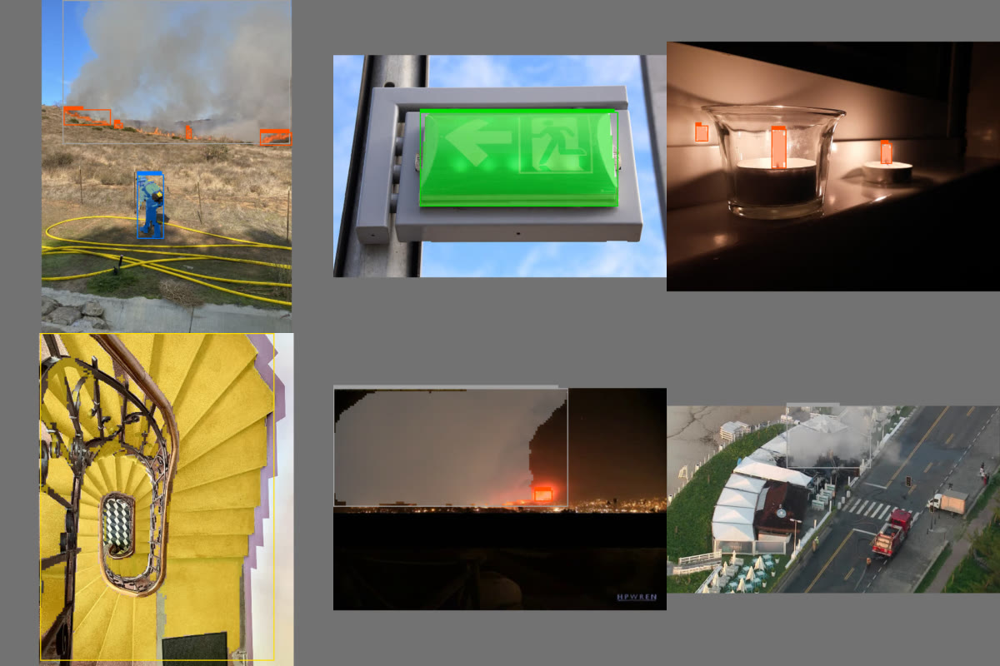
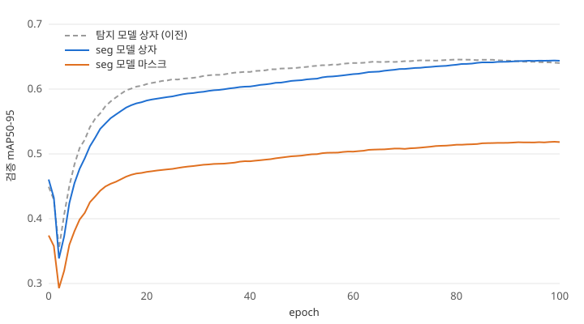

# 화재 대응 로봇의 눈 — YOLO26s-seg 인식 모델

로봇 카메라 영상에서 **불·연기·소화기·비상구 표지·사람·문·계단**을 찾고, 각각의 **모양(픽셀 단위 영역)**까지 그려 내는 인식 모델을 만든 과정과 결과를 정리했다.
처음 듣는 사람도 따라올 수 있게 기본 개념부터 적었다. 마지막 갱신 2026-10-27.

*시험 사진(학습에 쓰지 않은 사진)에 모델을 돌린 결과. 테두리 = 찾은 물체의 상자, 색칠 = 그 물체의 영역(마스크), 상자 위 막대 길이 = 확신도. 색: 주황 불 · 회색 연기 · 빨강 소화기 · 초록 비상구 표지 · 파랑 사람 · 보라 문 · 노랑 계단. 사진 출처는 맨 아래.*

## 한눈에

| 항목 | 내용 |
|---|---|
| 하는 일 | 사진 한 장 → 물체마다 **종류 + 상자 + 영역(마스크) + 확신도** |
| 찾는 것 | 7 종류: 불, 연기, 소화기, 비상구 표지, 사람, 문, 계단 |
| 모델 | **YOLO26s-seg** (Ultralytics, 2026 년 1 월 공개) — 파라미터 약 1,040 만 개 |
| 학습 데이터 | 사진 **68,214 장**(학습 54,585 · 검증 6,703 · 시험 6,820), 물체 약 **19.7 만 개** |
| 정답 만들기 | 사람이 직접 그리지 않고 **SAM 3**(Meta 의 최신 분할 AI)로 자동 라벨 → **SigLIP** 으로 틀린 라벨 걸러 냄 |
| 학습 | 직접 짠 **C++/CUDA 학습기**, RTX 5070 Ti 한 장, 100 epoch, **5.1 시간** (초당 약 290 장) |
| 결과(시험 사진) | 상자 mAP50-95 **0.651** · 마스크 mAP50-95 **0.521** (mAP50 은 0.787 · 0.731) |
| 이전 모델과 비교 | 상자만 찾던 이전 모델(0.654)과 상자 성능은 사실상 같고, **영역까지 얻음** |

## 1. 기본 개념

### 1.1 컴퓨터가 사진에서 물체를 "본다"는 것

같은 사진을 두고도 묻는 질문에 따라 일이 다르다.

| 일 | 질문 | 결과 | 예 |
|---|---|---|---|
| 분류 (classification) | 이 사진에 무엇이 있나? | 사진 하나에 이름 하나 | "불이 있는 사진" |
| **객체 탐지** (object detection) | 무엇이 **어디에** 있나? | 물체마다 **상자**(사각형) + 이름 | 불을 감싸는 사각형 |
| 의미 분할 (semantic segmentation) | 픽셀마다 무엇인가? | 픽셀마다 종류(같은 종류끼리는 구분 안 함) | 사람 셋이 한 덩어리 "사람" 영역 |
| **인스턴스 분할** (instance segmentation) | 물체마다 **정확한 모양**은? | 물체마다 **마스크**(그 물체에 속한 픽셀) + 이름 | 사람 셋이 각각 따로 칠해짐 |

이 모델은 **객체 탐지와 인스턴스 분할을 한 번에** 한다. 상자는 "어디쯤"을, 마스크는 "정확히 어디까지"를 알려 준다.

### 1.2 왜 상자만으로는 부족한가

- **불의 크기**: 상자는 불 주변의 빈 공간까지 포함한다. 마스크의 픽셀 수를 세면 실제로 타는 면적에 더 가깝게 잴 수 있다 → 진압할지, 물러날지 판단.
- **거리 재기**: 깊이 카메라로 물체까지 거리를 잴 때, 상자 안 픽셀을 쓰면 뒤 배경(벽·바닥)이 섞인다. 마스크 안 픽셀만 쓰면 그 물체의 거리만 나온다 → 지도에 소화기·비상구 위치를 정확히 찍음.
- **계단·문**: 비스듬히 찍힌 계단은 상자의 절반이 계단이 아니다. 마스크로 진입 금지 구역을 더 정확히 그린다.

### 1.3 YOLO 란

**YOLO(You Only Look Once, "한 번만 본다")** 는 2015 년에 처음 나온 실시간 객체 탐지 모델 계열이다.
예전 방식은 "물체가 있을 만한 곳 후보를 먼저 뽑고 → 후보마다 다시 들여다보는" 두 단계라 느렸다.
YOLO 는 사진을 **신경망에 한 번 통과**시켜 모든 위치의 물체를 동시에 예측한다. 그래서 빠르고, 로봇·자율주행·CCTV 처럼 **실시간**이 필요한 곳에서 가장 널리 쓰인다.

그 뒤 여러 팀이 버전을 이어 왔고, 지금은 주로 **Ultralytics** 라는 회사가 YOLOv5 · v8 · 11 · **26** 을 내고 있다. 이름의 숫자는 성능 순위가 아니라 세대(26 = 2026 년 세대)다.

### 1.4 YOLO26 이란

**YOLO26** 은 Ultralytics 가 **2026 년 1 월**에 공개한 최신 세대다. 작은 기기(엣지)에서 빠르게 돌리는 것을 목표로 다음을 바꿨다
(출처: [Ultralytics YOLO26 문서](https://docs.ultralytics.com/models/yolo26/)).

| 바뀐 점 | 쉬운 설명 | 우리에게 좋은 점 |
|---|---|---|
| **NMS 없는 끝단간(end-to-end) 출력** | 예전 YOLO 는 같은 물체에 상자를 여러 개 낸 뒤, NMS 라는 후처리로 겹친 것을 지웠다. YOLO26 은 물체마다 상자 하나만 내도록 학습한다(“one-to-one 머리”). | 후처리가 없어 로봇 컴퓨터(Jetson)에서 코드가 단순하고 시간이 일정 |
| **DFL 제거** | 상자 경계를 확률 분포로 내던 복잡한 출력(Distribution Focal Loss)을 없애고 거리 4 개를 바로 낸다. | 다른 기기용으로 변환(TensorRT·ONNX)이 쉬움 |
| **STAL**(작은 물체 맞춤 라벨 배정) | 아주 작은 물체도 학습 때 정답 위치를 충분히 배정받게 한다. | 멀리 있는 촛불·작은 불씨 |
| **ProgLoss**(점진적 손실) | 학습 초반엔 "여러 개 내는 머리", 후반으로 갈수록 "하나만 내는 머리"에 무게를 옮긴다. | 안정적인 학습 |
| **MuSGD 옵티마이저** | 대형 언어 모델 학습에 쓰던 Muon 과 전통적인 SGD 를 섞은 학습 방법. | 빠르고 안정적인 수렴 |

크기는 n(nano)·s(small)·m·l·x 다섯 가지이고, 일(task)마다 판이 있다: 탐지(`yolo26s`), 분할(`yolo26s-seg`), 자세, 분류 등.
COCO(물체 80 종류, 공개 표준 시험 데이터)에서 Ultralytics 가 발표한 성능은 다음과 같다
(출처: [탐지](https://docs.ultralytics.com/models/yolo26/), [분할](https://docs.ultralytics.com/tasks/segment/)).

| 모델 | 일 | 상자 mAP50-95 (NMS 없이) | 마스크 mAP50-95 | 파라미터 | 연산량 | T4 GPU TensorRT |
|---|---|---|---|---|---|---|
| YOLO26n | 탐지 | 40.1 | — | 2.4 M | 5.5 GFLOPs | 1.7 ms |
| YOLO26s | 탐지 | 47.8 | — | 9.5 M | 20.9 GFLOPs | 2.5 ms |
| YOLO26n-seg | 탐지 + 분할 | 39.6 | 33.9 | 2.7 M | 9.3 GFLOPs | 2.1 ms |
| **YOLO26s-seg** | 탐지 + 분할 | 47.3 | 40.0 | 10.4 M | 34.5 GFLOPs | 3.3 ms |

(이 표의 숫자는 COCO 기준이라 아래 우리 결과와 직접 비교하지 않는다. mAP 는 [6 장 용어](#6-용어-풀이) 참고.)

**왜 s-seg 인가**: 로봇에 실리는 컴퓨터(Jetson Orin Nano)에서 실시간으로 돌 만큼 작으면서, n 보다 정확도가 뚜렷이 높다. seg 판은 탐지 판보다 연산이 약 1.6 배지만 상자와 마스크를 **모델 하나, 추론 한 번**으로 얻는다(탐지 모델 + 분할 모델을 따로 돌리는 것보다 싸다).

### 1.5 YOLO26s-seg 의 구조(그림 없이)

1. **백본**(backbone): 사진(640×640)을 점점 작고 깊은 특징 지도로 바꾼다 — 1/8, 1/16, 1/32 크기 세 단계.
2. **넥**(neck): 세 단계를 위아래로 섞어 작은 물체·큰 물체 정보를 모두 갖게 한다.
3. **머리**(head), 위치(앵커) 8,400 곳마다:
   - 상자(경계까지 거리 4 개), 종류별 점수 7 개,
   - **마스크 계수 32 개** — "이 물체의 모양은 아래 32 장의 기본 무늬를 이 비율로 섞은 것".
4. **원형 마스크(proto)**: 사진 전체에 대한 **기본 무늬 32 장**(160×160). 물체 하나의 마스크 = 32 장을 그 물체의 계수로 더한 뒤 상자 밖을 지운 것.
5. (학습 때만) **의미 분할 가지**: 픽셀마다 종류를 맞히게 해 기본 무늬가 물체 모양을 잘 배우도록 돕는다. 추론 때는 떼어 낸다.

## 2. 무엇을 찾나 — 7 종류와 쓰임

| 번호 | 종류 | 로봇에서 쓰는 곳 |
|---|---|---|
| 0 | 불 (fire) | 불 찾기·크기 판단(촛불·인쇄한 불 포함) → 진압 |
| 1 | 연기 (smoke) | 연기 모드로 바꾸기(카메라가 안 보이면 레이더·열화상 위주) |
| 2 | 소화기 (fire_extinguisher) | 소방 시설 지도 |
| 3 | 비상구 표지 (exit_sign) | 소방 시설 지도·대피 안내 |
| 4 | 사람 (person) | 대피 안내(연기 속은 레이더) |
| 5 | 문 (door) | 소방 시설 지도·구역 나누기 |
| 6 | 계단 (stairs) | 낙하 방지 — 진입 금지 구역(내려가는 계단은 2D 라이다에 안 잡힘) |

## 3. 데이터

### 3.1 사진 모으기

| 출처 | 내용 | 장수 | 라이선스 |
|---|---|---|---|
| D-Fire | 실내·실외 화재 사진 | 21,527 | CC0(자유) |
| Open Images V7 | 계단·문이 있는 사진 | 18,552 | CC BY |
| 이미지 검색(네이버·Bing·Baidu) | 한국식 비상구 유도등·소화기·촛불·실내 계단 — AI(SigLIP)로 관계없는 사진을 거름 | 14,975 | 학습용만(재배포 금지) |
| Wikimedia Commons·Openverse | 같은 종류, 공개 라이선스만 | 3,000 | CC0·CC BY 등 |
| LVIS(COCO) | 소화기 | 172 | CC BY |
| COCO | 사람이 많이 나오는 일상 사진(무작위) | 9,988 | CC BY |
| **합계** | | **68,214** | |

사진은 **학습 : 검증 : 시험 = 8 : 1 : 1** 로 나눴다. 나누는 기준은 파일 경로의 해시라 언제 다시 나눠도 같다.
- **학습**: 모델이 보고 배우는 사진.
- **검증**: 학습 중간중간 실력을 재서 가장 좋은 시점을 고르는 사진.
- **시험**: 마지막에 한 번만 재는 사진(학습·선택에 전혀 쓰지 않음) — 아래 결과는 모두 시험 사진.

### 3.2 정답(라벨) 만들기 — 사람 대신 AI 선생님

6.8 만 장에 물체 약 20 만 개의 상자와 모양을 사람이 그리면 몇 달이 걸린다. 그래서 **더 크고 느리지만 정확한 AI 를 선생님**으로 써서 자동으로 정답을 만들었다(“지식 증류”와 같은 생각).

1. **SAM 3** (Meta, 2025): 글로 물체 이름을 주면("fire extinguisher") 사진에서 그 물체를 모두 찾아 상자와 모양을 그려 주는 모델. 파이썬 없이 **C++/CUDA 로 옮겨** 빠르게 돌렸다(한 장 0.15 초, 6.8 만 장 약 2 시간 48 분). PyTorch 원본과 결과가 같은지 단계별로 확인했다.
2. **프롬프트 고르기**: 종류마다 여러 문구를 시험해 가장 잘 잡는 것을 골랐다(예: 불은 "fire" + "candle flame", 비상구는 "emergency exit sign" + "green emergency exit light with running man").
3. **규칙으로 정리**(`train/detect/tools/yolods`): 확신도 0.5 미만 버림, 같은 종류끼리 겹친 상자 정리, 비상구 표지 속 "달리는 사람 그림"을 사람으로 잡은 것 버림, 너무 작은 것 버림.
4. **SigLIP 검사**: 눈으로 표본을 보니 비상구의 약 1/3 이 간판·방 번호판, 문에 자동차 문·찬장이 섞여 있었다. 상자를 잘라 SigLIP(그림-글 대조 AI)에 "비상구 표지인가 / 간판인가" 를 물어 틀린 것을 뺐다 — 비상구 46 %, 문 18 % 제거.
5. **마스크**: SAM 3 가 물체마다 낸 모양(288×288)을 한 장의 "번호 지도"로 합쳤다(겹치면 작은 물체가 위). 상자 197,092 개 모두 모양이 있다.

시험 사진의 정답도 같은 방법으로 만든 자동 라벨이다. 그래서 아래 점수는 "SAM 3 선생님을 얼마나 잘 따라 하나"에 가깝다. 실제 현장 성능은 학교에서 찍고 사람이 정답을 단 사진으로 따로 잴 예정이다.

## 4. 학습 방법

### 4.1 전이 학습

빈 모델에서 시작하지 않고, Ultralytics 가 **COCO 로 미리 학습한 YOLO26s-seg** 에서 시작했다. 이미 "물체 모양"을 아는 모델에 우리 7 종류를 새로 가르치는 것이라 적은 시간에 높은 성능이 나온다.
종류 수가 80 → 7 로 바뀌어 종류 점수를 내는 마지막 층은 새로 초기화하되, COCO 에도 있는 "사람"은 그 줄을 그대로 옮겨 왔다.

### 4.2 직접 만든 학습기

Ultralytics 공식 학습 코드는 파이썬(PyTorch)이다. 우리 프로젝트는 **C++ 와 Rust 만** 쓰기로 정해서, 같은 규칙을 **C++/CUDA 로 처음부터 다시 짰다**(`train/detect/trainer`).

- **맞는지 확인(정합성 시험)**: 같은 입력을 Ultralytics 와 우리 학습기에 넣어 결과를 비교했다 — 신경망 출력 차이 0.08 % 이하, 손실 값 0.00003 % 이하, 학습 신호(기울기) 0.003 % 이하.
- **빠르게**: 사진 압축 풀기는 CPU 여러 스레드, 사진 변형(증강)은 GPU, 데이터 옮기기와 계산을 겹쳐서 GPU 가 쉬지 않게 했다. 초당 약 290 장 (탐지만 하는 판은 393 장).

### 4.3 학습 설정

| 항목 | 값 | 뜻 |
|---|---|---|
| 입력 크기 | 640×640 | 사진을 이 크기로 맞춰 넣음 |
| 배치 | 32 장 | 한 번에 보는 사진 수 |
| epoch | 100 | 학습 사진 전체를 100 번 반복(1 epoch = 1,705 번 갱신) |
| 옵티마이저 | MuSGD, 학습률 0.01 → 0.0001(직선으로 줄임), 처음 3 epoch 은 서서히 올림 | |
| 가중치 평균(EMA) | 사용 | 최근 가중치들의 평균을 저장 — 결과가 덜 흔들림 |
| 증강 | 모자이크(4 장 붙이기), 크기 ±50 %, 위치 ±10 %, 색(색상·채도·밝기), 좌우 뒤집기 50 % | 같은 사진도 매번 다르게 보여 줘 외우지 않고 일반화하게 함. 마지막 10 epoch 은 모자이크를 끔 |
| 손실(틀린 정도) | 상자 위치(CIoU) · 종류(BCE) · 상자 거리(L1) · **마스크**(픽셀별 BCE) · **의미 분할**(BCE + Dice) | 마스크와 의미 분할은 이번에 추가 |
| 하드웨어·시간 | RTX 5070 Ti 1 장, 5.1 시간 | |
| 고른 가중치 | 검증 점수(상자 + 마스크 mAP50-95)가 가장 높은 99 epoch | |

### 4.4 학습 곡선

- 2 epoch 쯤 잠깐 떨어지는 것은 학습률을 올리는 준비 구간(워밍업) 때문이다.
- seg 모델의 상자 점수는 처음엔 이전 탐지 모델보다 2~3 점 낮았지만 끝에서 따라잡았다(마스크까지 배우느라 초반이 느림).

| epoch | 1 | 10 | 20 | 40 | 60 | 80 | 100 |
|---|---|---|---|---|---|---|---|
| 검증 상자 mAP50-95 | 0.461 | 0.525 | 0.582 | 0.604 | 0.623 | 0.638 | 0.644 |
| 검증 마스크 mAP50-95 | 0.374 | 0.434 | 0.472 | 0.489 | 0.504 | 0.514 | 0.518 |

## 5. 결과 (시험 사진 6,820 장)

### 5.1 종류별

| 종류 | 정답 수 | 상자 AP50 | 상자 AP50-95 | 마스크 AP50 | 마스크 AP50-95 |
|---|---|---|---|---|---|
| 불 | 2,971 | 0.790 | 0.605 | 0.661 | 0.369 |
| 연기 | 1,730 | 0.764 | 0.606 | 0.697 | 0.442 |
| 소화기 | 731 | 0.878 | 0.770 | 0.851 | 0.693 |
| 비상구 표지 | 593 | 0.851 | 0.800 | 0.835 | 0.706 |
| 사람 | 7,770 | 0.723 | 0.523 | 0.671 | 0.404 |
| 문 | 3,585 | 0.756 | 0.659 | 0.713 | 0.540 |
| 계단 | 1,803 | 0.749 | 0.597 | 0.687 | 0.491 |
| **전체** | 19,183 | **0.787** | **0.651** | **0.731** | **0.521** |

### 5.2 이전 모델(상자만)과 비교

| | 이전: YOLO26s (탐지) | 이번: YOLO26s-seg (탐지 + 분할) |
|---|---|---|
| 상자 mAP50 | 0.784 | **0.787** |
| 상자 mAP50-95 | **0.654** | 0.651 |
| 마스크 mAP50-95 | — | **0.521** |
| 파라미터(Ultralytics 발표, COCO 판) | 9.5 M | 10.4 M |
| 학습 시간(100 epoch) | 3.8 시간 | 5.1 시간 |

상자 성능은 차이가 ±0.003 으로 사실상 같고, 대신 **물체 모양을 얻었다**.
(학습 설정 차이: 이전 모델은 마지막 10 epoch 에도 모자이크를 켰고, 이번은 Ultralytics 기본값대로 껐다. 둘 다 시험 사진·정답은 같다.)

### 5.3 해석

- **잘 되는 것**: 소화기·비상구 표지 — 모양이 일정하고 색이 뚜렷해 상자·마스크 모두 0.7~0.8.
- **어려운 것**: 불·연기 마스크(0.37·0.44) — 경계가 흐릿하고 모양이 계속 바뀌어, "정답 모양" 자체가 애매하다. 상자보다 마스크 점수가 많이 낮은 이유.
- **사람**: 사진 속 사람이 작고 많이 겹친 경우(군중)가 많아 상대적으로 낮다.
- 마스크는 160×160 해상도라 아주 작은 물체(멀리 있는 촛불)는 모양이 거칠다.

### 5.4 한계와 다음 할 일

| 한계 | 다음 할 일 |
|---|---|
| 시험 정답도 AI(SAM 3)가 만든 것 | 학교에서 직접 찍고 사람이 정답을 단 사진으로 다시 재기 |
| 로봇 컴퓨터(Jetson Orin Nano)에서의 속도는 아직 안 잼 | TensorRT 로 변환해 실제 속도 재기 |
| 한국식 비상구·소화기 사진이 상대적으로 적음 | 직접 찍은 사진 추가 |

## 6. 용어 풀이

| 용어 | 뜻 |
|---|---|
| **IoU** | 예측과 정답이 얼마나 겹치나 = 겹친 넓이 ÷ 합친 넓이. 1 이면 완전히 같음. 상자끼리, 마스크끼리 잰다 |
| **정밀도**(precision) | 모델이 "찾았다"고 한 것 중 진짜 맞은 비율 |
| **재현율**(recall) | 진짜 있는 것 중 모델이 찾아낸 비율 |
| **AP** | 확신도 기준을 바꿔 가며 정밀도·재현율을 그린 곡선 아래 넓이(0~1). 종류마다 하나 |
| **mAP50** | IoU 0.5 이상이면 맞은 것으로 칠 때 AP 의 종류 평균 — "대충 맞으면 정답" |
| **mAP50-95** | IoU 기준을 0.50, 0.55, …, 0.95 로 바꿔 가며 잰 mAP 의 평균 — 위치·모양까지 정확해야 높음. 대표 지표 |
| **epoch** | 학습 사진 전체를 한 번 다 보는 것 |
| **배치** | 한 번 갱신할 때 같이 보는 사진 수 |
| **손실**(loss) | 예측이 정답과 얼마나 다른지를 숫자로 나타낸 것 — 학습은 이를 줄이는 방향으로 가중치를 고친다 |
| **증강**(augmentation) | 사진을 자르고 붙이고 색을 바꿔 학습 데이터를 다양하게 만드는 것 |
| **전이 학습** | 다른 큰 데이터로 미리 배운 모델에서 시작해 우리 일을 더 가르치는 것 |
| **마스크** | 물체에 속한 픽셀을 1, 나머지를 0 으로 표시한 그림 |
| **TensorRT** | NVIDIA 기기에서 신경망을 빠르게 돌리도록 바꿔 주는 도구 |

## 7. 재현 방법·파일

| 것 | 위치 |
|---|---|
| 데이터 준비·자동 라벨 | [train/detect/README.md](../train/detect/README.md) |
| 학습기 구조·정합성·실행 명령 | [train/detect/trainer/README.md](../train/detect/trainer/README.md) |
| 학습 기록 | `train/detect/data/runs/y26s_seg/log.tsv` (git 제외) |
| 가중치 | `train/detect/data/runs/y26s_seg/best.safetensors` (46 MB, git 제외) |
| 시험 평가 | `train --seg --eval --val ../data/cache/seg_test_640.ycache --weights <best>` |
| 예측 그림 | 위 명령에 `--draw <폴더>` |

예시 사진 출처: 불·연기 3 장 [D-Fire](https://github.com/gaiasd/DFireDataset) (CC0) · 비상구 표지 "Travaux gare de Gif-sur-Yvette 15", Lionel Allorge, [Wikimedia Commons](https://commons.wikimedia.org/wiki/File:Travaux_gare_de_Gif-sur-Yvette_15.jpg) (CC BY-SA 3.0) · 촛불 "Hanukkah candles 2015 (5)", Chenspec, [Wikimedia Commons](https://commons.wikimedia.org/wiki/File:Hanukkah_candles_2015_(5).jpg) (CC BY-SA 4.0) · 계단 "33 Strada Doctor Lister, Bucharest (12)", Neoclassicism Enthusiast, [Wikimedia Commons](https://commons.wikimedia.org/wiki/File:33_Strada_Doctor_Lister,_Bucharest_(12).jpg) (CC0). 예측 그림을 덧칠한 것은 원본 라이선스를 따른다.
