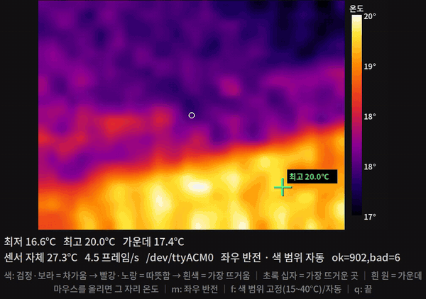

# 하드웨어 스펙 — 쓰는 모듈 전부

로봇에 달린 것과 달 것을 한 곳에 모은다. LIMO Pro 기본 모듈은 **2026-10-26 실물에서 직접 읽은 값**(드라이버 로그, `ros2 topic hz`, `camera_info`, `tf2_echo`, 정지 20 초 기록)이고, 확인 못 한 값은 "확인 필요"로 적었다. 추가 모듈의 구매 정보는 [parts.md](parts.md), 설계상 역할은 [spec.md](spec.md#하드웨어-구성).

## 한눈에

| 구분 | 모듈 | 연결 | ROS 토픽 | 상태 |
|---|---|---|---|---|
| 컴퓨터 | NVIDIA Jetson Orin Nano 8GB (Developer Kit, P3767-0003) | — | — | 장착 |
| 2D 라이다 | YDLIDAR T-mini Plus | USB(CP210x) `/dev/ydlidar` | `/scan` | 장착 · 동작 확인 |
| 깊이 카메라 | Orbbec Dabai DC1 | USB | `/camera/color/*`, `/camera/depth/*`, `/camera/ir/*` | 장착 · 동작 확인 |
| IMU | LIMO 본체 보드 내장 | UART `/dev/ttylimo`(→ `ttyTHS1`) | `/imu` | 장착 · 동작 확인 |
| 바퀴 오도메트리 | LIMO 본체 (파랑 메카넘 모드) | UART `/dev/ttylimo` | `/odom`, EKF → `/odometry/filtered` | 장착 · 동작 확인 |
| 카메라 틸트 | LIMO Pro 카메라 마운트 (손으로 고정) | — | URDF 인자 `camera_pitch` (`limo_fire.urdf.xacro`) | 장착 |
| 오디오 | USB PnP Audio (JMTek 0c76:161f) | USB | — | 장착, 스피커·마이크 여부 확인 필요 |
| 열화상 | GY-MCU90640 (MLX90640 BAB 55°, 32×24) | ESP32 UART 115200baud | 예정 | 보유 · ESP32-S3 에 단독 연결해 온도 확인(11-11), 로봇 미장착 |
| 레이더 | HLK-LD2450 24GHz | ESP32 UART 256000baud | 예정 | 보유 · ESP32-C3 에 단독 연결해 표적 확인(11-11), 로봇 미장착 |
| 초음파 | HC-SR04 × 3 | ESP32 GPIO | `/ultrasonic/front·left·right` (`sensor_msgs/Range`) | 키트 보유 · 펌웨어·다리 준비(실물 시험 전), 시뮬엔 있음 |
| 노즐 팬·틸트 | MG996R(팬) + DS3218 PRO 20kg(틸트) | ESP32 PWM | 예정 `/joint_states` | 부품 대기 |
| 펌프 | DP-521 12V 다이어프램 + D4184 MOSFET | ESP32 GPIO | 예정 `std_srvs/SetBool` | 부품 대기 |
| 제어 보드 | ESP32-S3-N16R8 개발 보드 · ESP32-C3 SuperMini | USB 시리얼 115200 (`/dev/esp32`) | `limo_fire_esp32_bridge` (펌웨어 `firmware/limo_fire_esp32`) | 보유(11-11). 펌웨어 초음파 핀은 원래 ESP32 기준이라 이 보드들에 맞춰야 함 |

## LIMO Pro 기본 모듈 (실측)

기동: `ros2 launch wego teleop_launch.py` (`~/wego_ws`, `ROS_LOCALHOST_ONLY=1`). 라이다·카메라·베이스·EKF·URDF 를 같이 띄우고 로봇은 움직이지 않는다.

### 컴퓨터

| 항목 | 값 |
|---|---|
| 모듈 | Jetson Orin Nano 8GB (`p3767-0003`, 캐리어 `p3768`) |
| CPU · 메모리 | 6 코어, 8 GB (공유) |
| OS | JetPack 6 / L4T R36.4.7, Ubuntu 22.04, ROS 2 Humble |
| 저장 | NVMe 116 GB |

### 라이다 — YDLIDAR T-mini Plus

| 항목 | 값 | 출처 |
|---|---|---|
| 모델·펌웨어 | T-mini Plus (model code 151), FW 1.2, HW 1 | 드라이버 로그 |
| 통신 | 230400 baud, `/dev/ydlidar` → `ttyUSB0` | 드라이버 로그 |
| 회전 주기 | 10 Hz (실측 10.04 Hz) | 파라미터 · `topic hz` |
| 샘플링 | 4 kHz | 드라이버 로그 |
| 사용 각도 | **±110° (220°)** — 센서는 360° 를 돌지만 WeGo 설정이 앞쪽만 자른다. 뒤 140° 는 안 보인다 | `/scan` angle_min/max = ±1.9199 rad |
| 각 간격 | 0.01544 rad (0.885°), 한 스캔 약 249 빔 | `/scan` |
| range_min / max 설정 | 0.01 m / 64 m | 파라미터 |
| 실제 측정 거리 | 사양 12 m @ 반사율 80 % (판매처 표기). 실측(드라이버 `/scan`, 2026-11 녹화): 최소 0.11 m, **최대 9.4 m** — 넓은 실험실 1104 녹화 3,100 장에 9.4 m 넘는 값 0. 같은 거리라도 면마다 다름: 8.4 m 벽은 거의 늘 돌아오고, 5~8.5 m 면 빔은 3~5 m 대비 85 %, 8.5~9 m 34 % 만 돌아옴(세워 둔 녹화, 다른 자리 멈춤들에선 8.5~9 m 81 %) (`train/explore/sim/analysis/real_limo.md` 먼 거리 절). 9.4 m 넘는 면이 있어도 돌아오는지는 아직 모름 | `~/limo_bags` 1103·1104 녹화 |
| 장착 (base_link → laser_link) | (0.103, 0, −0.034) m, 회전 0 | `tf2_echo` |

### 깊이 카메라 — Orbbec Dabai DC1

| 항목 | 값 | 출처 |
|---|---|---|
| 장치 | Orbbec Dabai DC1 (USB `2bc5:0557`, 깊이부 `2bc5:0657`) | `lsusb` |
| 시리얼 · 펌웨어 | CC1365303EG · RD1001 | 드라이버 로그 |
| 드라이버 | `orbbec_camera` `astra_stereo_u3.launch.py` | `teleop_launch.py` |
| 컬러 | 640×480, MJPG, 30 fps (실측 28.9 Hz) | 드라이버 로그 · `topic hz` |
| 깊이 (센서 원본) | 640×400, Y11, 30 fps | 드라이버 로그 |
| 깊이 (발행) | 640×480, 컬러에 정렬(`depth_registered`), 실측 29.4 Hz | `camera_info` · `topic hz` |
| IR | 640×400, Y10, 30 fps | 드라이버 로그 |
| 내부 파라미터 | fx = fy = 489.39, cx = 321.47, cy = 218.66 (컬러·깊이 같음) | `camera_info` |
| 왜곡 | rational_polynomial, k1 = 0.0718, k2 = −0.0971, p1 = 8.0e-5, p2 = 6.2e-4 | `camera_info` |
| 화각 (fx 로 계산) | 가로 66.4°, 세로 52.3° | 계산 |
| 측정 거리 | 확인 필요 (제조사 사양 + 실측) | — |
| 장착 (base_link → camera_link) | (0.15, −0.005, 0.06) m, 회전 0 (x·y 실측, z 는 WeGo 값 · 확인 필요). 10-26 에는 WeGo 틸트 TF (0.23, 0.05, 0.06) | `limo_fire.urdf.xacro`, `tf2_echo` |
| 장착 (base_link → camera_color_optical_frame) | (0.15, −0.035, 0.06) m (2026-10-28), 10-26 에는 (0.23, 0.02, 0.06), RPY (−89.9°, −0.2°, −90.3°) | `tf2_echo` |

- 위 "깊이 (발행) 640×480, 컬러에 정렬" 은 포인트 클라우드를 켠 10-26 설정 기준이다. 10-28 에 포인트 클라우드를 끄면서 정렬도 같이 꺼졌다가(640×400), 11-04 에 `depth_registration: true` 로 다시 켰다(실측 29.0·28.6 Hz) → [sensor_topics.md](sensor_topics.md#주의-1-깊이가-컬러에-정렬되지-않게-바뀐다-2026-11-04-고침)
- 내부 파라미터는 공장 값이다. 우리가 다시 캘리브레이션한 적은 없다.
- 기동 때 `Failed to setup devices: ... unknown error` 가 한 번 찍히지만 스트림은 정상으로 나온다. 원인 확인 필요.

### IMU — LIMO 본체 보드 내장

| 항목 | 값 | 출처 |
|---|---|---|
| 칩 | 확인 필요 | — |
| 출력 | `/imu`, 100 Hz (실측 99.9 Hz), frame `imu_link`. 자세(쿼터니언)를 보드가 계산해서 준다 | `topic hz` · echo |
| 자이로 바이어스 (정지) | x 0.00009 · y −0.00003 · z −0.00005 rad/s | 정지 18 초 |
| 자이로 노이즈 std (정지) | x 0.0017 · y 0.0028 · z 0.0010 rad/s | 정지 18 초 |
| 자이로 분해능 | 0.0017453 rad/s (= 0.1 °/s 단위로 끊긴다) | 값 관찰 |
| yaw 드리프트 (정지) | 0.000° / 18 s | 정지 18 초 |
| 가속도 평균 (정지) | (−0.056, −0.022, 10.036) m/s², 크기 10.04 → **실제 중력 9.81 보다 2.3 % 크다** (스케일 오차) | 정지 18 초 |
| 가속도 노이즈 std | x 0.045 · y 0.030 · z 0.079 m/s² | 정지 18 초 |
| 공분산 (메시지) | 자세·자이로 모두 1e-6 고정 — 실제 노이즈보다 작게 적혀 있어 EKF 가 IMU 를 과신할 수 있다 | echo |
| 장착 (base_link → imu_link) | (0, 0, −0.1) m, 회전 0 | `tf2_echo` |

### 바퀴 오도메트리 · EKF

| 항목 | 값 |
|---|---|
| 구동 | **파랑(메카넘) 모드로 운용**(바퀴: 메카넘 4 개, LIMO Pro 기본 구성). 구동 모델도 이 모드 녹화로 맞춤. 예전 표기 "차동(diff) 모드"는 잘못. `limo_fire_base`(WeGo `limo_base` 의 우리 판), 포트 `ttylimo`. 모드는 섀시가 정함: 앞 불 노랑 4 륜 차동 · 초록 아커만 · 파랑 메카넘(앱) |
| `/odom` | 50 Hz (실측 49.9 Hz) |
| 정지 드리프트 | 20 초 동안 0.1 mm |
| EKF | `robot_localization` `ekf_filter_node_odom` → `/odometry/filtered` 30 Hz. 기동 때 `odom0_differential` 과 `odom0_relative` 가 둘 다 true 라는 오류가 찍힌다(차동 모드로 동작) — 설정 정리 필요 |
| 주행 중 정확도 | 확인 필요 (직진·회전 시험) |

## 추가 모듈 (ESP32 쪽)

| 모듈 | 핵심 사양 | 용도 | 비고 |
|---|---|---|---|
| 열화상 GY-MCU90640 | MLX90640 BAB, 55° 화각, 32×24, 최대 300 °C, UART | 작은불 열원 확인 | |
| 레이더 HLK-LD2450 | 24 GHz, 최대 3 명 추적, UART 256000 baud | 연기 속 사람 위치 | 정지한 사람 약함, 하드웨어 UART |
| 초음파 HC-SR04 × 최대 3 | 5 V, Echo 는 전압 분배 후 ESP32 | 연기 속 장애물, AMCL 보정 | 간섭 막으려고 하나씩 순서대로 트리거 |
| 서보 MG996R | 메탈기어 | 노즐 팬 | 순간 2~3 A |
| 서보 DS3218 PRO | 20 kg, 180°, 메탈기어 | 노즐 틸트 | 순간 2~3 A |
| 펌프 DP-521 | 12 V 다이어프램, 0.48 MPa, 3.5 L/min | 물 분사 | D4184 MOSFET(40 V 50 A)으로 ON/OFF |
| 전원 | LM2596 × 3, XL4015 5 A, DC Y 분배 케이블 | 서보 6 V, 센서·ESP32 5 V | 확인 사항은 [parts.md](parts.md#받은-뒤-확인할-것) |

장착 위치가 정해지면 모듈마다 xacro 하나씩 `limo_fire_description` 에 더한다.

### 열화상·레이더 단독 연결 시험 (2026-11-11)

시험 코드와 배선은 [firmware/sensor_check](../firmware/sensor_check/README.md), 화면은 [tools/sensor_view](../tools/sensor_view/README.md). 로봇에 달거나 ROS 로 잇기 전, 모듈 하나씩 ESP32 에 꽂아 데이터가 맞게 나오는지만 봤다.

| 모듈 | 보드 · 핀 | 결과 |
|---|---|---|
| 열화상 GY-MCU90640 | ESP32-S3, 전원 3V3, 모듈 TX → GPIO 10, RX ← GPIO 11 | 115200 baud 에서 약 4~4.5 프레임/s, 체크섬 실패 약 0.6 %(6/972). 실내 17~21 °C, 손 25~31 °C |
| 레이더 HLK-LD2450 | ESP32-C3 SuperMini, 전원 **5V**, 모듈 TX → GPIO 4, RX ← GPIO 3 | 10~12 프레임/s(매뉴얼 10). 앞 0.2~0.35 m 표적 좌표가 나옴. 걸어 다니는 사람 추적은 아직 안 봄 |

알게 된 것

- **레이더 전원은 5 V** (매뉴얼 4.5~5.5 V). 3.3 V 를 넣으면 켜지지 않는다 — TX 선이 LOW 로 떨어져 있고 데이터 0 바이트(S3·C3 둘 다). 5 V 에서는 TX 가 HIGH 로 떠 있다.
  신호선(TX·RX)은 3.3 V 라 ESP32 에 바로 꽂는다. 레이더 뒷면 핀 헤더의 `3.3V` 핀은 전원 입력이 아니다.
- **ESP32-S3 개발 보드의 5Vin 핀에서 5 V 가 안 나왔다**(사용자 측정). 레이더처럼 5 V 가 필요한 모듈은 다른 5 V 에서 받는다.
- **열화상은 3.3 V 로 동작했다**(매뉴얼 3~5 V). PS 핀은 비워 둔다 — GND 에 닿으면 UART 가 꺼지고 I2C 모드가 된다(매뉴얼).
- **열화상 그림의 바둑판 무늬**: MLX90640 이 화소 절반씩(체스판) 번갈아 새로 읽어 두 묶음 사이에 0.1~0.3 °C 차가 난다. 화면에 그릴 때 2×2 이웃 평균으로 없앴다. 온도 숫자(최고·최저)는 원래 값.
- 열화상 속도는 115200 baud 가 한계라 약 4 Hz 다. 매뉴얼상 460800 baud(명령 `A5 15 03 BD`)면 최대 8 Hz — 아직 안 바꿨다.
- 레이더는 블루투스가 기본으로 켜져 있고 비밀번호가 없다(HLKRadarTool 앱으로 설정 변경 가능) — 시연 전에 앱에서 끄는 것을 검토한다.
- 레이더 뒷면의 IPEX 단자는 레이더 블루투스용 외부 안테나 자리다. 사람 감지(24 GHz)는 앞면 금색 패치 안테나가 하고, 이 단자 없이 동작했다.

## 시뮬레이션에 넣을 센서 모델

위 실측값으로 맞춘다. GPU 학습 시뮬(`train/explore/sim`)과 Isaac Sim 이 같은 값을 쓴다.

| 센서 | 시뮬 모델 |
|---|---|
| 라이다 | 2D 광선 249 개, ±110°, 10 Hz, 장착 (0.103, 0, −0.034). 최대 거리는 실측으로 정한다 |
| 깊이 카메라 | 핀홀 640×480, fx = fy = 489.4, 가로 66.4° · 세로 52.3°, 30 Hz. 2.5D 환경은 열마다 광선 근사 |
| 컬러 → YOLO | 2.5D 환경에서는 사진을 만들지 않고, 화각 안에 보이는 소화기·불 등을 의미 채널로 바로 넣는다 |
| IMU | 100 Hz, 자이로 std 0.002 rad/s + 0.1 °/s 양자화, 가속도 스케일 ×1.023 |
| 오도메트리 | 50 Hz, 파랑(메카넘) 모드. 주행 오차는 주행 시험 뒤 넣는다 |

## 확인할 것

- [ ] 라이다 실제 최대 거리·잡음(제조사 사양 + 복도에서 실측) → Cartographer·Nav2 의 최대 거리
- [ ] Dabai DC1 깊이 측정 거리와 거리별 오차
- [ ] 카메라 내부 파라미터 재캘리브레이션 필요 여부(체커보드로 공장 값과 비교)
- [ ] 라이다–카메라 외부 파라미터가 URDF 값과 맞는지(벽·상자로 스캔과 깊이 점을 겹쳐 보기)
- [ ] IMU 칩 모델, 공분산 1e-6 을 실측 노이즈로 바꿀지
- [ ] 오도메트리 주행 오차(1 m 직진, 360° 회전)
- [ ] EKF `odom0_differential`·`odom0_relative` 설정 정리 (`limo_fire_bringup` 에 우리 판)
- [ ] 카메라 기동 오류 `Failed to setup devices` 원인
- [ ] USB 오디오가 스피커·마이크인지 → 음성 안내에 쓸 수 있는지
