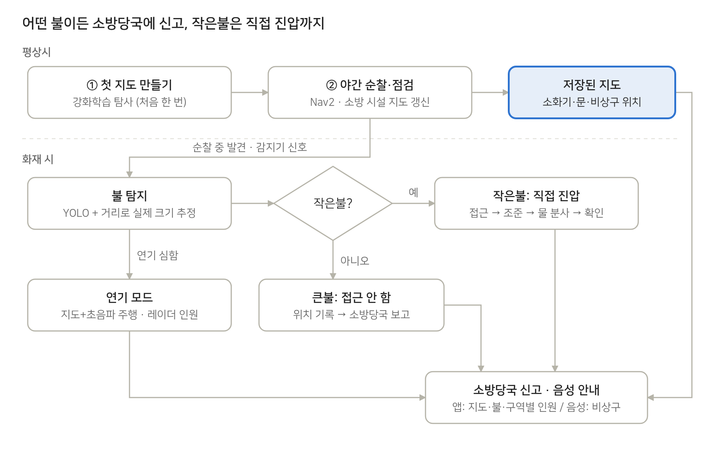
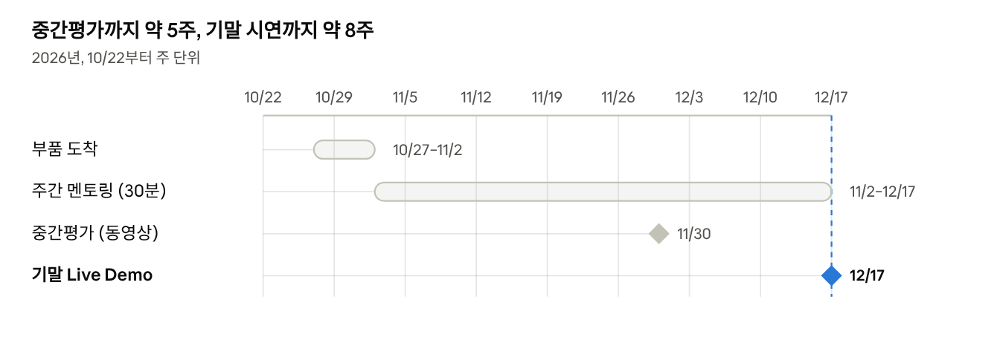

# LIMO Pro 화재 대응 로봇 — 아이디어

2026-10-22 · 김주영

## 한 줄 요약

평소에는 밤마다 순찰하며 건물의 **소방 시설 지도**(소화기·문·비상구 위치)를 만들어 두고, 순찰 중 불을 발견하거나 화재 감지기가 울리면 그 위치로 출동해 **불은 크기와 상관없이 소방당국에 신고하고 작은불은 직접 진압**하며, **연기 속 구역별 인원**을 집계해 알리고 건물 안 사람에게 **소화기·비상구 위치를 음성으로 안내**하는 LIMO Pro 기반 화재 대응 로봇. 화재를 먼저 찾아내고 먼저 대응하는 것이 핵심이다.

로봇프로그래밍(0533) 조별 과제. 기말 평가 상황은 투자를 받으려는 스타트업 창업 멤버가 심사위원에게 기술력을 보여주는 자리.

## 문제 정의와 사용자

화재 초기에는 건물 안 상황 정보가 없고, 연기 때문에 눈으로도 카메라로도 사람과 길을 찾기 어렵다. 이 로봇은 사람이 없는 밤에도 미리 지도를 만들어 두고, 화재 시 그 정보를 바로 쓸 수 있게 한다.

| 사용자 | 어려움 | 로봇이 주는 것 |
| --- | --- | --- |
| 건물 관리자 | 밤에 사람이 없어 초기 화재를 놓침, 소방 시설 점검이 수작업 | 야간 순찰, 소방 시설 지도 자동 갱신, 작은불 즉시 진압 |
| 소방당국 | 도착 전 내부 상황(불 위치, 요구조자 수, 막힌 통로)을 모름 | 앱으로 지도 + 불 위치 + 구역별 인원(추정치) + 막힌 통로 |
| 건물 안 사람 | 연기 속에서 비상구·소화기 위치를 모름 | 음성으로 가장 가까운 비상구·소화기 안내 |

## 서비스 시나리오

로봇이 출동하는 경우는 두 가지다. 야간 순찰 중 직접 발견하거나, 건물 화재 감지기 신호를 받고 그 위치로 간다. 불은 크기와 상관없이 무조건 소방당국에 신고한다. 작은불은 신고와 함께 직접 끄고, 큰불은 진압을 시도하지 않는다.

## 기존 방식 대비 이점

핵심 차이는 **화재 전에 미리 만들어 둔 지도**가 있다는 점이다. 그 지도 덕분에 연기 속에서도 움직이고, 보고에 위치가 붙는다.

| 비교 대상 | 한계 | 이 로봇 |
| --- | --- | --- |
| 고정식 스프링클러·감지기 | 설치된 자리만 대응, 사람 수나 내부 상황은 모름 | 이동하며 확인, 인원·불 위치·막힌 통로를 지도 위에 보고 |
| 소방관 직접 수색 | 연기 속 진입 위험, 내부 구조를 모름 | 진입 전에 지도·인원 정보 제공 |
| 상용 소방 로봇 | 크고 비싸며, 화재 이후 투입용 | 평소 순찰·점검에 상시 투입, 추가 부품비 약 9.5만 원 |
| 사람 야간 순찰 | 인건비, 점검 기록이 수기 | 소방 시설 위치·변화가 지도에 자동 기록 |

## 핵심 차별점 (오픈소스 위에 우리가 더한 것)

수업 취지는 오픈소스(Nav2, YOLO, cartographer)를 적극 활용하되, 서비스를 위해 어떤 adaptation을 했는지 보여주는 것이다. 우리가 내세울 것은 아래 다섯 가지다.

1. **BT + 강화학습 탐사**: 판단은 해석 가능하게(BT), 탐사 전략은 학습으로(RL), 학습이 실패해도 고전 프론티어 탐사로 Fallback해 시스템은 멈추지 않는다. RL은 빈 곳 없이 빠르고 끊김 없이 덮는 것을 배운다.
2. **작은불·큰불 판단**: YOLO 박스에 거리(depth → 라이다 → 바닥 평면 가정)를 합쳐 불의 실제 크기를 추정하고, 그것으로 진압할지 보고만 할지 정한다.
3. **소방 시설 지도**: 순찰하며 소화기·문·비상구를 인식해 지도에 등록하고 갱신한다.
4. **연기 모드**: 라이다를 덜 믿고, 저장된 지도 + 오도메트리·IMU + 초음파 거리 보정으로 위치를 잡고, 초음파로 새 장애물을 피해 경로를 다시 짠다.
5. **연기 속 인원 집계**: 레이더 표적을 지도 좌표에서 추적하고, 지도로 유령을 걸러내며, 멈춘 사람은 없음을 확인하기 전까지 지우지 않는다. 보고는 추정치와 마지막 확인 시각으로 보여준다.

## 시연 계획

기말 시연장은 강의동 303호(또는 비전홀) 바닥에 덕트호스로 통로를 만든 미로이고, 라바콘과 박스가 놓인다. 실제 방·문이 없으므로 아래처럼 연출한다.

| 장면 | 연출 |
| --- | --- |
| 방과 구역 | 덕트호스로 나뉜 구역을 방으로 정의 |
| 소화기·비상구·문 | 인쇄 표지판·소품을 배치해 지도에 등록 |
| 작은불 | 촛불 → 조준 후 물 분사로 끄기 |
| 큰불 | 인쇄한 불 사진 → 접근하지 않고 보고만 (물을 쏘지 않으므로 종이가 젖지 않음) |
| 연기 | 연기 모드 버튼으로 라이다·카메라 토픽에 노이즈를 섞거나 끊음, 사람 앞을 천으로 가리고 레이더로 탐지 |
| 무너진 장애물 | 연기 모드 주행 중 박스를 갑자기 놓아 초음파로 우회 |
| 보고 앱 | 심사위원이 QR 코드로 자기 폰에서 열어 봄 |

사람은 손을 흔드는 정도로 움직여야 레이더(LD2450)가 안정적으로 잡는다.

## 일정

중간평가(11/30, 과학관 211호)는 PPT와 동영상 시연으로 설계 타당성 40점, 핵심 기술 검증 40점, 향후 계획 20점을 본다. 기말(12/17 13시)은 다른 교수님들이 서비스 적절성 × 기능 구현 + 데모로 110점 만점을 매기고, 발표와 Live Demo를 합쳐 조별 20분이다.
