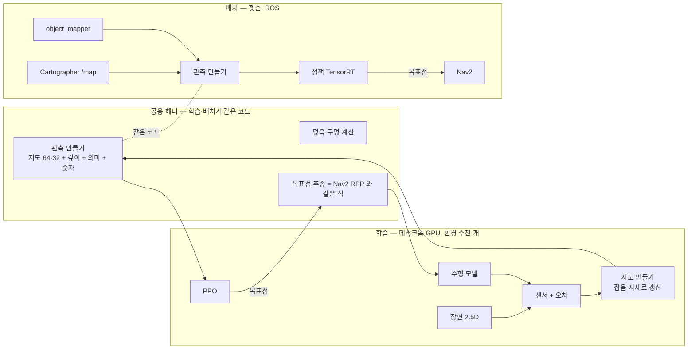

# 탐사 RL 학습 시뮬레이터 계획

첫 지도 만들기(프론티어 탐사)를 강화학습으로 배우는 GPU 시뮬레이터와 학습·배치 계획. 요구사항은 [spec.md "강화학습 탐사"](spec.md#강화학습-탐사-첫-지도-만들기),
센서 실측은 [hardware.md](hardware.md). 지금 `train/explore/env` 는 동작 시험용 초안이고, 이 계획대로 다시 만든다(초안의 결정적 수학·CPU 참조 검증 방식은 이어 쓴다).

## 1. 목표와 성공 기준

- 정책은 "어디를 어떤 순서로 볼지"만 정한다: 0.5~1 초마다 로봇 기준 중간 목표점(방향 16 × 거리 3). 주행·회피는 Nav2.
- **배운 정책이 실물에서 그대로 돈다**: 학습 때 정책이 보는 입력이 실물 로봇(Cartographer 지도 + 센서 + 물체 지도)에서 만든 입력과 같은 분포여야 한다 → 센서·자세 오차와 지도 만들기 과정을 시뮬레이터에 넣는다.
- 성공 기준 (spec.md 실험 계획과 같은 지표, 같은 평가 코드로 단계마다):

| 단계 | 어디서 | 기준 |
|---|---|---|
| 학습 맵 | GPU 시뮬 | 95 % 덮음 성공률 ≥ 95 % |
| 처음 보는 맵 | GPU 시뮬 (따로 둔 맵) | 95 % 도달 시간이 가장 가까운 프론티어보다 짧음, 충돌 ≤ 1 % |
| 통합 | Webots + 실제 Nav2 + Cartographer (맵 4 개) | 같은 비교에서 프론티어보다 짧음 |
| 실물 | LIMO, 시연장 모양 덕트호스 미로 | 끝까지 덮음, 사람 개입 0 |

## 2. 전체 구조



- **관측 만들기·덮음 계산·추종 식은 헤더 하나**(호스트·장치 공용, ROS 없음)로 두고 GPU 환경과 ROS 노드(`limo_fire_rl`)가 같이 쓴다. 인식 벤치마크의 `det_metrics.hpp` 와 같은 방식.
- 학습은 데스크톱 GPU, 젯슨은 검증·배치. 결정적 수학(`detmath.h`, `--fmad=false`)으로 같은 입력이면 두 GPU 와 CPU 가 비트까지 같은 값을 낸다 → 젯슨에서 맞춘 값이 데스크톱 학습에서도 맞는다. 빌드 대상 `87;120`, 같은 검증 도구를 양쪽에서 돌린다.

## 3. 시뮬레이터 층 (C++/CUDA, 환경 하나 = 스레드 묶음 하나)

### 3.1 장면 — 2.5D

- 5 cm 칸마다 **막힌 높이 구간** 최대 2 개(`[z0, z1]`)와 물체 번호(의미). 벽 0~2.4 m, 덕트호스 0~0.15, 상자 0~0.6, 탁자는 상판만, 팔레트는 다리 칸만.
  2D 격자로는 라이다 높이(0.111 m)에 걸리는지·깊이 카메라에 보이는지를 못 가린다.
- 맵 출처:
  - 기존 생성기(`train/maps`: HouseExpo · ProcTHOR · 덕트호스) — 높이 구간 규칙 추가
  - **우리 Webots 월드 변환기**(새로, `train/maps`): `Wall`·상자·`DuctHose`·기본 물체를 높이 구간 칸으로. 같은 맵으로 Webots 와 값 비교·마지막 미세조정
  - 덕트호스 미로 생성기를 시연장 모양(약 6×8 m, 통로 0.9~1.5 m, 라바콘·상자) 위주로 늘림
- 맵을 학습 90 % · 처음 보는 맵 10 % 로 미리 나눔(크기·출처 고르게).

### 3.2 주행

- 차동 구동, 몸통 사각형 0.32 × 0.22 m 충돌.
- **목표점 추종 = 배치 때 Nav2 와 같은 Regulated Pure Pursuit 식**(앞쪽 점 0.5 m, 45° 넘게 틀어지면 제자리 회전, 0.26 m/s · 1.0 rad/s, 가속 한도). 지금 `nav2_params.yaml` 값을 그대로 읽어 쓴다.
- 목표점까지 경로는 짧은 거리(≤ 2 m)라 직선 + 장애물이면 가장 가까운 빈 칸(spec). Smac 경로와의 차이는 Webots 통합 단계에서 잰다.

### 3.3 센서와 오차 (실측으로 맞춤, 판마다 무작위로 흔듦)

| 센서 | 모델 | 오차 (처음 값 → 실측으로 교체) |
|---|---|---|
| 라이다 T-mini Plus | 248 빔, ±110°, 10 Hz, 높이 0.111 m 평면에서 높이 구간과 교차, 0.1~12 m, 무효 = 0 | 거리 가우스 σ(r)·양자화, 빔 빠짐 확률(먼 곳·비스듬한 면), 모서리 혼합 점, 각도 떨림, 스캔 지연 |
| 깊이 Dabai DC1 | 핀홀 640 × 480(관측용은 줄인 해상도), 66.4° × 52.3°, 0.3~3.0 m, 유효 영역 행 22~399, mm 정수 | σ ∝ z² (스테레오), 모서리·먼 곳 구멍, 최소 거리 안 0 |
| 바퀴 오도메트리 | 50 Hz | 거리 배율 오차, 좌우 바퀴 차(휘어짐), 미끄러짐 |
| IMU | 100 Hz | 자이로 σ 0.002 rad/s + 0.1 °/s 양자화, 바이어스 걸음, 가속도 ×1.023 (hardware.md 실측) |
| 물체 탐지(YOLO 대신) | 화각 안에 보이는 물체를 클래스마다 **거리·크기별 탐지 확률**로 넣음 | 인식 벤치마크(`docs/benchmarks`) 크기별 재현율·오탐(덕트호스 → 문 등)·지도 위치 오차 0.2~0.3 m 를 그대로 씀 |

- 사진(컬러)은 만들지 않는다. YOLO 는 이미 인식 벤치마크로 쟀으므로 그 결과를 확률 모델로 넣는다.
- 이 모든 값은 표 하나(`sensor_model.yaml`)에 두고 학습·Webots 비교·실물 보정이 같은 표를 읽는다.

### 3.4 지도 만들기 — 정책이 보는 것

- 실물은 Cartographer 지도를 본다. 그래서 시뮬도 **잡음 섞인 스캔을 잡음 섞인 자세로 확률 격자에 쌓는다**(맞음·지나감 로그 오즈, Cartographer 2D 확률 격자와 같은 갱신).
- 자세 오차: 오도메트리·IMU 적분 + 판마다 크기가 다른 천천히 쌓이는 오차 + 가끔 고리 닫힘처럼 되돌림. 크기는 실물 녹화(`~/limo_bags`)에서 Cartographer 자세와 오도메트리 차이로 맞춘다.
- 덮음 보상은 정답(진짜 맵)으로 계산하고(학습 신호가 깨끗하게), 관측은 잡음 지도로 준다.
- 물체 지도: 탐지 모델 출력을 `object_mapper` 와 같은 병합 규칙(클래스별 반경·5 번 이상)으로 쌓는다.

### 3.5 관측·행동·보상

- spec 표 그대로: 가까운 지도 64 × 64(10 cm) · 먼 지도 32 × 32, 채널(장애물·빈 곳·안 본 곳·덮은 정도·지나간 횟수 + 의미), 줄인 깊이, 숫자(속도·직전 목표점·남은 시간·덮은 비율).
- 보상: 새로 덮음(+) · 구멍(−) · 완료(++) · 재방문(−) · 시간(−) · 멈춤(−) · 충돌(−). 초안에 없는 구멍 감점을 넣는다.

### 3.6 무작위로 흔드는 것 (도메인 무작위화)

센서 오차 크기(× 0.5~2), 스캔·제어 지연(0~150 ms), 속도·가속 한도 ±10 %, 미끄러짐, 자세 오차 크기, 맵 크기 1~3 배·장애물 위치, 탐지 확률·오탐률, 깊이 구멍 비율.

## 4. 검증 — 값이 맞는지 (젯슨에서)

| 검증 | 방법 | 통과 기준 |
|---|---|---|
| V0 비트 동일 | 커널마다 CPU 참조판, 같은 난수열로 비교 (초안 `fenv_verify` 방식) | 비트 같음, 일부러 틀린 입력은 잡아냄 |
| V1 GPU 같음 | 같은 검사를 젯슨(sm_87)·데스크톱(sm_120)에서 | 비트 같음 |
| V2 Webots 와 같음 (오차 끔) | Webots 로봇에 참값 자세를 내게 하고(`limo_fire_sim` 플러그인에 추가), 같은 월드·자세에서 GPU 라이다·깊이를 Webots `/scan`·`/camera/depth` 와 빔·픽셀마다 비교 | 라이다 빔 95 % 가 2 cm 안, 깊이 유효 영역 IoU ≥ 0.95 |
| V3 오차 분포가 실물과 같음 | 실물을 세워 두고 벽까지 0.5·1·2·4 m 에서 라이다·깊이 60 초 녹화 → σ(거리)·빠짐률 맞춤. 1 m 직진·360° 회전·네모 한 바퀴로 오도메트리 오차 | 시뮬 오차 분포가 실측과 같은 범위 (KS 검정 등) |
| V4 지도가 실물과 비슷 | 같은 경로를 실물 Cartographer 지도와 시뮬 잡음 지도로 만들어 비교 | 벽 두께·빈 곳 비율·안 본 곳 비율 차이 |
| V5 정책 결과 | 같은 평가 코드로 GPU 처음 보는 맵 → Webots → 실물 | 1 절 기준 |

- V2·V3 비교 도구는 인식 벤치마크처럼 C++ 노드 + 표(`docs/benchmarks` 형식).
- **V2 를 먼저 통과해야 학습을 시작한다**(틀린 센서로 배운 정책은 버려야 한다).

## 5. 학습

- 데스크톱 GPU, PPO + 학습 뷰어는 robot-agent(object-memory-robot)에서 가져와 C++/CUDA 로. 정책: 지도 채널 CNN + 깊이 작은 CNN + 숫자 MLP → 행동 48.
- 목표 속도: 환경 4,096 개 이상, 초당 행동 5 만 이상(센서는 행동마다 0.5 s 분량 = 라이다 5 장).
- 교육 과정: 작은 덕트호스 맵·오차 없음 → 큰 맵·방 구조 → 오차·지연 전부.
- 비교 기준(같은 GPU 환경에서, 같은 평가 코드): 가장 가까운 프론티어, 정보 이득 프론티어. 실물 Fallback 도 이 프론티어를 쓴다.

## 6. 배치

- `limo_fire_rl` (C++ ROS 패키지): Action 서버. `/map`(Cartographer)·TF·깊이·`object_mapper` 물체 → **공용 헤더로 관측** → 정책(ONNX → TensorRT, YOLO 와 같은 방식) → 목표점을 Nav2 에 이어서 줌.
- BT 가 부르고, 실패·시간 초과면 프론티어 탐사로 넘어감(spec).
- Webots 맵 4 개에서 먼저 돌리고(`sim.launch.xml slam:=true`), 같은 지표로 프론티어와 비교한 뒤 실물.

## 7. 폴더

```
train/explore/
├── sim/        장면·주행·센서·오차·지도 만들기 커널 + CPU 참조판, sensor_model.yaml
├── ppo/        PPO (robot-agent 에서)
├── viewer/     학습 뷰어
└── tools/      verify(V0·V1) · bench · 평가(덮음 곡선)
train/maps/     맵 생성기 + Webots 월드 변환기(새)
src/limo_fire/limo_fire_rl/          Action 서버 + 공용 헤더(관측·덮음·추종) — train 이 include
src/limo_fire/limo_fire_sim/         Webots 참값 자세 발행(V2)
src/limo_fire/limo_fire_perception/  센서 비교 노드(V2·V3, 벤치마크 옆)
```

## 8. 일정 (중간평가 11/30, 시연 12/17)

| 기간 | 할 일 | 끝났다는 것 |
|---|---|---|
| 10/30~11/5 | 2.5D 장면·Webots 월드 변환기, 라이다·깊이 커널 + CPU 참조, Webots 참값 자세 | V0·V1·**V2 통과** |
| 11/6~11/12 | 실물 오차 녹화·맞춤(라이다·깊이·오도메트리), 잡음 지도 만들기, 공용 관측 헤더, 프론티어 기준 | V3·V4 표 |
| 11/13~11/22 | PPO 학습·교육 과정, 처음 보는 맵 평가 | 처음 보는 맵에서 프론티어보다 짧음 |
| 11/23~11/30 | `limo_fire_rl` + TensorRT, Webots 4 맵 비교, **중간평가 영상** | Webots 통합 지표 |
| 12/1~12/10 | 실물 시험, 오차 다시 맞춤·미세조정, BT Fallback | 실물 미로 끝까지 |
| 12/11~12/17 | 리허설 | |

## 9. 위험과 대책

| 위험 | 대책 |
|---|---|
| 시뮬 지도와 Cartographer 지도 모양이 달라 정책이 헷갈림 | V4 로 재고, 잡음 지도 갱신을 Cartographer 와 같은 식으로. 모자라면 실물 지도 조각으로 관측 증강 |
| 추종기(시뮬)와 Nav2 차이 | 같은 RPP 식, 목표점 짧게. Webots 통합에서 도착 시간·경로 차이 측정 |
| 학습이 늦거나 실패 | 프론티어 Fallback 이 늘 있음. 행동 공간은 굵게(48) 유지 |
| 실물 오차를 덜 잼 | 무작위화 폭을 실측보다 넓게, V3 를 실물 바뀔 때마다 다시 |
| 시간 부족 | V2 통과 → 프론티어 기준 → 학습 순으로, 각 단계 결과만으로도 발표 가능하게 |

## 10. 정할 것

- [ ] 데스크톱 GPU 모델·메모리(환경 수 정하기), robot-agent PPO·뷰어 코드를 가져올 범위
- [ ] 관측 깊이 해상도(80 × 60 정도?)와 정책 크기 — 젯슨 TensorRT 추론 1 ms 안
- [ ] 시연장 실제 크기·덕트호스 지름(라이다에 걸리는지, spec 확인 항목)
