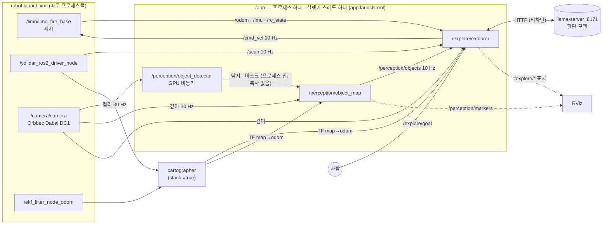

# 실행 구조 — 프로세스·스레드·토픽 입출력

로봇에서 합친 탐사(판단 모델 + A*)와 물체 지도를 돌릴 때 **어느 프로세스·스레드가 무엇을 받아 무엇을 내는지** 한 곳에 모은다.
계획이 아니라 **지금 코드**(2026-11-18 한 프로세스 정리 뒤) 기준이다. 센서 자체의 사양·실측 주기 근거는 [sensor_topics.md](sensor_topics.md), 이름·메시지 규약은 [conventions.md](conventions.md).

**몇 줄로**: 로봇 드라이버(`robot.launch.xml`)는 따로 프로세스들이고, **우리 노드는 전부 프로세스 하나 `/app`, 실행기 스레드 하나**다(`app.launch.xml`).
그 한 스레드가 차례로: 영상을 받아 GPU 에 걸고(기다리지 않음) → 끝난 탐지를 꺼내 물체 지도에 넣고 → 라이다 한 장마다 탐사 걸음 하나
(지도·관측 → 판단 모델 답 확인 → A* 추종) → `/cmd_vel`. 판단 모델은 로봇 안 `llama-server` 에 비차단 HTTP 로 묻는다.

**읽는 법**
- QoS(서비스 품질)는 `신뢰성 / 지속성 / 깊이` 로 적는다: R = RELIABLE(신뢰), BE = BEST_EFFORT(최선), V = VOLATILE(휘발), TL = TRANSIENT_LOCAL(늦게 온 구독자도 마지막 값을 받음).
  `SensorData` = rclcpp `SensorDataQoS()` = BE / V / 5. 숫자만 적은 것(`10`)은 rclcpp 기본 = R / V / 그 깊이.
- 주기는 코드로 정해진 값이다. 센서 실측 값은 [sensor_topics.md](sensor_topics.md#한눈에).
- 모듈의 주 노드 토픽은 이름공간 바로 아래(`/explore/status`, `/perception/detections`). 이름 규칙·옛 이름 표는 [conventions.md "이름"](conventions.md#이름-노드토픽서비스launch--2026-11-18).
- 근거 파일은 `src/limo_fire/<패키지>/src/…`, 탐사 공용 헤더는 `train/explore/scripts/…`.

## 시험 대비 한 장 — 모듈마다 입력 · 출력 · launch · 확인 명령

| 모듈 | 노드 | 받는 것 | 내는 것 | launch | 확인 |
|---|---|---|---|---|---|
| 로봇 (섀시·센서) | `/limo/limo_fire_base` · `/ydlidar_ros2_driver_node` · `/camera/camera` · `/ekf_filter_node_odom` | `/cmd_vel` | `/odom` `/imu` `/rc_state` `/scan` `/camera/color/image_raw` `/camera/depth/image_raw` `/odometry/filtered` TF | `limo_fire_bringup robot.launch.xml` | `ros2 topic hz /scan` · `ros2 topic echo /rc_state --once` |
| 지도 (SLAM) | `cartographer_node` · `cartographer_occupancy_grid_node` | `/scan` `/imu` `/odometry/filtered` | TF `map→odom`, `/map` | `app.launch.xml stack:=true` (= `limo_fire_bringup mapping.launch.xml`) | `ros2 run tf2_ros tf2_echo map base_link` |
| 탐사 | `/explore/explorer` (컨테이너 `/app`) | `/scan` `/odom` `/imu` `/camera/depth/*` `/rc_state` TF, `/explore/goal` `/perception/objects` | `/cmd_vel`(dry_run:=false) `/explore/status` `/explore/state` `/explore/done` `/explore/goal_status`, debug 면 `/explore/cmd_debug` `/explore/candidates` `/explore/candidates_text` `/explore/decider_image` `/explore/goal_marker` | `limo_fire_explore app.launch.xml` | `ros2 service call /explore/enable std_srvs/srv/SetBool "{data: true}"` · `ros2 topic echo /explore/status` |
| 물체로 가기 | (탐사 안) `/explore/explorer` | `/explore/goal` (글, 빈 글 = 지움) | `/explore/goal_status` | `app.launch.xml perception:=true` | `ros2 topic pub -1 /explore/goal std_msgs/msg/String "{data: '의자'}"` · `ros2 topic echo /explore/goal_status` |
| 인식 | `/perception/object_detector` · `/perception/object_map` (컨테이너 `/app`) | `/camera/color/image_raw` `/camera/depth/*` TF | `/perception/detections` `/perception/mask` `/perception/detection_image` `/perception/objects` `/perception/markers` `/perception/summary`, 서비스 `/perception/{clear,save,load}_objects` | `app.launch.xml perception:=true` | `ros2 topic echo /perception/objects --once` · `ros2 service call /perception/clear_objects std_srvs/srv/Trigger` |
| 탐사 (프론티어, Nav2) | `/explore/frontier_explorer` | `/map` TF | `/explore/frontier_explorer/{state,status,done,frontiers}`, Nav2 액션 `/navigate_to_pose` | `limo_fire_explore frontier_explorer.launch.xml` | `ros2 service call /explore/frontier_explorer/enable std_srvs/srv/SetBool "{data: true}"` |
| 주행 (Nav2, 저장 지도) | Nav2 노드들 · `/explore/object_goto` | `/map` `/scan` TF, `/goal_pose`, `/explore/goal` | `/cmd_vel`, `/plan`, `/explore/goal_status` | `limo_fire_bringup navigation.launch.xml` | `ros2 action list` |
| 화면 | `rviz2` + 탐사 패널 | 위 표시 토픽 | `/explore/enable` · `/explore/frontier_explorer/enable` 부름 | `app.launch.xml rviz:=true` | |

로봇에서 띄우는 것은 둘뿐이다:

```bash
ros2 launch limo_fire_bringup robot.launch.xml                                  # 1) 로봇 드라이버 (센서·섀시·EKF)
ros2 launch limo_fire_explore app.launch.xml perception:=true stack:=true rviz:=true   # 2) 우리 프로세스 /app (+ Cartographer · RViz)
```

`app.launch.xml` 인자: `perception`(인식 같이) · `stack`(Cartographer) · `rviz` · `dry_run`(기본 true — `/cmd_vel` 안 냄) · `debug`(RViz 표시 토픽, 기본 = rviz) · `record` · `perception_config` · `objects_file` · `gpu_thread`(옛 YOLO 작업 스레드 — 로봇 확인 전 대비).

## 한눈에 — 데이터 흐름



- 합친 탐사에서는 Nav2·AMCL 을 띄우지 않는다. `explorer` 는 Cartographer 의 `/map` 을 **읽지 않고** 라이다·깊이로 자기 지도를 만든다. Cartographer 에서 받는 것은 TF `map → odom` 뿐이다.
- `explorer` 는 EKF 결과(`/odometry/filtered`)가 아니라 섀시의 원래 `/odom` 을 읽는다(시뮬 관측과 같게).
- TF 사슬: `map → odom`(Cartographer, `published_frame = odom`, 50 Hz) → `base_link`(EKF, 30 Hz) → 센서(`robot_state_publisher` 정적 TF + Orbbec 드라이버의 `camera_*_frame`).

## 프로세스와 launch

| launch | 프로세스 (노드) | 켜는 조건 |
|---|---|---|
| `limo_fire_bringup/robot.launch.xml` | `robot_state_publisher` · `joint_state_publisher` · `/limo/limo_fire_base` · `/camera/camera_container`(컴포넌트 `/camera/camera`) · `/ydlidar_ros2_driver_node` · `/ekf_filter_node_odom` · `esp32_bridge` · `rviz2` · `jetson_clocks`(한 번 돌고 끝) | 섀시·EKF 는 `base:=true`(기본), ESP32 는 `esp32:=true`, RViz 는 `viz:=true` |
| `limo_fire_explore/app.launch.xml` | **`/app`** (`component_container` — 한 스레드 실행기, 컴포넌트 `/explore/explorer` + `perception:=true` 면 `/perception/object_detector` · `/perception/object_map`, 모두 `use_intra_process_comms`) · `limo_fire_rviz` (RViz) | 인식은 `perception:=true`, RViz 는 `rviz:=true` |
| ↳ `stack:=true` | `mapping.launch.xml`: `cartographer_node` · `cartographer_occupancy_grid_node` | |
| (ROS 밖) | `llama-server` (`127.0.0.1:8171`, 판단 모델) — [limo_fire_explore README](../src/limo_fire/limo_fire_explore/README.md) 대로 손으로 먼저 띄움 | 늘 |

- 시뮬(`sim.launch.xml perception:=true`)은 인식만 `limo_fire_perception/perception.launch.xml`(자기 컨테이너 `/perception_container`)로 띄운다 — 탐사 노드 없이.
- 저장 지도 주행(`navigation.launch.xml`)의 "○○ 로 가" 는 `limo_fire_navigation object_goto`(따로 프로세스, Nav2 액션). `/app` 과 같이 띄우지 않는다(둘 다 `/explore/goal` 을 받음).
- `env.sh` 는 RMW 를 정하지 않으므로 Humble 기본(Fast DDS 2.6)이다. 프로세스 사이는 DDS(직렬화 → 공유 메모리·UDP → 역직렬화), `/app` 안은 프로세스 안 전달(포인터).
  `env.sh` 가 `FASTRTPS_DEFAULT_PROFILES_FILE` 로 공유 메모리 칸을 4 MB 로 키운 설정을 고른다(아래 "DDS 설정") — 카메라와 `/app` 을 모두 `env.sh` 셸에서 띄운다.

## 스레드 — 무엇을 받아 무엇을 내나

| 프로세스 | 스레드 | 받는 것 | 하는 일 | 내는 것 |
|---|---|---|---|---|
| `limo_fire_base` | 시리얼 읽기 (`std::thread readData`) | UART 프레임 460800 bps | 프레임 해석, 시각 = 받은 때 `now()` | `/odom` `/imu` `/limo_status` `/rc_state` `/motor_states` `/wheel_odometry` (이 스레드에서 바로 발행) |
| | 실행기 (`rclcpp::spin`, 한 스레드) | `/cmd_vel` | 속도 명령 프레임 만들기 | UART 쓰기 |
| `ydlidar_ros2_driver_node` | main 고리 (`WallRate 20`) + SDK 안 읽기 스레드 | USB 시리얼 | 한 바퀴 모으기 | `/scan` (main 에서 발행) |
| `camera_container` | 실행기 1 개 + Orbbec SDK 프레임 콜백 스레드 + `colorFrameThread_` | USB 영상 | 깊이→컬러 정렬(HW), 메시지 만들기 | `/camera/color/*` `/camera/depth/*` + TF |
| `ekf_filter_node_odom` | 실행기 1 개 (30 Hz 타이머) | `/odom` `/imu` | 융합 | `/odometry/filtered`, TF `odom→base_link` |
| `cartographer_node` | 실행기 + Cartographer 뒤 작업 스레드 | `/scan` `/imu` `/odometry/filtered` + TF | SLAM | TF `map→odom`, `/submap_list` 등 → `occupancy_grid_node` 가 `/map` (1 s) |
| **`/app`** | **실행기 (component_container, 한 스레드)** — 우리 코드는 모두 여기서 차례로 | 아래 셋의 모든 구독·타이머·서비스, `/tf` `/tf_static` (TF 스레드 없음) | ① `object_detector`: 영상 콜백이 GPU 에 걸고(비동기) · 2 ms 타이머가 `cudaEventQuery` 로 끝났나만 묻고 끝나면 꺼내 발행 ② `object_map`: 탐지·깊이 짝 → 20 ms 타이머가 그 시각 TF 있는 장부터 지도에 ③ `explorer`: `/scan` 한 장 = 걸음 하나(감각 → 판 끝 → 깊이 → 판단 모델 답 확인 → A* 추종 → 명령), TF 는 5 ms 타이머로 막지 않고 기다림 | `/perception/*` `/explore/*` `/cmd_vel`, HTTP 요청 |
| | DDS 안 스레드 (Fast DDS 받기·이벤트·타이머 — 우리 코드 아님) · CUDA·TensorRT 드라이버 안 스레드 | 네트워크·공유 메모리 | 역직렬화해 실행기 줄에 넣음 | |
| RViz | Qt 화면 스레드 + ROS 실행 스레드 | 화면 토픽 | 탐사 패널: 콜백은 값만 바꾸고 Qt 타이머가 그림 | `/explore/enable` 서비스 부름 |

`/app` 이 막히지 않는 까닭: 오래 걸리는 일은 다 기다리지 않는다 — GPU 는 걸고 묻기만(`TrtYolo::ready`), 판단 모델 HTTP 는 비차단 소켓을 걸음마다 조금씩, TF 는 줄에 두고 다시 봄.
재는 곳: `object_detector` 5 초 로그의 "콜백 최대 ms", `/explore/status` 의 "평균 ms: 걸음 · 관측 · 위층 (최대)".
(실물 확인 전 대비: `gpu_thread:=true` 면 YOLO 가 옛 작업 스레드 하나를 더 씀 — TODO(제거))

### 복사 — 프로세스 안·밖

| # | 길 | 복사 | 크기·횟수 |
|---|---|---|---|
| 1 | 카메라 → `object_detector` 컬러 | DDS 직렬화(카메라) → 역직렬화 → `memcpy` 고정 메모리 → `cudaMemcpyAsync` H2D | 640×480 rgb8 = 921 KB, 30 장/초 × 3 번 (`bgr8` 이면 색 바꿈 1 번 더) |
| 2 | GPU → `/perception/mask` → `object_map` | D2H → `msg.data.assign` 1 번 → 프로세스 안 `unique_ptr` (복사 없음) | 307 KB, 물체가 있을 때만 |
| 3 | `/perception/detections` → `object_map` | 프로세스 안 `unique_ptr` (복사 없음) | 작음 |
| 4 | 카메라 → 깊이 (`object_map`·`explorer`) | 구독마다 역직렬화 1 번 (같은 프로세스라도 둘) | 640×480 16UC1 = 614 KB × 30 장/초 × 2 |
| 5 | `/perception/objects` → `explorer` | TL(임무 BT 가 TL 로 받음)이라 프로세스 안 전달을 끔 → 같은 프로세스 안에서도 직렬화 1 + 역직렬화 1 | 물체 수 × 수백 B, 10 Hz |
| 6 | `/scan` → `explorer` | 역직렬화 + `Scan` 구조체로 `ranges`·`intensities` 복사 | 약 250 점, 10 Hz |
| 7 | `explorer` → llama-server | JSON 본문(지도 PNG 288 px base64) → 소켓 | 요청마다 수십 KB |
| 8 | TF | `/tf` 를 받는 노드마다 TF 버퍼 따로 (`explorer`·`object_map`·Cartographer·EKF·RViz) | Cartographer `map→odom` 50 Hz 가 가장 많음 |

4 번(깊이 두 번)은 남겨 둔다: 깊이를 한 번 받아 나눠 주는 중계 노드를 둬도 Humble rclcpp 는 밖에서 온 메시지를 프로세스 안으로 넘길 때 한 번 복사하므로
(`any_subscription_callback.hpp` `create_ros_unique_ptr_from_ros_shared_ptr_message`) 복사 수가 같고 노드·토픽만 는다. 역직렬화도 영상은 거의 `memcpy` 하나다.

### DDS 설정 — 공유 메모리 칸 4 MB (`limo_fire_bringup/config/fastdds.xml`)

같은 컴퓨터 안 프로세스 사이(카메라 → `/app`)는 Fast DDS 공유 메모리로 간다. 보내는 참가자가 **자기 칸(segment)** 에 쓰고 받는 쪽이 읽는데,
칸 기본값 512 KB 가 영상 한 장(컬러 921 KB · 깊이 614 KB)보다 작아 받는 쪽이 다 읽기 전에 덮이면 그 장은 빠진다.
Fast DDS 문서: "Setting a segment_size close to or smaller than the data size poses a high risk of data loss"
([Shared Memory Transport, 2.6](https://fast-dds.docs.eprosima.com/en/v2.6.10/fastdds/transport/shared_memory/shared_memory.html)),
같은 일을 겪은 사례 [ROS Discourse #39874](https://discourse.openrobotics.org/t/shared-memory-transport-in-fastdds-for-image-publisher-has-lower-frame-rate-than-udp-transport/39874) (4.1 MB 영상 5.5 → 25 fps).

| 파일 | 전송 | 쓰는 곳 |
|---|---|---|
| `fastdds.xml` | 공유 메모리 칸 4 MB + UDPv4 (Humble 기본과 같은 둘, 칸만 큼) | PC (`env.sh` 기본) |
| `fastdds_localhost.xml` | 위와 같고 UDP 를 `127.0.0.1` 로만 | 로봇 (`~/wego_ws` 가 있으면 `env.sh` 가 고름) = 옛 `ROS_LOCALHOST_ONLY=1` 과 같은 범위 |

- `ROS_LOCALHOST_ONLY=1` 은 같이 쓰지 않는다(`env.sh` 가 끔): rmw_fastrtps 가 XML 위에 자기 전송(UDP 127.0.0.1 + 512 KB 칸)을 더 붙여 칸이 둘이 된다
  (rmw_fastrtps_shared_cpp `participant.cpp`, 이 PC 에서 발행 프로세스에 4 MB·512 KB 칸이 같이 붙는 것을 봄).
- 64 KB 조각으로 나눠 보내는 것은 그대로다(참가자의 최대 메시지 = 전송들 가운데 가장 작은 것 = UDP 65500 B). 칸을 키우면 조각 여러 장이 덮이지 않고 칸에 남는다.
- 칸은 참가자(프로세스)마다 하나씩 `/dev/shm/fastrtps_*` 4 MB (쓴 만큼만 메모리를 씀).
- 대시보드로 띄운 WeGo 드라이버처럼 `env.sh` 없이 뜬 발행자는 기본 칸 그대로다 — 카메라는 `robot.launch.xml` 로 띄운다.

**확인 (이 PC, 합성 카메라)**: 다른 프로세스가 640×480 깊이 16UC1 + 컬러 rgb8 을 30 Hz(R / V / 10, 카메라와 같은 QoS)로 내고, 받는 프로세스가 깊이 구독 2 개 + 컬러 1 개
(SensorData, `/app` 과 같음)로 받은 때 − stamp 를 잼. 도구는 저장소 밖 보조(`depth_bench`, rclcpp 컴포넌트 둘).

| 조건 | 기본 (512 KB) 받은 장 · 빠진 비율 | 4 MB 받은 장 · 빠진 비율 |
|---|---|---|
| 코어 제한 없음 (30 s × 5 번) | 깊이 29.2~29.6 Hz (1.3~2.8 % 빠짐) · 컬러 29.6~29.8 Hz (0.6~1.2 %) | **30.0 · 30.0 Hz (0 %)** 5 번 모두 |
| 두 프로세스를 코어 2 개에 (`taskset -c 2,3`, 20 s × 2 번) | 깊이 28.7 · 29.4 Hz · **컬러 14.5 · 18.5 Hz (38~52 % 빠짐)** | 30.0 · 30.0 Hz (0 %) |
| 코어 1 개에 (`taskset -c 2`, 30 s × 3 번) | **거의 0 장** (깊이 0 · 0 · 6 장, 컬러 0 · 0 · 1 장) | 30.0 · 30.0 Hz (0 %) |

- 받은 장의 지연(중앙 0.5~0.9 ms)·CPU(한 코어 기준 발행 2.2~3.7 %, 받기 2.3~3.0 %)는 둘이 잡음 안에서 같다 — 얻는 것은 **빠지는 장이 없어짐**이다. 받는 쪽 CPU 가 몰릴수록(로봇: YOLO·판단 모델·RViz) 기본 칸의 손실이 커진다.
- 전송 확인: 발행 프로세스를 `strace -f -e sendmsg,sendto` 로 7 s 보면 UDP 는 43~64 번 · 14~22 KB(발견만, 60 KB 넘는 것 0) — 영상 1.5 MB × 30 장/초는 모두 공유 메모리로 감.
  칸 크기는 `/proc/<발행 PID>/maps` 의 `/dev/shm/fastrtps_*` 파일 크기: 기본 549 408 B, 이 설정 4 219 424 B. 공유 메모리 덤프(`rtps_dump_file`)의 데이터 조각은 65 528 B.
- 범위 확인: `fastdds_localhost.xml` ↔ `ROS_LOCALHOST_ONLY=1` 참가자는 양쪽으로 받음(150 장/5 s), 기본 참가자와는 0 장 — `ROS_LOCALHOST_ONLY=1` ↔ 기본도 0 장이라 옛 동작과 같음. 이 판의 UDP 목적지는 127.0.0.1 · 239.255.0.1 뿐.

### 앞(11-18 이름 정리) · 뒤(이 구조) — PC 녹화 재생 (`1116_fuel_rl_1`, `--clock`, 켬 dry run, 40 s 평균)

| | 앞 | 뒤 |
|---|---|---|
| 우리 프로세스 | 3 (`explorer` · `object_goto` · `perception_container`) | **1** (`/app`) |
| 스레드 (`ps -T`, DDS 안 스레드 포함) | 12 + 12 + 13 = 37 (+ 로봇 YOLO 작업 스레드 1) | **14** (실행기 1 + DDS 13) |
| 우리 노드 (`ros2 node list`) | 4 + 컨테이너 1 | 2 + 컨테이너 1 (로봇은 + `object_detector`) |
| 우리 `/explore/*` 토픽 | 15 | 6 (`debug:=true` 면 11) |
| CPU (한 코어 %) | 5.9 + 0.5 + 3.2 = 9.6 | **8.5** |
| RSS | 61.9 + 27.4 + 38.6 = 127.9 MB | **75.9 MB** |

(이 PC 는 TensorRT 가 없어 `object_detector` 없이 잼 — 로봇 값은 로봇에서. 결정은 앞·뒤가 같음: 같은 걸음에 같은 목표 칸 133400 · 179432 · 154847, 같은 명령)

## 모듈별 입출력

### `limo_fire_base` — `/limo/limo_fire_base` (`src/limo_driver.cpp`, 설정 `limo_fire_bringup/config/limo_base.yaml`)

토픽은 모두 **절대 이름**이라 네임스페이스 `limo` 가 붙지 않는다. 시각은 시리얼 프레임을 받은 때의 `now()`.

| 방향 | 토픽 | 타입 | QoS | 주기 | frame_id | 뜻 |
|---|---|---|---|---|---|---|
| 냄 | `/odom` | `nav_msgs/Odometry` | R / V / 50 | 50 Hz | `odom` → child `base_link` | 바퀴 오도메트리. TF 는 안 냄(`pub_odom_tf: false`) |
| 냄 | `/imu` | `sensor_msgs/Imu` | R / V / 10 | 100 Hz | `imu_link` | 자세 쿼터니언은 REP-103 대로 ([sensor_topics.md](sensor_topics.md#imu--바퀴-오도메트리--imu-odom-limo_status)) |
| 냄 | `/limo_status` | `limo_msgs/LimoStatus` | R / V / 50 | 2 Hz | — | stamp 가 1970 년(원본 버그) |
| 냄 | `/rc_state` | `sensor_msgs/Joy` | R / V / 10 | 40 Hz | `""` | 아래 표 |
| 냄 | `/motor_states` | `sensor_msgs/JointState` | R / V / 20 | 20 Hz | — | `motor1~4`: velocity rad/s, effort A, position = 엔코더 펄스 원값 |
| 냄 | `/wheel_odometry` | `sensor_msgs/JointState` | R / V / 20 | 50 Hz | — | `left_wheel`·`right_wheel` 누적 m |
| 받음 | `/cmd_vel` | `geometry_msgs/Twist` | R / V / 10 | 명령마다 | — | 리모컨 SWB 위(오토)일 때만 섀시가 따름 |

`/rc_state` (`publishRcState`, AgileX 규약 RcStateFrame 0x241):

| 칸 | 뜻 |
|---|---|
| `axes[0..3]` | 오른 가로 · 오른 세로 · 왼 세로 · 왼 가로, −1 ~ 1 |
| `axes[4]` | 다이얼, −1 ~ 1 |
| `buttons[0..3]` | 스위치 SWA · SWB · SWC · SWD, 2 비트씩: **2 = 위, 1 = 가운데, 3 = 아래** |
| `buttons[1]` | **SWB. 2(위) = 오토 — `/cmd_vel` 을 섀시가 받음.** `explorer` 는 `rc_button: 1`, `rc_auto_value: 2` 로 이것만 봄 |

### `ydlidar_ros2_driver_node` (외부 코드, `config/ydlidar.yaml`)

| 방향 | 토픽 | 타입 | QoS | 주기 | frame_id |
|---|---|---|---|---|---|
| 냄 | `/scan` | `sensor_msgs/LaserScan` | SensorData | 10 Hz | `laser_link` |
| 서비스 | `/stop_scan` `/start_scan` | `std_srvs/Empty` | | | |

### Orbbec `/camera/camera` (외부 코드, `config/orbbec_dabai_dc1.yaml`)

| 방향 | 토픽 | 타입 | QoS | 주기 | frame_id |
|---|---|---|---|---|---|
| 냄 | `/camera/color/image_raw` | `sensor_msgs/Image` rgb8 640×480 | R / V (`color_qos: default`) | 30 Hz | `camera_color_optical_frame` |
| 냄 | `/camera/color/camera_info` | `sensor_msgs/CameraInfo` | R / V | 30 Hz | 같음 |
| 냄 | `/camera/depth/image_raw` | `sensor_msgs/Image` 16UC1 mm, 컬러에 정렬 640×480 (`depth_registration: true`) | R / V | 약 29 Hz | `camera_color_optical_frame` |
| 냄 | `/camera/depth/camera_info` | `sensor_msgs/CameraInfo` (fx 489.39 = 컬러) | R / V | 30 Hz | 같음 |
| 냄 | TF `camera_link → camera_{color,depth}_frame → _optical_frame` | `publish_tf: true` | | | |

### EKF · Cartographer (외부 코드)

| 노드 | 받음 | 냄 |
|---|---|---|
| `/ekf_filter_node_odom` (`config/ekf.yaml`, 30 Hz) | `odom`(=`/odom`), `imu`(=`/imu`) | `/odometry/filtered` (`odom`→`base_link`), TF `odom→base_link` |
| `cartographer_node` (`limo_fire_navigation/config/cartographer_2d.lua`) | `/scan`, `/imu`, `odom` → remap `/odometry/filtered` | TF `map→odom` (`pose_publish_period_sec 0.02` = 50 Hz), `/submap_list`, `/trajectory_node_list` 등 |
| `cartographer_occupancy_grid_node` (`-resolution 0.05 -publish_period_sec 1.0`) | `/submap_list` | `/map` (`nav_msgs/OccupancyGrid`, 1 Hz) — 합친 탐사에서는 RViz 만 읽음 |

### 인식 — `/perception/object_detector` (`limo_fire_perception/src/object_detector_node.cpp`, 설정 `config/yolo_coco.yaml` · `yolo_fire.yaml`)

<!-- io:/perception/object_detector -->
| 방향 | 이름 | 타입 |
|---|---|---|
| 받음 | `/camera/color/image_raw` | `sensor_msgs/msg/Image` |
| 냄 | `/perception/detection_image` | `sensor_msgs/msg/Image` |
| 냄 | `/perception/detections` | `vision_msgs/msg/Detection2DArray` |
| 냄 | `/perception/mask` | `sensor_msgs/msg/Image` |
<!-- /io -->

(위 칸은 코드에서 손으로 옮긴 것 — 이 PC 엔 TensorRT 가 없어 노드를 못 띄움. 로봇에서 `io_table write` 로 덮어 확인, 아래 "I/O 표 맞추기")

타이머: `poll_period` 0.002 s (벽시계) — GPU 에 건 장이 있을 때만 돌고 `cudaEventQuery` 로 끝났나만 묻는다(기다리지 않음). 끝났으면 결과를 꺼내 쥔 다음 장을 먼저 GPU 에 건 뒤 발행.

| 방향 | 토픽 | 타입 | QoS | 주기 | frame_id·stamp |
|---|---|---|---|---|---|
| 받음 | `image_topic` = `/camera/color/image_raw` | `sensor_msgs/Image` (rgb8·bgr8·rgba8·bgra8) | SensorData, 프로세스 안 전달 끔(카메라는 다른 프로세스). 실행기 콜백이 빈 GPU 면 바로 걸고, 일하는 중이면 가장 최근 장만 쥠 (`gpu_thread: true` 면 옛 작업 스레드가 WaitSet 으로) | 카메라대로 | |
| 냄 | `/perception/detections` | `vision_msgs/Detection2DArray` | 10 | 처리한 장마다 (빈 배열도 냄) | 컬러 영상 header 그대로 |
| 냄 | `/perception/mask` | `sensor_msgs/Image` mono8, 컬러 영상과 같은 크기 | 10 | 물체가 있는 장만, `/perception/detections` 보다 **먼저** | 같음 |
| 냄 | `/perception/detection_image` | `sensor_msgs/Image` rgb8 (상자·이름·덧칠) | R / V / 1 | 구독자 있을 때만, 없으면 5 s 뒤 GPU 버퍼 풂 | 같음 |

`Detection2D` 한 개의 칸:

| 칸 | 값 |
|---|---|
| `bbox.center.position.x/y` | 상자 가운데, 컬러 영상 픽셀 |
| `bbox.size_x/size_y` | 상자 너비·높이, 픽셀 |
| `results[0].hypothesis.class_id` | **클래스 이름 글** (`class_names` 의 것, 예 `chair`) — 번호가 아님 |
| `results[0].hypothesis.score` | 신뢰도 0~1 (`conf_threshold` 0.40 넘는 것만) |
| `/perception/mask` 픽셀 값 | `detections` 안 차례 + 1, 0 = 배경 |

### 인식 — `/perception/object_map` (`limo_fire_perception/src/object_map_node.cpp`, 같은 설정 파일의 `/perception/object_map:` 칸)

<!-- io:/perception/object_map -->
| 방향 | 이름 | 타입 |
|---|---|---|
| 받음 | `/camera/depth/camera_info` | `sensor_msgs/msg/CameraInfo` |
| 받음 | `/camera/depth/image_raw` | `sensor_msgs/msg/Image` |
| 받음 | `/perception/detections` | `vision_msgs/msg/Detection2DArray` |
| 받음 | `/perception/mask` | `sensor_msgs/msg/Image` |
| 받음 | `/perception/save_objects_to` | `std_msgs/msg/String` |
| 받음 | `/tf` | `tf2_msgs/msg/TFMessage` |
| 받음 | `/tf_static` | `tf2_msgs/msg/TFMessage` |
| 냄 | `/perception/markers` | `visualization_msgs/msg/MarkerArray` |
| 냄 | `/perception/objects` | `vision_msgs/msg/Detection3DArray` |
| 냄 | `/perception/summary` | `rviz_2d_overlay_msgs/msg/OverlayText` |
| 서비스 | `/perception/clear_objects` | `std_srvs/srv/Trigger` |
| 서비스 | `/perception/load_objects` | `std_srvs/srv/Trigger` |
| 서비스 | `/perception/save_objects` | `std_srvs/srv/Trigger` |
<!-- /io -->

(위 칸도 코드에서 손으로 옮긴 것 — 로봇에서 `io_table write` 로 확인)

| 방향 | 토픽·서비스 | 타입 | QoS | 주기 | frame_id |
|---|---|---|---|---|---|
| 받음 | `detections_topic` = `/perception/detections` | `Detection2DArray` | 10 (message_filters), 프로세스 안 | | |
| 받음 | `depth_topic` = `/camera/depth/image_raw` | `Image` 16UC1·32FC1 | SensorData, 받기 메시지 32 개 돌려 씀 | | |
| | ↳ 탐지·깊이 짝 | ApproximateTime 줄 10, 시각 차 ≤ `max_sync_dt` 0.05 s | | | |
| 받음 | `mask_topic` = `/perception/mask` | `Image` mono8 | 10, 최근 10 장에서 같은 stamp 를 찾음 | | |
| 받음 | `camera_info_topic` = `/camera/depth/camera_info` | `CameraInfo` | SensorData | | |
| 받음 | `/tf` `/tf_static` | | 리스너 스레드 없음, 프로세스 안 전달 끔 | | |
| 받음 | `/perception/save_objects_to` | `std_msgs/String` (경로) | 10 | | |
| 냄 | `/perception/objects` | `vision_msgs/Detection3DArray` | R / TL / 1 | **10 Hz** (벽시계 타이머, 바뀌지 않아도) | `map` |
| 냄 | `/perception/markers` | `visualization_msgs/MarkerArray` | R / TL / 1 | 10 Hz (비면 안 냄) | `map` |
| 냄 | `/perception/summary` | `rviz_2d_overlay_msgs/OverlayText` | R / TL / 1 | 2 Hz | |
| 서비스 | `/perception/clear_objects` `/perception/save_objects` `/perception/load_objects` | `std_srvs/Trigger` | | | |
| 파일 | `objects_file` | 글 파일 (`# limo_fire object map v1 …`) | | `/perception/save_objects`·`/perception/save_objects_to` 로 쓰고 켤 때 읽음 | |

타이머: 작업 줄 처리 `process_period` 0.02 s(노드 시계, `tf_wait` 0.2 s 넘으면 그 장 버림, `max_pending` 10 넘으면 가장 오래된 장 버림), 표시 0.1 s(벽시계).

**`/perception/objects` — 지도에 올라간 물체 하나 = `Detection3D`** (`publish_objects`, `min_hits` 3 번 넘게 보고 아직 안 빠진 것만)

| 칸 | 뜻 |
|---|---|
| `id` | `"<클래스>-<번호>"` (예 `chair-3`). 번호는 클래스마다 1 부터, 같은 물체는 같은 번호 유지 |
| `results[0].hypothesis.class_id` / `.score` | 클래스 이름 / 지금까지 가장 높은 점수 |
| `bbox.center.position` | 물체 위치 (map, m). 정지 물체는 평균, 움직이는 클래스(`dynamic_classes`)는 가장 최근 측정 |
| `bbox.size.x` | 물체 너비 m (모르면 0) |
| `bbox.size.y` | 앞면 넓이의 제곱근 m (모르면 0) |
| `bbox.size.z` | 안 씀 (0) |
| `results[0].pose.pose.position` | 밑점 — 마스크 3D 점 가운데 가장 낮은 10 % 의 평균 (map). 마스크로 못 잰 물체는 `bbox.center` 와 같음 |
| `results[0].pose.covariance[35]` | **마지막으로 본 뒤 지난 초** (공분산 칸을 빌려 씀, 발행 순간 기준). `explorer` 이 판단 모델 글의 `seen_s`·`vis` 로 씀 |
| `header.stamp` | 발행 시각 (`now()`) — 물체를 본 시각이 아님 |

### 탐사 — `/explore/explorer` 합친 탐사 노드 (`limo_fire_explore/src/explorer_node.cpp`, 설정 `config/explorer.yaml` + 시뮬 설정 `env_yaml` = `train/explore/sim/config/env.yaml`)

<!-- io:/explore/explorer -->
| 방향 | 이름 | 타입 |
|---|---|---|
| 받음 | `/camera/depth/camera_info` | `sensor_msgs/msg/CameraInfo` |
| 받음 | `/camera/depth/image_raw` | `sensor_msgs/msg/Image` |
| 받음 | `/explore/goal` | `std_msgs/msg/String` |
| 받음 | `/imu` | `sensor_msgs/msg/Imu` |
| 받음 | `/odom` | `nav_msgs/msg/Odometry` |
| 받음 | `/perception/objects` | `vision_msgs/msg/Detection3DArray` |
| 받음 | `/rc_state` | `sensor_msgs/msg/Joy` |
| 받음 | `/scan` | `sensor_msgs/msg/LaserScan` |
| 받음 | `/tf` | `tf2_msgs/msg/TFMessage` |
| 받음 | `/tf_static` | `tf2_msgs/msg/TFMessage` |
| 냄 | `/explore/candidates` | `visualization_msgs/msg/MarkerArray` |
| 냄 | `/explore/candidates_text` | `rviz_2d_overlay_msgs/msg/OverlayText` |
| 냄 | `/explore/cmd_debug` | `geometry_msgs/msg/TwistStamped` |
| 냄 | `/explore/decider_image` | `sensor_msgs/msg/Image` |
| 냄 | `/explore/done` | `std_msgs/msg/Bool` |
| 냄 | `/explore/goal_marker` | `visualization_msgs/msg/MarkerArray` |
| 냄 | `/explore/goal_status` | `std_msgs/msg/String` |
| 냄 | `/explore/state` | `std_msgs/msg/String` |
| 냄 | `/explore/status` | `std_msgs/msg/String` |
| 서비스 | `/explore/enable` | `std_srvs/srv/SetBool` |
<!-- /io -->

(위 생성 칸은 `debug:=true` 로 띄운 것. 기본 `debug: false` 면 `candidates` · `candidates_text` · `decider_image` · `goal_marker` 가 없고 `cmd_debug` 는 dry run 에만 — `app.launch.xml` 은 `rviz:=true` 면 debug 를 켬)

아래 표는 QoS·주기·뜻까지 적은 손 표 (위 생성 칸이 이름·타입의 기준).

컨테이너 `/app` 의 한 스레드 실행기(인식과 같이). `/scan` 한 장이 걸음 하나(0.1 s)다: 장과 그때의 오도메트리·IMU·깊이를 줄에 두고, **장 시각의** TF `map→base_link` 가 오면(5 ms 마다 다시 봄, `tf_timeout` 0.2 s 넘으면 건너뜀) 처리한다.

| 방향 | 토픽·서비스 | 타입 | QoS | 주기 | frame_id·뜻 |
|---|---|---|---|---|---|
| 받음 | `scan_topic` = `/scan` | `LaserScan` | SensorData | 10 Hz | 걸음 시계 |
| 받음 | `odom_topic` = `/odom` | `Odometry` | 20 | 50 Hz | 바퀴 속도 (EKF 결과 아님) |
| 받음 | `imu_topic` = `/imu` | `Imu` | 50 | 100 Hz | 자이로·가속도·roll/pitch |
| 받음 | `depth_topic` · `depth_info_topic` | `Image` 16UC1 · `CameraInfo` | SensorData | 30 Hz | `depth_timeout` 0.5 s 넘은 깊이는 안 씀 (구멍 0) |
| 받음 | `rc_topic` = `/rc_state` | `Joy` | SensorData 깊이 5 (R 발행자와도 맞음) | 40 Hz | `buttons[1] == 2` 가 아니거나 0.5 s 안 오면 멈추고 꺼짐. 발행자가 있는데 2 s 못 받으면 구독을 새로 만듦 |
| 받음 | `/perception/objects` | `Detection3DArray` | R / TL / 1 | 10 Hz | 지시가 있을 때 물체 후보·`known_objects` |
| 받음 | `/explore/goal` | `std_msgs/String` | 10 | | 사용자 지시 글 (빈 글 = 지시 지움 → 보통 탐사). 글 그대로 판단 모델 글에, 별칭(`aliases`)·물체 지도 클래스 이름으로 푼 클래스는 힌트(물체 후보 차례에서 앞으로) |
| 받음 | `/tf` `/tf_static` | | 리스너 스레드 없음 | | `map_frame`(map) → `base_frame`(base_link) |
| 서비스 | `/explore/enable` | `std_srvs/SetBool` | | | true: 리모컨 오토일 때만 켬 (아니면 `success: false` + 까닭). false: 멈춤 |
| 냄 | `cmd_vel_topic` = `/cmd_vel` | `Twist` | 10 | 10 Hz (장마다) | **`dry_run: false` 일 때만 발행자를 만듦**. 켜짐·입력 정상일 때만 냄, 멈출 때 0 한 번 |
| 냄 | `/explore/cmd_debug` | `TwistStamped` | 10 | 10 Hz | `base_link`, stamp = 장 시각. dry run 이거나 `debug` 일 때만 |
| 냄 | `/explore/status` | `String` | 10 | 1 Hz (10 장마다) | 아래 |
| 냄 | `/explore/state` | `String` | R / TL / 1 | 바뀔 때 | `idle` · `running` · `paused` · `done` |
| 냄 | `/explore/done` | `std_msgs/Bool` | R / TL / 1 | 시작·끝 | true = 판 끝남 |
| 냄 | `/explore/goal_status` | `String` | R / TL / 1 | 일이 생길 때 | 아래 |
| 냄 | `/explore/goal_marker` | `MarkerArray` | 10 | 목표가 바뀔 때 | `map` (`debug` 만) |
| 냄 | `/explore/candidates` | `MarkerArray` | 10 | 1 s (결정 차례) | `map`, 후보 구·글·덩어리, 물체 후보 (`debug` 만) |
| 냄 | `/explore/candidates_text` | `OverlayText` | R / TL / 1 | 결정 차례 | 후보 표 글 + 지시와 마지막 진행 (`debug` 만) |
| 냄 | `/explore/decider_image` | `Image` rgb8 | R / TL / 1 | 판단 모델 요청마다 (처음엔 회색 판) | `map` (보기만, `debug` 만) |
| HTTP | `decider_url` + `/v1/systemone` | JSON | 비차단 소켓, 연결마다 닫음 | `decider_mode: event` (목표 1 m 앞·실패·후보 크게 바뀜·최대 10 s) | 아래 |
| 파일 | `record` | `low_node_rec.h` 꼴 | | 비우면 안 씀 | 입력·명령 녹화 (`low_explore_replay` 로 다시 돌림) |

타이머: 입력 감시 50 ms(벽시계), TF 기다림 장 처리 5 ms(벽시계).

**`/explore/state` 값과 바뀌는 때**

| 값 | 때 |
|---|---|
| `idle` | 처음 뜸(늘 꺼진 채), `/explore/enable false` |
| `running` | `/explore/enable true` 성공, `contact_resume_s > 0` 이면 닿음 뒤 저절로 |
| `paused` | 리모컨이 오토 아님·`/rc_state` 끊김, 닿음(충돌 신호), 물체에 도착(`goto_resume: false`), 지시를 못 끝냄 — 모두 꺼짐으로 바뀌어 `/explore/enable true` 를 다시 불러야 함 |
| `done` | 판 끝: 대충 다 앎 · 지도 닫힘 + 진척 없음 10 s · 진척 없음 · 시간 한도. 다시 켜면 새 판 |

입력 끊김(라이다·TF·오도메트리 0.3 s)은 `/explore/state` 를 바꾸지 않고 명령만 0 으로 하며, 돌아오면 이어 간다.

**`/explore/status` 한 줄 (1 Hz)** — `·` 로 나뉜 칸:

`<state> (<까닭>) · 리모컨 오토|오토 아님 · 걸음 N · 목표 칸 K[ (목표 없음)] · 명령 v ω · 결정 a 통과 b 막힘 c · 평균 ms: 걸음 · 관측 · 위층 (최대) · 리모컨 …(마지막 받은 뒤 ms, 받음 수, 발행자 수, 다시 구독 수, buttons[1]=값) · 판단 모델: 보냄 n 답 n (마지막 ms) 시간 끝 n 실패 n — <마지막 오류> 후보 안 맞음 n 규칙 대신 n · 기다리는 중`

- `목표 칸` 은 로봇 지도 칸 번호(−1 = 없음).
- `규칙 대신` = 판단 모델 답이 없거나 틀려 규칙(점수 1 등 후보, 지금 목표 붙듦)이 고른 수.

**`/explore/goal_status` 글 (한글 한 줄, 앞말로 갈래를 안다)**

| 앞말 | 때 |
|---|---|
| `지시: … → 클래스 c` / `지시 없음 — 보통 탐사` | `/explore/goal` 받음 (클래스를 못 풀면 "클래스 못 풂 — 판단 모델이 글을 읽음") |
| `물체 후보를 고름: <oid> — 설 자리 (x, y) 로` | 판단 모델(또는 대신 규칙)이 물체 후보를 고름 |
| `판단 모델이 따라가기를 고름: <oid> …` | 사람 따라가기 시작 |
| `도착: <이름> — 멈춤` / `— 탐사를 이어 감` | 설 자리 닿고 물체 쪽으로 돎 |
| `못 감: <이름> (<까닭>) — …` | 막힘·경로 없음. 그 물체를 `goto_fail_ttl_s` 동안 후보에서 뺌 |
| `못 찾음: <지시> — …` | 지시 시간 한도·실패 한도·다 탐사했는데 없음 → 멈춤 |
| `고른 물체가 지도에서 빠지거나 옮김: …` · `판단 모델이 물체 대신 탐사 자리를 고름` · `사람을 놓침: …` | 다시 물음·따라가기 끝 |

**판단 모델 HTTP** (`limo_fire_explore/include/limo_fire_explore/decider_client.h`, 본문 `train/explore/scripts/low_decider.h` `render_cand`)

요청: `POST /v1/systemone HTTP/1.1`, `Content-Type: application/json`, `Connection: close`, 한도 `decider_timeout` 8 s. 기본 설정(`decider_compact` true)의 본문:

| 칸 | 뜻 |
|---|---|
| `state.task` | 임무 글 (지시 없음: 바닥 전체를 가장 빨리 지도로 · 지시 있음: 지시를 수행) |
| `state.map_image` | 지도 사진 범례 (흰 빈 곳·검은 벽·회색 모름, 파란 화살표 = 로봇, 글자 동그라미 = 후보, 보라 = 지나온 길 60 s, ✓·× = 지난 목표) |
| `state.candidate_fields` | 짧은 키 뜻 |
| `state.hint` | "Rules of thumb …" (`decider_hint`) |
| `state.candidates[]` | 후보 최대 `decider_max_cands` 6 개. 프론티어: `id`(글자) `t`(가는 시간 s) `len`(경로 m) `bear`(방위 도, 왼쪽 +) `new`(새로 보일 넓이 m²) `w`(프론티어 폭 m) `room` `cur` `fail` `fail_s` `seen`. 물체(지시가 있을 때 앞 글자, 최대 `decider_obj_max` 3): `kind`(`object`·`follow`) `object`(클래스) `oid`(`chair-3`) `len` `bear` `dist` `seen_s` `vis`. 지시가 있으면 프론티어에 `kind: frontier` |
| `state.decision_log_newest_first[]` | 최근 `decider_log_k` 4 결정 (언제·고른 후보·이어 감/바꿈·결과) |
| `state.instruction` · `class_hint` · `known_objects[]` · `candidate_kinds` | 지시가 있을 때. `known_objects` 는 가까운 10 개 `"chair-3 chair 1.2 m front-left seen 4 s visible"` |
| `images[]` | `"data:image/png;base64,…"` — 지도 사진 288 px 한 장 |
| `questions.pick` | `{"type": "choice", "instructions": …, "criteria": {"A": null, "B": null, …}}` |

답: HTTP 200 JSON 의 `answers.pick.choice` = 글자 하나(`"A"` …). 다른 꼴·늦은 답(8 s)·`http <코드>` 는 버리고 지금 목표 그대로 (`/explore/status` 의 실패·시간 끝 수). 고른 후보 칸에서 `decider_match_r` 1.5 m 안의 지금 후보로 맞춘다.

### 저장 지도 "○○ 로 가" — `/explore/object_goto` (`limo_fire_navigation/src/object_goto_node.cpp`, 설정 `config/object_goto.yaml` + 별칭 `limo_fire_explore/config/explorer.yaml` 의 `/explore/**`, `navigation.launch.xml` 이 띄움)

저장 지도 위 Nav2 주행 때만. 탐사 중(`app.launch.xml`)에는 explorer 가 `/explore/goal` 을 직접 받는다 — 둘을 같이 띄우지 않는다.

<!-- io:/explore/object_goto -->
| 방향 | 이름 | 타입 |
|---|---|---|
| 받음 | `/explore/goal` | `std_msgs/msg/String` |
| 받음 | `/map` | `nav_msgs/msg/OccupancyGrid` |
| 받음 | `/perception/objects` | `vision_msgs/msg/Detection3DArray` |
| 냄 | `/explore/goal_status` | `std_msgs/msg/String` |
| 액션 부름 | `/navigate_to_pose` | `nav2_msgs/action/NavigateToPose` |
<!-- /io -->

| 방향 | 토픽 | 타입 | QoS | 뜻 |
|---|---|---|---|---|
| 받음 | `/explore/goal` | `String` | 10 | 지시 글 (별칭·영문 클래스, explorer 와 같은 `class_alias.h`). 빈 글 = 지움 |
| 받음 | `/perception/objects` | `Detection3DArray` | R / TL / 1 | 지도에 없으면 물체 수가 바뀔 때 다시 찾음 |
| 받음 | `/map` | `OccupancyGrid` | R / TL / 1 | 설 자리 BFS |
| 냄 | `/explore/goal_status` | `String` | R / TL / 1 | `대기 — …` · `'<글>' → <id> … Nav2 주행` · `'<글>' — 지도에 없음 …` · `도착: <id>` · `지시 지움` |
| 액션 | `/navigate_to_pose` | `nav2_msgs/NavigateToPose` | | 설 자리 (물체를 바라봄) |

### 탐사 — `/explore/frontier_explorer` 프론티어 탐사 노드 (`limo_fire_explore/src/frontier_explorer_node.cpp`, 설정 `config/frontier_explorer.yaml`)

Nav2 `NavigateToPose` 로 프론티어를 차례로 가는 탐사 (시뮬 `sim.launch.xml explore:=true`, 임무 BT `ExploreFrontiers`). 꺼진 채 뜬다.

<!-- io:/explore/frontier_explorer -->
| 방향 | 이름 | 타입 |
|---|---|---|
| 받음 | `/map` | `nav_msgs/msg/OccupancyGrid` |
| 냄 | `/explore/frontier_explorer/done` | `std_msgs/msg/Bool` |
| 냄 | `/explore/frontier_explorer/frontiers` | `visualization_msgs/msg/MarkerArray` |
| 냄 | `/explore/frontier_explorer/state` | `std_msgs/msg/String` |
| 냄 | `/explore/frontier_explorer/status` | `std_msgs/msg/String` |
| 서비스 | `/explore/frontier_explorer/enable` | `std_srvs/srv/SetBool` |
| 액션 부름 | `/navigate_to_pose` | `nav2_msgs/action/NavigateToPose` |
| 액션 부름 | `/spin` | `nav2_msgs/action/Spin` |
<!-- /io -->

### RViz 탐사 패널 (`limo_fire_rviz/src/explore_panel.cpp`)

"합친 탐사 (/explore/explorer)" 를 고르면: `/explore/state`(R / TL / 1), `/explore/done`(R / TL / 1), `/explore/status`(10) 구독, `/explore/enable` 부름. `/explore/state == "running"` 이면 켜짐으로 그린다.
운용 화면(`limo_fire_explore/rviz/explore.rviz`)이 그리는 토픽: `/map` `/scan` `/perception/markers` `/perception/summary` `/explore/candidates` `/explore/candidates_text` `/explore/decider_image` `/explore/goal_marker` `/perception/detection_image` `/robot_description` (`/explore/*` 표시 토픽은 `debug` 일 때만 — `rviz:=true` 면 켜짐).

## I/O 표 맞추기 (`tools/io_table`)

모듈 절의 생성 칸(HTML 주석 `io:<노드>` 와 `/io` 사이)은 **코드에서 만든다** — 손으로 고치지 않는다. 노드를 띄운 채 `ros2 node info` 를 읽어 견준다
(ROS 2 가 모든 노드에 붙이는 `/parameter_events` · `/rosout` · 파라미터 서비스는 뺌). 토픽을 바꾸면 노드를 띄우고 `write` 로 칸을 새로 쓴다.

```bash
cargo build --release --manifest-path tools/io_table/Cargo.toml        # 한 번
source env.sh
ros2 launch limo_fire_explore app.launch.xml perception:=true debug:=true &   # 센서 없이도 입출력은 다 만들어짐 (dry run). object_detector 는 로봇(TensorRT)에서만
ros2 launch limo_fire_explore frontier_explorer.launch.xml &
ros2 run limo_fire_navigation object_goto --ros-args -r __ns:=/explore --params-file install/limo_fire_explore/share/limo_fire_explore/config/explorer.yaml &
tools/io_table/target/release/io_table check     # 다르면 끝 코드 1 과 + / − 줄. 안 떠 있는 노드는 건너뜀 (--all 이면 실패)
tools/io_table/target/release/io_table write     # 떠 있는 노드 칸을 지금 입출력으로 새로 씀
```

그 밖에:

```bash
ros2 topic info -v /perception/objects         # 발행·구독 노드와 QoS
ros2 node info /explore/explorer
ps -T -p $(pgrep -f "__node:=app")            # /app 의 스레드 (실행기 1 + DDS 안 스레드)
```
