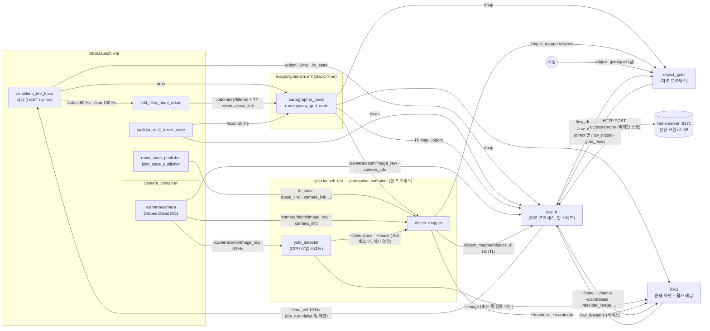

# 실행 구조 — 스레드·토픽 입출력

로봇에서 합친 탐사(판단 모델 + A*)와 물체 지도를 돌릴 때 **어느 프로세스·스레드가 무엇을 받아 무엇을 내는지** 한 곳에 모은다.
계획이 아니라 **지금 코드**(커밋 52cad57) 기준이다. 센서 자체의 사양·실측 주기 근거는 [sensor_topics.md](sensor_topics.md), 이름·메시지 규약은 [conventions.md](conventions.md).
단일 프로세스 Rust 통합 설계(`limo_upper_keep/wt_rust/docs/onboard_rust.md`)가 이 표를 출발점으로 쓴다.

**읽는 법**
- QoS(서비스 품질)는 `신뢰성 / 지속성 / 깊이` 로 적는다: R = RELIABLE(신뢰), BE = BEST_EFFORT(최선), V = VOLATILE(휘발), TL = TRANSIENT_LOCAL(늦게 온 구독자도 마지막 값을 받음).
  `SensorData` = rclcpp `SensorDataQoS()` = BE / V / 5. 숫자만 적은 것(`10`)은 rclcpp 기본 = R / V / 그 깊이.
- 주기는 코드로 정해진 값이다. 센서 실측 값은 [sensor_topics.md](sensor_topics.md#한눈에).
- `~/x` 는 노드 이름 아래 토픽이다(`low_rl` 의 `~/status` = `/low_rl/status`).
- 근거 파일은 `src/limo_fire/<패키지>/src/…`, 탐사 공용 헤더는 `train/explore/scripts/…`.

## 한눈에 — 데이터 흐름



- 합친 탐사에서는 Nav2·AMCL 을 띄우지 않는다. `low_rl` 은 Cartographer 의 `/map` 을 **읽지 않고** 라이다·깊이로 자기 지도를 만든다. Cartographer 에서 받는 것은 TF `map → odom` 뿐이다.
- `low_rl` 은 EKF 결과(`/odometry/filtered`)가 아니라 섀시의 원래 `/odom` 을 읽는다(시뮬 관측과 같게).
- TF 사슬: `map → odom`(Cartographer, `published_frame = odom`, 50 Hz) → `base_link`(EKF, 30 Hz) → 센서(`robot_state_publisher` 정적 TF + Orbbec 드라이버의 `camera_*_frame`).

## 프로세스와 launch

| launch | 프로세스 (노드) | 켜는 조건 |
|---|---|---|
| `limo_fire_bringup/robot.launch.xml` | `robot_state_publisher` · `joint_state_publisher` · `/limo/limo_fire_base` · `/camera/camera_container`(컴포넌트 `/camera/camera`) · `/ydlidar_ros2_driver_node` · `/ekf_filter_node_odom` · `esp32_bridge` · `rviz2` · `jetson_clocks`(한 번 돌고 끝) | 섀시·EKF 는 `base:=true`(기본), ESP32 는 `esp32:=true`, RViz 는 `viz:=true` |
| `limo_fire_rl/explore_fuel_rl.launch.xml` | `low_rl` (`low_rl.launch.xml`) · `limo_fire_rviz` (RViz) | RViz 는 `rviz:=true` |
| ↳ `stack:=true` | `mapping.launch.xml`: `cartographer_node` · `cartographer_occupancy_grid_node` | |
| ↳ `perception:=true` | `yolo.launch.xml`: `/perception_container`(컴포넌트 `yolo_detector` + `object_mapper`, `use_intra_process_comms`) + 따로 프로세스 `object_goto`(`mode: explore`) | |
| (ROS 밖) | `llama-server` (`127.0.0.1:8171`, 판단 모델) — [limo_fire_rl README](../src/limo_fire/limo_fire_rl/README.md) 대로 손으로 먼저 띄움 | `upper:=decider`(기본) |

- `env.sh` 는 RMW 를 정하지 않으므로 Humble 기본(Fast DDS)이다. 프로세스 사이는 모두 DDS(직렬화 → 공유 메모리·UDP → 역직렬화)다.
- 같은 프로세스 안 복사 없는 전달은 `perception_container` 의 `yolo_detector → object_mapper` 하나뿐이다. 카메라는 따로 컨테이너라 영상은 DDS 로 온다(`robot.launch.xml` 주석: 드라이버가 transient_local 발행자를 만들어 프로세스 안 전달을 켤 수 없음).

## 스레드 — 무엇을 받아 무엇을 내나

| 프로세스 | 스레드 | 받는 것 | 하는 일 | 내는 것 |
|---|---|---|---|---|
| `limo_fire_base` | 시리얼 읽기 (`std::thread readData`) | UART 프레임 460800 bps | 프레임 해석, 시각 = 받은 때 `now()` | `/odom` `/imu` `/limo_status` `/rc_state` `/motor_states` `/wheel_odometry` (이 스레드에서 바로 발행) |
| | 실행기 (`rclcpp::spin`, 한 스레드) | `/cmd_vel` | 속도 명령 프레임 만들기 | UART 쓰기 |
| `ydlidar_ros2_driver_node` | main 고리 (`WallRate 20`) + SDK 안 읽기 스레드 | USB 시리얼 | 한 바퀴 모으기 | `/scan` (main 에서 발행) |
| `camera_container` | 실행기 1 개 + Orbbec SDK 프레임 콜백 스레드 + `colorFrameThread_` | USB 영상 | 깊이→컬러 정렬(HW), 메시지 만들기 | `/camera/color/*` `/camera/depth/*` + TF |
| `ekf_filter_node_odom` | 실행기 1 개 (30 Hz 타이머) | `/odom` `/imu` | 융합 | `/odometry/filtered`, TF `odom→base_link` |
| `cartographer_node` | 실행기 + Cartographer 뒤 작업 스레드 | `/scan` `/imu` `/odometry/filtered` + TF | SLAM | TF `map→odom`, `/submap_list` 등 → `occupancy_grid_node` 가 `/map` (1 s) |
| `perception_container` | **YOLO GPU 작업 스레드** (`std::thread`, 실행기 밖, WaitSet 으로 직접 받음) | `/camera/color/image_raw` (가장 최근 장만, 밀린 장은 버림) | RGB 로 맞춤 → 고정 메모리로 복사 → GPU 에 걸기 → 앞 장 결과 받기 (GPU 슬롯 2 개로 겹침) | `~/mask` → `~/detections` 차례로, `~/image` (구독자 있을 때만) |
| | 실행기 (component_container, **한 스레드**) | `object_mapper` 의 모든 구독 · 타이머 · `/tf` `/tf_static` (TF 스레드 없음) | 탐지·깊이 짝 → 작업 줄 → 20 ms 타이머가 그 시각 TF 있는 장부터 처리 | `~/instances` `~/objects` `~/markers` `~/summary` `~/selected` |
| | CUDA·TensorRT 드라이버 안 스레드 | | | |
| `low_rl` | 실행기 (`rclcpp::spin`, **한 스레드**, TF 도 이 실행기에서 — 리스너 스레드 없음) | 아래 low_rl 표의 모든 입력, llama-server 답(비차단 소켓을 걸음마다 한 단계씩) | 장 한 장 = 걸음 하나(0.1 s): 지도·관측 → 위층 → A* 추종 | `/cmd_vel` `~/cmd_debug` `~/status` … , HTTP 요청 |
| `object_goto` | 실행기 1 개 + **TF 리스너 스레드** (`TransformListener(buffer)` 기본값 = 따로 스레드) | `/object_mapper/objects` `/map` `/low_rl/goto_status` `~/goal`, TF | 글 → 클래스, (direct·nav2 모드) 설 자리 BFS | `/low_rl/*` 지시, `~/status` `~/target` `~/overlay`, (nav2 모드) `navigate_to_pose` 액션 |
| RViz | Qt 화면 스레드 + ROS 실행 스레드 | 화면 토픽 | 탐사 패널: 콜백은 값만 바꾸고 Qt 타이머가 그림 | `/low_rl/enable` 서비스 부름, `/clicked_point` |
| 모든 ROS 프로세스 | DDS 안 스레드 (받기·이벤트·타이머) | 네트워크·공유 메모리 | 역직렬화해 실행기 줄에 넣음 | |

### 스레드 사이·프로세스 사이 복사 (Rust 한 프로세스 통합 참고)

| # | 길 | 복사 | 크기·횟수 |
|---|---|---|---|
| 1 | 카메라 → `yolo_detector` 컬러 | DDS 직렬화(카메라) → 역직렬화(받기 메시지 풀을 돌려 써 할당은 없음) → `memcpy` 고정 메모리 `h_img` → `cudaMemcpyAsync` H2D | 640×480 rgb8 = 921 KB, 30 장/초 × 3 번 (`bgr8` 이면 색 바꿈 1 번 더) |
| 2 | GPU → `~/mask` | D2H `h_ids` → `msg.data.assign` 1 번 → 프로세스 안 `unique_ptr` 로 `object_mapper` 에 (복사 없음) | 307 KB, 물체가 있을 때만. 프로세스 밖 구독자(rqt 등)가 있으면 그 몫 직렬화 1 번 |
| 3 | `~/detections` | `unique_ptr` 프로세스 안 전달 (복사 없음) | 작음 |
| 4 | 카메라 → 깊이 (`object_mapper`·`low_rl` 둘 다) | 프로세스마다 역직렬화 1 번 (`object_mapper` 는 받기 메시지 32 개를 돌려 씀) | 640×480 16UC1 = 614 KB × 30 장/초 × 2 프로세스 |
| 5 | `/object_mapper/objects` → `low_rl`·`object_goto` | TL 이라 프로세스 안 전달을 끔 → 직렬화 1 번 + 프로세스마다 역직렬화 | 물체 수 × 수백 B, **10 Hz 로 늘** (바뀔 때만이 아님) |
| 6 | `/scan` → `low_rl` | 역직렬화 + `Scan` 구조체로 `ranges`·`intensities` 복사 | 약 250 점, 10 Hz |
| 7 | `low_rl` 깊이 → 지도 | 메시지 버퍼를 그대로 읽어 칸으로 투영 (복사 아님, 계산) | |
| 8 | `low_rl` → llama-server | JSON 본문 문자열(지도 PNG 288 px 를 base64 로) → 소켓, 같은 PNG 를 RViz 용으로 다시 풀어 `~/decider_image` | 요청마다 수십 KB |
| 9 | TF | `/tf` 를 받는 프로세스마다 TF 버퍼 따로 (`low_rl`·`object_mapper`·`object_goto`·Cartographer·EKF·RViz) | Cartographer `map→odom` 50 Hz 가 가장 많음 |

## 모듈별 입출력

### `limo_fire_base` — `/limo/limo_fire_base` (`src/limo_driver.cpp`, 설정 `limo_fire_bringup/config/limo_base.yaml`)

토픽은 모두 **절대 이름**이라 네임스페이스 `limo` 가 붙지 않는다. 시각은 시리얼 프레임을 받은 때의 `now()`.

| 방향 | 토픽 | 타입 | QoS | 주기 | frame_id | 뜻 |
|---|---|---|---|---|---|---|
| 냄 | `/odom` | `nav_msgs/Odometry` | R / V / 50 | 50 Hz | `odom` → child `base_link` | 바퀴 오도메트리. TF 는 안 냄(`pub_odom_tf: false`) |
| 냄 | `/imu` | `sensor_msgs/Imu` | R / V / 10 | 100 Hz | `imu_link` | 자세 쿼터니언은 REP-103 대로 ([sensor_topics.md](sensor_topics.md#imu--바퀴-오도메트리--imu-odom-limo_status)) |
| 냄 | `/limo_status` | `limo_msgs/LimoStatus` | R / V / 50 | 2 Hz | — | stamp 가 1970 년(원본 버그) |
| 냄 | `/rc_state` | `sensor_msgs/Joy` | R / V / 10 | 40 Hz | `""` | 아래 표 |
| 냄 | `/motor_states` | `sensor_msgs/JointState` | R / V / 20 | 20 Hz | — | `motor1~4`: velocity rad/s, effort A, position = 엔코더 펄스 원값 |
| 냄 | `/wheel_odometry` | `sensor_msgs/JointState` | R / V / 20 | 50 Hz | — | `left_wheel`·`right_wheel` 누적 m |
| 받음 | `/cmd_vel` | `geometry_msgs/Twist` | R / V / 10 | 명령마다 | — | 리모컨 SWB 위(오토)일 때만 섀시가 따름 |

`/rc_state` (`publishRcState`, AgileX 규약 RcStateFrame 0x241):

| 칸 | 뜻 |
|---|---|
| `axes[0..3]` | 오른 가로 · 오른 세로 · 왼 세로 · 왼 가로, −1 ~ 1 |
| `axes[4]` | 다이얼, −1 ~ 1 |
| `buttons[0..3]` | 스위치 SWA · SWB · SWC · SWD, 2 비트씩: **2 = 위, 1 = 가운데, 3 = 아래** |
| `buttons[1]` | **SWB. 2(위) = 오토 — `/cmd_vel` 을 섀시가 받음.** `low_rl` 은 `rc_button: 1`, `rc_auto_value: 2` 로 이것만 봄 |

### `ydlidar_ros2_driver_node` (외부 코드, `config/ydlidar.yaml`)

| 방향 | 토픽 | 타입 | QoS | 주기 | frame_id |
|---|---|---|---|---|---|
| 냄 | `/scan` | `sensor_msgs/LaserScan` | SensorData | 10 Hz | `laser_link` |
| 서비스 | `/stop_scan` `/start_scan` | `std_srvs/Empty` | | | |

### Orbbec `/camera/camera` (외부 코드, `config/orbbec_dabai_dc1.yaml`)

| 방향 | 토픽 | 타입 | QoS | 주기 | frame_id |
|---|---|---|---|---|---|
| 냄 | `/camera/color/image_raw` | `sensor_msgs/Image` rgb8 640×480 | R / V (`color_qos: default`) | 30 Hz | `camera_color_optical_frame` |
| 냄 | `/camera/color/camera_info` | `sensor_msgs/CameraInfo` | R / V | 30 Hz | 같음 |
| 냄 | `/camera/depth/image_raw` | `sensor_msgs/Image` 16UC1 mm, 컬러에 정렬 640×480 (`depth_registration: true`) | R / V | 약 29 Hz | `camera_color_optical_frame` |
| 냄 | `/camera/depth/camera_info` | `sensor_msgs/CameraInfo` (fx 489.39 = 컬러) | R / V | 30 Hz | 같음 |
| 냄 | TF `camera_link → camera_{color,depth}_frame → _optical_frame` | `publish_tf: true` | | | |

### EKF · Cartographer (외부 코드)

| 노드 | 받음 | 냄 |
|---|---|---|
| `/ekf_filter_node_odom` (`config/ekf.yaml`, 30 Hz) | `odom`(=`/odom`), `imu`(=`/imu`) | `/odometry/filtered` (`odom`→`base_link`), TF `odom→base_link` |
| `cartographer_node` (`limo_fire_navigation/config/cartographer_2d.lua`) | `/scan`, `/imu`, `odom` → remap `/odometry/filtered` | TF `map→odom` (`pose_publish_period_sec 0.02` = 50 Hz), `/submap_list`, `/trajectory_node_list` 등 |
| `cartographer_occupancy_grid_node` (`-resolution 0.05 -publish_period_sec 1.0`) | `/submap_list` | `/map` (`nav_msgs/OccupancyGrid`, 1 Hz) — 합친 탐사에서는 RViz·`object_goto` 만 읽음 |

### `yolo_detector` (`limo_fire_perception/src/yolo_detector_node.cpp`, 설정 `config/yolo_coco.yaml` · `yolo_fire.yaml`)

| 방향 | 토픽 | 타입 | QoS | 주기 | frame_id·stamp |
|---|---|---|---|---|---|
| 받음 | `image_topic` = `/camera/color/image_raw` | `sensor_msgs/Image` (rgb8·bgr8·rgba8·bgra8) | SensorData, 실행기에 안 올린 콜백 그룹 → 작업 스레드가 WaitSet 으로 꺼냄, 프로세스 안 전달 끔 | 카메라대로 | |
| 냄 | `~/detections` | `vision_msgs/Detection2DArray` | 10 | 처리한 장마다 (빈 배열도 냄) | 컬러 영상 header 그대로 |
| 냄 | `~/mask` | `sensor_msgs/Image` mono8, 컬러 영상과 같은 크기 | 10 | 물체가 있는 장만, `~/detections` 보다 **먼저** | 같음 |
| 냄 | `~/image` | `sensor_msgs/Image` rgb8 (상자·이름·덧칠) | R / V / 1 | 구독자 있을 때만, 없으면 5 s 뒤 GPU 버퍼 풂 | 같음 |

`Detection2D` 한 개의 칸:

| 칸 | 값 |
|---|---|
| `bbox.center.position.x/y` | 상자 가운데, 컬러 영상 픽셀 |
| `bbox.size_x/size_y` | 상자 너비·높이, 픽셀 |
| `results[0].hypothesis.class_id` | **클래스 이름 글** (`class_names` 의 것, 예 `chair`) — 번호가 아님 |
| `results[0].hypothesis.score` | 신뢰도 0~1 (`conf_threshold` 0.40 넘는 것만) |
| `~/mask` 픽셀 값 | `detections` 안 차례 + 1, 0 = 배경 |

### `object_mapper` (`limo_fire_perception/src/object_mapper_node.cpp`, 같은 설정 파일의 `object_mapper:` 칸)

| 방향 | 토픽·서비스 | 타입 | QoS | 주기 | frame_id |
|---|---|---|---|---|---|
| 받음 | `detections_topic` = `/yolo_detector/detections` | `Detection2DArray` | 10 (message_filters), 프로세스 안 | | |
| 받음 | `depth_topic` = `/camera/depth/image_raw` | `Image` 16UC1·32FC1 | SensorData, 받기 메시지 32 개 돌려 씀 | | |
| | ↳ 탐지·깊이 짝 | ApproximateTime 줄 10, 시각 차 ≤ `max_sync_dt` 0.05 s | | | |
| 받음 | `mask_topic` = `/yolo_detector/mask` | `Image` mono8 | 10, 최근 10 장에서 같은 stamp 를 찾음 | | |
| 받음 | `camera_info_topic` = `/camera/depth/camera_info` | `CameraInfo` | SensorData | | |
| 받음 | `/tf` `/tf_static` | | 리스너 스레드 없음, 프로세스 안 전달 끔 | | |
| 받음 | `clicked_topic` = `/clicked_point` | `geometry_msgs/PointStamped` | 10 | | RViz Publish Point |
| 받음 | `view_topic` = `/yolo_detector/image` | `Image` | 5 | `~/selected` 구독자가 있을 때만 구독 | |
| 받음 | `~/save_to` | `std_msgs/String` (경로) | 10 | | |
| 냄 | `~/objects` | `vision_msgs/Detection3DArray` | R / TL / 1 | **10 Hz** (벽시계 타이머, 바뀌지 않아도) | `map` |
| 냄 | `~/instances` | `Detection3DArray` | 10, 프로세스 안 `unique_ptr` | 처리한 장마다 (물체가 있을 때만) | `map`, stamp = 탐지 시각 |
| 냄 | `~/markers` | `visualization_msgs/MarkerArray` | R / TL / 1 | 10 Hz (비면 안 냄) | `map` |
| 냄 | `~/summary` | `rviz_2d_overlay_msgs/OverlayText` | R / TL / 1 | 2 Hz | |
| 냄 | `~/selected` | `Image` | R / TL / 1 | 누를 때 | |
| 서비스 | `~/clear` `~/save` `~/load` | `std_srvs/Trigger` | | | |
| 파일 | `objects_file` | 글 파일 (`# limo_fire object map v1 …`) | | `~/save`·`~/save_to` 로 쓰고 켤 때 읽음 | |

타이머: 작업 줄 처리 `process_period` 0.02 s(노드 시계, `tf_wait` 0.2 s 넘으면 그 장 버림, `max_pending` 10 넘으면 가장 오래된 장 버림), 표시 0.1 s(벽시계).

**`~/objects` — 지도에 올라간 물체 하나 = `Detection3D`** (`publish_objects`, `min_hits` 3 번 넘게 보고 아직 안 빠진 것만)

| 칸 | 뜻 |
|---|---|
| `id` | `"<클래스>-<번호>"` (예 `chair-3`). 번호는 클래스마다 1 부터, 같은 물체는 같은 번호 유지 |
| `results[0].hypothesis.class_id` / `.score` | 클래스 이름 / 지금까지 가장 높은 점수 |
| `bbox.center.position` | 물체 위치 (map, m). 정지 물체는 평균, 움직이는 클래스(`dynamic_classes`)는 가장 최근 측정 |
| `bbox.size.x` | 물체 너비 m (모르면 0) |
| `bbox.size.y` | 앞면 넓이의 제곱근 m (모르면 0) |
| `bbox.size.z` | 안 씀 (0) |
| `results[0].pose.pose.position` | 밑점 — 마스크 3D 점 가운데 가장 낮은 10 % 의 평균 (map). 마스크로 못 잰 물체는 `bbox.center` 와 같음 |
| `results[0].pose.covariance[35]` | **마지막으로 본 뒤 지난 초** (공분산 칸을 빌려 씀, 발행 순간 기준). `low_rl` 이 판단 모델 글의 `seen_s`·`vis` 로 씀 |
| `header.stamp` | 발행 시각 (`now()`) — 물체를 본 시각이 아님 |

**`~/instances` — 이 장에서 잰 물체 하나 = `Detection3D`** (지도에 합치기 전 측정 그대로, 점검·깊이 비교용)

| 칸 | 뜻 |
|---|---|
| `id` | `"<클래스>\|<출처>\|mask <깊이 m>\|floor <깊이 m>"` (예 `chair\|mask\|mask 2.31\|floor 2.40`). 출처 = `mask`(마스크 픽셀 깊이) · `box`(상자 가운데 깊이) · `floor`(바닥 광선 거리로 바꿈). 못 재면 `nan` |
| `results[0].hypothesis` | 클래스 이름 · 이 장 점수 |
| `results[0].pose.pose.position` | 바닥 광선 밑점이 있으면 그것, 없으면 잰 점 (map) |
| `bbox.center.position` | 잰 점 (map) |
| `bbox.size.x` / `.z` | 너비 / 높이 m (마스크 또는 상자 픽셀 × 거리 / f) |

### `low_rl` — 합친 탐사 노드 (`limo_fire_rl/src/low_rl_node.cpp`, 설정 `config/low_rl.yaml` + 시뮬 설정 `env_yaml` = `train/explore/sim/config/env.yaml`)

한 스레드 실행기. `/scan` 한 장이 걸음 하나(0.1 s)다: 장과 그때의 오도메트리·IMU·깊이를 줄에 두고, **장 시각의** TF `map→base_link` 가 오면(5 ms 마다 다시 봄, `tf_timeout` 0.2 s 넘으면 건너뜀) 처리한다.

| 방향 | 토픽·서비스 | 타입 | QoS | 주기 | frame_id·뜻 |
|---|---|---|---|---|---|
| 받음 | `scan_topic` = `/scan` | `LaserScan` | SensorData | 10 Hz | 걸음 시계 |
| 받음 | `odom_topic` = `/odom` | `Odometry` | 20 | 50 Hz | 바퀴 속도 (EKF 결과 아님) |
| 받음 | `imu_topic` = `/imu` | `Imu` | 50 | 100 Hz | 자이로·가속도·roll/pitch |
| 받음 | `depth_topic` · `depth_info_topic` | `Image` 16UC1 · `CameraInfo` | SensorData | 30 Hz | `depth_timeout` 0.5 s 넘은 깊이는 안 씀 (구멍 0) |
| 받음 | `color_topic` · `color_info_topic` | `Image` · `CameraInfo` | SensorData | | `decider_cam > 0` 일 때만 구독 (기본 0 → 안 함) |
| 받음 | `rc_topic` = `/rc_state` | `Joy` | SensorData 깊이 5 (R 발행자와도 맞음) | 40 Hz | `buttons[1] == 2` 가 아니거나 0.5 s 안 오면 멈추고 꺼짐. 발행자가 있는데 2 s 못 받으면 구독을 새로 만듦 |
| 받음 | `/object_mapper/objects` | `Detection3DArray` | R / TL / 1 | 10 Hz | 지시가 있을 때 물체 후보·`known_objects` |
| 받음 | `~/instruction` | `std_msgs/String` | 10 | | 사용자 지시 글 그대로 (빈 글 = 지시 지움 → 보통 탐사) |
| 받음 | `~/target_class` | `String` | 10 | | 클래스 힌트 (물체 후보 차례에서 앞으로) |
| 받음 | `~/goto` | `geometry_msgs/PointStamped` | 10 | | 설 자리 (map). `point.x/y` 만 씀 |
| 받음 | `~/goto_face` | `PointStamped` | 10 | | 닿은 뒤 바라볼 물체 자리 (`~/goto` 바로 앞에 와야 함) |
| 받음 | `/tf` `/tf_static` | | 리스너 스레드 없음 | | `map_frame`(map) → `base_frame`(base_link) |
| 서비스 | `~/enable` | `std_srvs/SetBool` | | | true: 리모컨 오토일 때만 켬 (아니면 `success: false` + 까닭). false: 멈춤 |
| 냄 | `cmd_vel_topic` = `/cmd_vel` | `Twist` | 10 | 10 Hz (장마다) | **`dry_run: false` 일 때만 발행자를 만듦**. 켜짐·입력 정상일 때만 냄, 멈출 때 0 한 번 |
| 냄 | `~/cmd_debug` | `TwistStamped` | 10 | 10 Hz | `base_link`, stamp = 장 시각. dry run 에도 늘 |
| 냄 | `~/status` | `String` | 10 | 1 Hz (10 장마다) | 아래 |
| 냄 | `~/state` | `String` | R / TL / 1 | 바뀔 때 | `idle` · `running` · `paused` · `done` |
| 냄 | `~/done` | `std_msgs/Bool` | R / TL / 1 | 시작·끝 | true = 판 끝남 |
| 냄 | `~/goto_status` | `String` | R / TL / 1 | 일이 생길 때 | 아래 |
| 냄 | `~/goal_marker` | `MarkerArray` | 10 | 목표가 바뀔 때 | `map` |
| 냄 | `~/candidates` | `MarkerArray` | 10 | 1 s (결정 차례) | `map`, 후보 구·글·덩어리, 물체 후보 |
| 냄 | `~/candidates_text` | `OverlayText` | R / TL / 1 | 결정 차례 | 후보 표 글 |
| 냄 | `~/decider_image` | `Image` rgb8 | R / TL / 1 | 판단 모델 요청마다 (처음엔 회색 판) | `map` (보기만) |
| HTTP | `decider_url` + `/v1/systemone` | JSON | 비차단 소켓, 연결마다 닫음 | `decider_mode: event` (목표 1 m 앞·실패·후보 크게 바뀜·최대 10 s) | 아래 |
| 파일 | `record` | `low_node_rec.h` 꼴 | | 비우면 안 씀 | 입력·명령 녹화 (`low_explore_replay` 로 다시 돌림) |

타이머: 입력 감시 50 ms(벽시계), TF 기다림 장 처리 5 ms(벽시계).

**`~/state` 값과 바뀌는 때**

| 값 | 때 |
|---|---|
| `idle` | 처음 뜸(늘 꺼진 채), `~/enable false` |
| `running` | `~/enable true` 성공, `contact_resume_s > 0` 이면 닿음 뒤 저절로 |
| `paused` | 리모컨이 오토 아님·`/rc_state` 끊김, 닿음(충돌 신호), 물체에 도착(`goto_resume: false`), 지시를 못 끝냄 — 모두 꺼짐으로 바뀌어 `~/enable true` 를 다시 불러야 함 |
| `done` | 판 끝: 대충 다 앎 · 지도 닫힘 + 진척 없음 10 s · 진척 없음 · 시간 한도. 다시 켜면 새 판 |

입력 끊김(라이다·TF·오도메트리 0.3 s)은 `~/state` 를 바꾸지 않고 명령만 0 으로 하며, 돌아오면 이어 간다.

**`~/status` 한 줄 (1 Hz)** — `·` 로 나뉜 칸:

`<state> (<까닭>) · 리모컨 오토|오토 아님 · 걸음 N · 목표 칸 K[ (목표 없음)| (slot0)] · 명령 v ω · 결정 a 통과 b 막힘 c · 평균 ms: 걸음 · 관측 · 위층 (최대) · 리모컨 …(마지막 받은 뒤 ms, 받음 수, 발행자 수, 다시 구독 수, buttons[1]=값) · 판단 모델: 보냄 n 답 n (마지막 ms) 시간 끝 n 실패 n — <마지막 오류> 후보 안 맞음 n slot0 대신 n · 기다리는 중`

- `목표 칸` 은 로봇 지도 칸 번호(−1 = 없음). `(slot0)` = 판단 모델 대신 점수 1 등 후보로 잡음.
- `판단 모델:` 칸은 `upper: decider` 일 때만.

**`~/goto_status` 글 (한글 한 줄, 앞말로 갈래를 안다)**

| 앞말 | 때 |
|---|---|
| `지시: …` / `지시 없음 — 보통 탐사` | `~/instruction` 받음 |
| `가는 중: <이름> (x, y)` | `~/goto` 받음 (꺼져 있으면 "— 탐사가 꺼져 있어 켜야 움직임") |
| `물체 후보를 고름: <oid> — 설 자리 (x, y) 로` | 판단 모델(또는 대신 규칙)이 물체 후보를 고름 |
| `판단 모델이 따라가기를 고름: <oid> …` | 사람 따라가기 시작 |
| `도착: <이름> — 멈춤` / `— 탐사를 이어 감` | 설 자리 닿고 물체 쪽으로 돎. **`object_goto` 는 `도착` 으로 시작하는 글을 보고 그 지시를 끝냄** |
| `못 감: <이름> (<까닭>) — …` | 막힘·경로 없음. 그 물체를 `goto_fail_ttl_s` 동안 후보에서 뺌 |
| `못 찾음: <지시> — …` | 지시 시간 한도·실패 한도·다 탐사했는데 없음 → 멈춤 |
| `고른 물체가 지도에서 빠지거나 옮김: …` · `판단 모델이 물체 대신 탐사 자리를 고름` · `사람을 놓침: …` | 다시 물음·따라가기 끝 |

**판단 모델 HTTP** (`limo_fire_rl/include/limo_fire_rl/decider_client.h`, 본문 `train/explore/scripts/low_decider.h` `render_cand`)

요청: `POST /v1/systemone HTTP/1.1`, `Content-Type: application/json`, `Connection: close`, 한도 `decider_timeout` 8 s. 기본 설정(`decider_cand`·`decider_compact` true)의 본문:

| 칸 | 뜻 |
|---|---|
| `state.task` | 임무 글 (지시 없음: 바닥 전체를 가장 빨리 지도로 · 지시 있음: 지시를 수행) |
| `state.map_image` | 지도 사진 범례 (흰 빈 곳·검은 벽·회색 모름, 파란 화살표 = 로봇, 글자 동그라미 = 후보, 보라 = 지나온 길 60 s, ✓·× = 지난 목표) |
| `state.candidate_fields` | 짧은 키 뜻 |
| `state.hint` | "Rules of thumb …" (`decider_hint`) |
| `state.candidates[]` | 후보 최대 `decider_max_cands` 6 개. 프론티어: `id`(글자) `t`(가는 시간 s) `len`(경로 m) `bear`(방위 도, 왼쪽 +) `new`(새로 보일 넓이 m²) `w`(프론티어 폭 m) `room` `cur` `fail` `fail_s` `seen`. 물체(지시가 있을 때 앞 글자, 최대 `decider_obj_max` 3): `kind`(`object`·`follow`) `object`(클래스) `oid`(`chair-3`) `len` `bear` `dist` `seen_s` `vis`. 지시가 있으면 프론티어에 `kind: frontier` |
| `state.decision_log_newest_first[]` | 최근 `decider_log_k` 4 결정 (언제·고른 후보·이어 감/바꿈·결과) |
| `state.instruction` · `class_hint` · `known_objects[]` · `candidate_kinds` | 지시가 있을 때. `known_objects` 는 가까운 10 개 `"chair-3 chair 1.2 m front-left seen 4 s visible"` |
| `state.camera_image` | `decider_cam > 0` 일 때만 (기본 끔) |
| `images[]` | `"data:image/png;base64,…"` — 지도 사진 288 px 한 장 (+ 카메라 2 × 2, 켰을 때) |
| `questions.pick` | `{"type": "choice", "instructions": …, "criteria": {"A": null, "B": null, …}}` |

답: HTTP 200 JSON 의 `answers.pick.choice` = 글자 하나(`"A"` …). 다른 꼴·늦은 답(8 s)·`http <코드>` 는 버리고 지금 목표 그대로 (`~/status` 의 실패·시간 끝 수). 고른 후보 칸에서 `decider_match_r` 1.5 m 안의 지금 후보로 맞춘다.

### `object_goto` (`limo_fire_navigation/src/object_goto_node.cpp`, 설정 `config/object_goto.yaml`, `explore_fuel_rl` 에서는 `mode: explore`)

| 방향 | 토픽 | 타입 | QoS | 뜻 |
|---|---|---|---|---|
| 받음 | `~/goal` | `String` | 10 | 사람이 주는 지시 글 (한글 별칭 `aliases`·영문 클래스). 빈 글 = 지시 지움 |
| 받음 | `objects_topic` = `/object_mapper/objects` | `Detection3DArray` | R / TL / 1 | 물체 수가 바뀌면 찾는 중인 지시를 다시 찾음 |
| 받음 | `map_topic` = `/map` | `OccupancyGrid` | R / TL / 1 | 설 자리 BFS (direct·nav2 모드) |
| 받음 | `explore_status_topic` = `/low_rl/goto_status` | `String` | 10 | `도착` 으로 시작하면 이 지시 끝 |
| 냄 | `explore_topic` = `/low_rl/instruction` | `String` | 10 | 지시 글 그대로 (빈 글 = 지움) |
| 냄 | `explore_target_topic` = `/low_rl/target_class` | `String` | 10 | 글에서 푼 클래스 (못 풀면 빈 글) |
| 냄 | `explore_goto_topic` · `explore_face_topic` = `/low_rl/goto` · `/low_rl/goto_face` | `PointStamped` | 10 | `direct: true` 일 때만 (기본 false: 판단 모델이 고름). `map` |
| 냄 | `~/status` | `String` | R / TL / 1 | 한글 한 줄: `대기 — …` · `'<글>' → 판단 모델이 …` · `'<글>' → 클래스 c · 지도에 n 개 — …` · `'<글>' — 지도에 없음. 탐사하며 찾는 중` · `끝: 도착…` · `지시 지움` |
| 냄 | `~/target` · `~/overlay` | `MarkerArray` · `OverlayText` | R / TL / 1 | 고른 물체·설 자리 / 지시 + 상태 |
| 액션 | `nav_action` = `navigate_to_pose` | `nav2_msgs/NavigateToPose` | | `mode: nav2` 일 때만 (저장 지도 주행) |

### RViz 탐사 패널 (`limo_fire_rviz/src/explore_panel.cpp`)

`/low_rl` 고르면: `/low_rl/state`(R / TL / 1), `/low_rl/done`(R / TL / 1), `/low_rl/status`(10) 구독, `/low_rl/enable` 부름. `~/state == "running"` 이면 켜짐으로 그린다.
운용 화면(`limo_fire_rl/rviz/explore_fuel_rl.rviz`)이 그리는 토픽: `/map` `/scan` `/object_mapper/markers` `/object_mapper/summary` `/object_goto/target` `/object_goto/overlay` `/low_rl/candidates` `/low_rl/candidates_text` `/low_rl/decider_image` `/low_rl/goal_marker` `/yolo_detector/image` `/robot_description`.

## 다시 확인하는 법

```bash
grep -n "create_publisher\|create_subscription\|create_service\|declare_parameter" src/limo_fire/*/src/*.cpp
ros2 topic info -v /object_mapper/objects      # 발행·구독 노드와 QoS
ros2 node info /low_rl
ps -T -p <PID>                                 # 프로세스의 스레드
```
