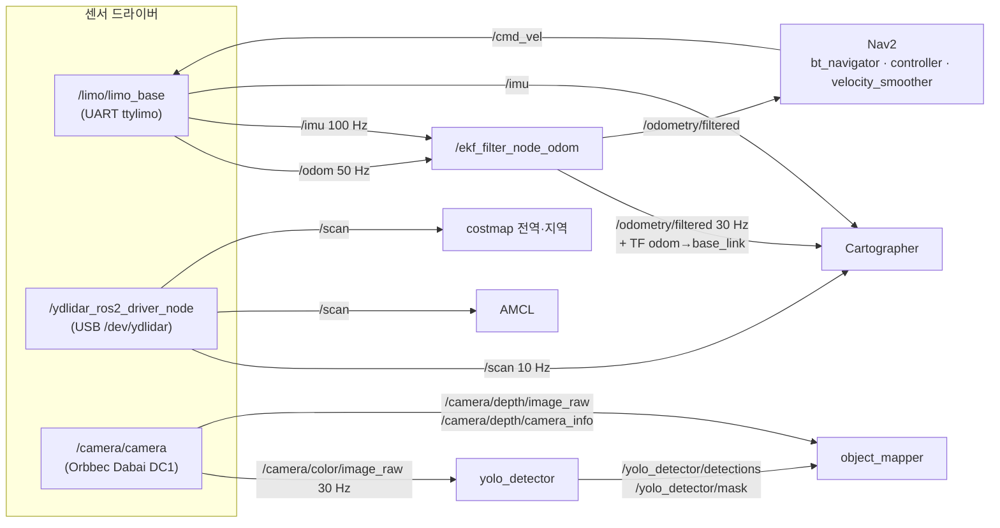

# 센서 토픽 — 누가 내고 누가 읽나

실물 LIMO Pro 의 센서가 어떤 토픽으로 나오고, 우리 노드(EKF·Cartographer·Nav2·YOLO·object_mapper)가 그중 무엇을 읽는지 한 곳에 모은다. 센서 자체의 사양(해상도 근거, 노이즈, 장착 위치)은 [hardware.md](hardware.md) 에 있다.

**조사 방법 (2026-10-28)**
- 코드: 드라이버 소스(`src/external/wego_limo_pro`)와 우리 launch·config(`src/limo_fire`)에서 발행·구독 토픽 이름을 찾았다.
- 실측: 돌고 있던 `limo_base` 의 토픽을 읽었고, 카메라·라이다 드라이버만 따로 30 초 남짓 띄워 `ros2 topic list/hz/echo/info` 로 쟀다(로봇은 움직이지 않음). 라이다·EKF 주기는 10-26 녹화 bag(`~/limo_bags/mapping_1026_1900`, 200 초)으로도 맞춰 봤다.
- 실측에서 확인 못 한 것은 "코드 기준"이라고 적었다.

## 한눈에

`ros2 launch limo_fire_bringup robot.launch.xml` 이 띄우는 센서 토픽.

| 센서 | 토픽 | 타입 | 주기 (실측) | frame_id | 발행 노드 | 읽는 노드 |
|---|---|---|---|---|---|---|
| 라이다 | `/scan` | `sensor_msgs/LaserScan` | 10.0 Hz | `laser_link` | `/ydlidar_ros2_driver_node` | Cartographer, AMCL, 전역·지역 costmap |
| IMU | `/imu` | `sensor_msgs/Imu` | 99.9 Hz | `imu_link` | `/limo/limo_base` | EKF, Cartographer |
| 바퀴 오도메트리 | `/odom` | `nav_msgs/Odometry` | 49.9 Hz | `odom` → `base_link` | `/limo/limo_base` | EKF |
| 융합 오도메트리 | `/odometry/filtered` | `nav_msgs/Odometry` | 30.0 Hz (bag) | `odom` → `base_link` | `/ekf_filter_node_odom` | Cartographer, Nav2(bt_navigator·controller·velocity_smoother) |
| 베이스 상태 | `/limo_status` | `limo_msgs/LimoStatus` | 2.0 Hz | — | `/limo/limo_base` | 없음 |
| 컬러 영상 | `/camera/color/image_raw` | `sensor_msgs/Image` (rgb8, 640×480) | 29.4~29.7 Hz | `camera_color_optical_frame` | `/camera/camera` | `yolo_detector` |
| 컬러 내부 파라미터 | `/camera/color/camera_info` | `sensor_msgs/CameraInfo` | 29.9 Hz | `camera_color_optical_frame` | `/camera/camera` | 없음 |
| 깊이 영상 | `/camera/depth/image_raw` | `sensor_msgs/Image` (16UC1, mm) | 28.4~29.9 Hz | [주의 1](#주의-1-깊이가-컬러에-정렬되지-않게-바뀐다) | `/camera/camera` | `object_mapper` |
| 깊이 내부 파라미터 | `/camera/depth/camera_info` | `sensor_msgs/CameraInfo` | 30.2 Hz | 위와 같음 | `/camera/camera` | `object_mapper` |

로봇이 받는 쪽: `/cmd_vel` (`geometry_msgs/Twist`) 은 `limo_base` 가 구독한다. Nav2 에서는 controller → `cmd_vel_nav` → velocity_smoother → `/cmd_vel` 순으로 들어온다.

## 데이터 흐름



- 맵을 만들 때(`mapping.launch.xml`)는 Cartographer, 주행할 때(`navigation.launch.xml`)는 AMCL + Nav2 가 붙는다. 둘을 같이 띄우지 않는다.
- TF `odom → base_link` 는 EKF 만 낸다(`limo_base` 의 `pub_odom_tf: false`).

## 센서별 자세히

### 라이다 — `/scan`

| 항목 | 값 | 근거 |
|---|---|---|
| 발행 | `create_publisher<LaserScan>("scan", SensorDataQoS)` — 상대 이름, 노드 네임스페이스 `/` 라서 `/scan` | `ydlidar_ros2_driver/src/ydlidar_ros2_driver_node.cpp:160` |
| QoS | BEST_EFFORT, VOLATILE | `ros2 topic info -v` |
| 각도 | angle_min/max = ±1.9199 rad (±110°), 간격 0.015514 rad | `topic echo` |
| 거리 | range_min 0.01 m, range_max 64 m | `topic echo`, `config/ydlidar.yaml` |
| 설정 파일 | `limo_fire_bringup/config/ydlidar.yaml` | |
| 서비스 | `/stop_scan`, `/start_scan` (`std_srvs/Empty`) | 같은 파일 :170, :180 |

읽는 쪽과 각자 쓰는 거리:

| 노드 | 설정 | 쓰는 거리 |
|---|---|---|
| Cartographer | `num_laser_scans = 1` (토픽 `scan`) | 0.1 ~ 8 m (`cartographer_2d.lua`) |
| AMCL | `scan_topic: scan` | 최대 12 m (`laser_max_range`) |
| 전역 costmap | `obstacle_layer` → `topic: /scan` | 장애물 3 m, 지우기 4 m |
| 지역 costmap | `obstacle_layer` → `topic: /scan` | 장애물 1 m, 지우기 1.5 m |

### IMU · 바퀴 오도메트리 — `/imu`, `/odom`, `/limo_status`

| 항목 | 값 | 근거 |
|---|---|---|
| 발행 | `"/odom"`, `"/imu"`, `"/limo_status"` 를 **절대 이름**으로 만든다 | `limo_ros2/limo_base/src/limo_driver.cpp:66-68` |
| 네임스페이스 | launch 는 `namespace="limo"` 로 띄우지만(노드 이름 `/limo/limo_base`), 토픽은 절대 이름이라 `/limo/odom` 이 아니라 **`/odom`** 이다 | 실측 `ros2 topic list` |
| 구독 | `"/cmd_vel"` (`geometry_msgs/Twist`) | `limo_driver.cpp:70` |
| frame | `/imu` → `imu_link` (코드에 고정), `/odom` → `odom` / `base_link` (파라미터) | `limo_driver.cpp:472, 602-603`, 실측 |
| QoS | 셋 다 RELIABLE, VOLATILE | `ros2 topic info -v` |

EKF(`limo_fire_bringup/config/ekf.yaml`)가 쓰는 값:

| 입력 | 쓰는 성분 | 모드 |
|---|---|---|
| `odom0: odom` | x, y, yaw, vx, vy, vyaw | differential + relative (둘 다 true — 기동 때 경고, [hardware.md](hardware.md#바퀴-오도메트리--ekf) 참고) |
| `imu0: imu` | yaw, 각속도 x·y·z, 가속도 x·y | relative, 중력 제거 |

Cartographer 는 `/imu` 를 직접 받고(`use_imu_data = true`, `tracking_frame = "imu_link"`), 오도메트리는 `/odom` 대신 EKF 결과를 받는다(`mapping.launch.xml` 의 `remap odom → odometry/filtered`).

### 깊이 카메라 — `/camera/*`

| 항목 | 값 | 근거 |
|---|---|---|
| 노드 | 컴포넌트 `orbbec_camera::OBCameraNodeDriver`, 이름 `camera`, 네임스페이스 `/camera` → `/camera/camera` | `robot.launch.xml` |
| 토픽 이름 | `<스트림>/image_raw`, `<스트림>/camera_info` (상대 이름). 스트림 이름은 `color`, `depth`, `ir` | `orbbec_camera/src/ob_camera_node.cpp:44-46, 1102-1111` |
| QoS | 영상 RELIABLE (`color_qos: default`). 우리 구독자는 SensorData(BEST_EFFORT) 로 받는다 — 서로 맞는다 | `ros2 topic info -v`, `yolo_detector_node.cpp:66` |
| image_transport | 영상마다 `/compressed`, `/compressedDepth`, `/theora` 가 같이 생긴다 | 실측 |
| 그 밖에 | `/camera/depth_to_color` (`orbbec_camera_msgs/Extrinsics`, transient_local), `/camera/depth_filter_status` | 실측 |
| TF | 드라이버가 `camera_link` 아래 `camera_color_frame`·`camera_depth_frame` 과 각 `_optical_frame` 을 낸다(`publish_tf: true`) | `config/orbbec_dabai_dc1.yaml` |

설정에 따라 생기고 없어지는 토픽:

| 토픽 | 켜는 설정 | 현재 설치본 (10-26 빌드) | 소스 (10-28 이후) |
|---|---|---|---|
| `/camera/ir/image_raw`, `/camera/ir/camera_info` | `enable_ir` | 나옴 | 안 나옴 |
| `/camera/depth/points` | `enable_point_cloud` | 나옴 | 안 나옴 |
| `/camera/depth_registered/points` | `enable_colored_point_cloud` | 나옴 | 안 나옴 |
| `/camera/depth_to_ir` | 깊이 + IR | 나옴 | 안 나옴 |

우리 노드가 읽는 카메라 토픽은 전부 `limo_fire_perception/config/yolo_fire.yaml` 의 파라미터로 바꿀 수 있다.

| 노드 | 파라미터 | 토픽 |
|---|---|---|
| `yolo_detector` | `image_topic` | `/camera/color/image_raw` |
| `object_mapper` | `depth_topic` | `/camera/depth/image_raw` |
| `object_mapper` | `camera_info_topic` | `/camera/depth/camera_info` |
| `object_mapper` | `detections_topic`, `mask_topic` | `/yolo_detector/detections`, `/yolo_detector/mask` |

## 주의할 것

### 주의 1. 깊이가 컬러에 정렬되지 않게 바뀐다

커밋 `02ec95e`(10-28)에서 카메라 포인트 클라우드를 껐다. 그런데 Orbbec 드라이버는 `enable_colored_point_cloud: true` 일 때만 `depth_registration` 을 강제로 켜고(`ob_camera_node.cpp:946-948`), `depth_registration` 이 켜졌을 때만 깊이를 컬러에 정렬한다(`:1057-1061`). 우리 설정은 `depth_registration: false` 라서 **포인트 클라우드를 끄면 정렬도 같이 꺼진다.**

두 설정으로 실물을 띄워 잰 값:

| | 설치본 (포인트 클라우드 켬) | 소스 (포인트 클라우드 끔) |
|---|---|---|
| 드라이버 로그 | `set align mode to ALIGN_D2C_HW_MODE` | 정렬 로그 없음 |
| `/camera/depth/image_raw` | 640×480, `camera_color_optical_frame` | **640×400, `camera_depth_optical_frame`** |
| `/camera/depth/camera_info` fx, cx | 489.39, 321.47 (컬러와 같음) | **478.02, 323.44** |

`object_mapper` 는 탐지 좌표(컬러 640×480 기준)를 깊이 영상에 그대로 대고(`object_mapper_node.cpp:249-251`), 깊이의 `camera_info` 로 3D 를 계산한다. 그래서 다시 빌드하면:
- 상자가 깊이 영상에서 엉뚱한 줄을 읽는다(세로 480 → 400, 시차 약 3 cm 도 안 맞춤).
- 마스크(640×480)가 `camera_info`(640×400)와 크기가 달라서 마스크 측정이 조용히 꺼지고 상자 측정만 쓴다(`:266`).

`yolo_fire.yaml` 주석("깊이는 컬러에 정렬된 영상")과 [hardware.md](hardware.md#깊이-카메라--orbbec-dabai-dc1) 의 "깊이 (발행) 640×480, 컬러에 정렬"도 설치본 기준이다.

고칠 방법(아직 안 고침): `orbbec_dabai_dc1.yaml` 에 `depth_registration: true` 를 넣으면 포인트 클라우드는 끈 채로 정렬만 켤 수 있다(코드 기준). 커밋 메시지의 "깊이 19→30 Hz" 가 정렬을 끈 덕분인지는 확인하지 않았으니, 켠 뒤 YOLO 를 같이 돌리면서 깊이 주기를 다시 재야 한다.

### 주의 2. 설치본이 소스보다 오래됐다

`install/limo_fire_bringup` 은 10-26 19:30 빌드다. 10-28 의 카메라 설정 변경이 아직 안 들어가 있어서, 지금 `robot.launch.xml` 을 켜면 포인트 클라우드·IR 이 다 나온다. `colcon build --packages-select limo_fire_bringup` 을 하면 반영되고, 그때부터 주의 1 이 생긴다.

### 주의 3. `limo_base` 의 네임스페이스는 토픽에 안 붙는다

노드 이름은 `/limo/limo_base` 지만 토픽은 `/odom`, `/imu`, `/cmd_vel` 이다. remap 하거나 로봇을 여러 대 띄울 때 `/limo/...` 로 찾으면 안 나온다.

## 시뮬레이션(Webots)

`webots_ros2_limo` 의 `limo_sensors.py` 플러그인이 실물과 **같은 이름·타입**으로 낸다. 그래서 YOLO·EKF·Nav2 설정을 그대로 쓴다.

| 토픽 | 주기 | frame | 실물과 다른 점 |
|---|---|---|---|
| `/scan` | 10 Hz | `laser_link` | 각도 ±110°, 간격 0.015514 rad — 실물과 같게 맞춤 |
| `/imu` | 100 Hz | `imu_link` | 공분산 1e-6 고정도 실물과 같음 |
| `/odom` | 50 Hz | `odom` → `base_link` | 플러그인이 TF `odom → base_link` 도 낸다 |
| `/camera/color/image_raw` | 약 33 Hz (30 ms) | `camera_color_optical_frame` | fx = fy = 490.90 |
| `/camera/depth/image_raw` | 약 33 Hz | `camera_color_optical_frame` | 컬러에 정렬된 640×480 (실물 설치본과 같고, 소스 설정과는 다름) |
| `/camera/ir/*`, `/camera/depth/points`, `/camera/depth_registered/points` | 약 33 Hz | | 실물 소스 설정에서는 꺼져 있지만 시뮬에서는 구독하면 나온다 |

- 카메라 토픽은 전부 **구독자가 있을 때만** 렌더링해서 낸다(0.5 초마다 구독자 수를 확인). `ros2 topic hz` 로 재도 나온다.
- 근거: `src/external/webots_ros2_limo/webots_ros2_limo/limo_sensors.py:40-89, 139-190, 220-237`, `resource/limo.urdf`.

## 아직 없는 센서 (ESP32 쪽)

열화상·레이더·초음파·노즐 서보·펌프는 부품을 기다리는 중이라 토픽이 없다. 계획은 [hardware.md](hardware.md#한눈에) 와 [CLAUDE.md](../CLAUDE.md#urdftf센서) 의 규칙(초음파 `sensor_msgs/Range`, 서보 `/joint_states`, 펌프 `std_srvs/SetBool`)을 따른다. 만들면 이 문서의 표에 더한다.

## 다시 확인하는 법

```bash
source ~/limo_fire_ws/env.sh
ros2 launch limo_fire_bringup robot.launch.xml        # 다른 터미널

ros2 topic list -t                                      # 이름과 타입
ros2 topic hz /scan                                     # 주기
ros2 topic info -v /camera/depth/image_raw              # 발행·구독 노드와 QoS
ros2 topic echo --once --no-arr /camera/depth/image_raw # 해상도·frame_id (정렬 여부)
ros2 topic echo --once --field k /camera/depth/camera_info
```

- `limo_base` 가 이미 떠 있으면(대시보드·teleop) `robot.launch.xml` 을 또 켜지 않는다. 같은 시리얼 포트 `ttylimo` 를 두고 부딪친다.
- `ros2 topic hz` 를 `timeout` 으로 끊을 때는 `timeout -s INT` 를 써야 평균값이 찍힌다.
