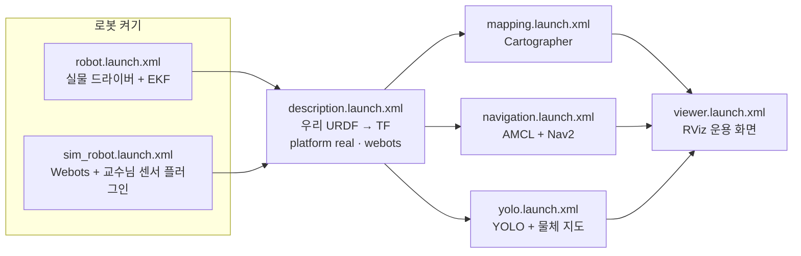

# 시뮬레이션 · 주행 · 운용 화면

Webots 에서 실물과 같은 지도 만들기·Nav2·인식을 돌리는 구조와, 그 위에서 정한 Nav2 설정·운용 화면. 맵과 물체는 [sim/webots/README.md](../sim/webots/README.md), 인식 성능은 [benchmarks](benchmarks/README.md).

## 구조: 실물과 다른 것은 로봇 켜기 하나



- 교수님 센서 플러그인(`webots_ros2_limo`)이 실물과 같은 토픽·프레임으로 `/scan` `/imu` `/odom` `/camera/*` 와 `odom → base_link`(실물은 EKF), 카메라 프레임 TF(실물은 Orbbec 드라이버)를 낸다. 그래서 그 뒤 launch 는 실물과 같은 것을 쓴다.
- 로봇 모델 TF 는 실물과 같은 우리 URDF. 실물과 Webots 모델은 카메라 장착 위치만 달라서 `platform` 인자로 고른다.
- 교수님 `robot_launch.py` 대신 Webots·드라이버를 직접 띄운다. 교수님 launch 는 드라이버가 로봇 모델을 1 초만 기다려 넘겨 두 번에 한 번꼴로 TF 가 안 나왔다.
- 시뮬 차이는 인자와 덮어쓰기 파일로만 준다. `nav2_sim.yaml` 에 있는 것:
  - `use_sim_time`: 실물 설정은 False 라 costmap 이 `/clock` 시각 스캔을 버린다.
  - `odom_topic: /odom`: 실물은 EKF 출력(`/odometry/filtered`). 틀리면 컨트롤러가 현재 속도를 0 으로 보고 한 주기 0.125 m/s 까지만 낸다.
  - AMCL 처음 위치 (0, 0, 0): 시뮬 지도는 시작 자리에서 만들어서 시작 자리가 원점이다. 2D Pose Estimate 없이 바로 주행한다.

```bash
ros2 launch limo_fire_bringup sim.launch.xml world:=limo_fire_maze                   # 저장 지도 + AMCL + Nav2
ros2 launch limo_fire_bringup sim.launch.xml world:=limo_fire_maze slam:=true        # 지도 만들기 (Cartographer)
ros2 launch limo_fire_bringup sim.launch.xml world:=limo_fire_maze perception:=true  # + YOLO·물체 지도
ros2 launch limo_fire_bringup sim.launch.xml world:=limo_fire_maze benchmark:=true   # + 인식 벤치마크
```

## Nav2 설정 (`limo_fire_navigation/config/nav2_params.yaml`, 실물·시뮬 공용)

WeGo 값으로 시작했지만 덕트호스 미로에서 막혀 바꿨다. **모두 실물 확인 필요.**

| 항목 | WeGo | 지금 | 까닭 (Webots 에서 확인) |
|---|---|---|---|
| 경로 추종 | DWB (궤적 수백 개 평가, 손튜닝 7 개) | Regulated Pure Pursuit | U 자 구간에서 제자리 좌우 회전만 하다 멈춤. RPP 는 앞쪽 한 점을 따라가고 45° 넘게 틀어지면 먼저 돈다 |
| 전역 경로 | NavFn | Smac 2D | 미로 시작 → 반대편 끝(U 자 두 번)을 "legal potential was found" 로 못 냄 |
| 팽창 반경 | 0.05 · 0.13 m | 0.45 m | 로봇 반경(0.2 m)보다 작아 경로가 벽·문틀에 붙어 부딪히고 SLAM 이 틀어짐 |
| 속도 명령 | 5 Hz | 20 Hz | 컨트롤러(20 Hz)가 계산해도 0.2 초마다 한 번만 나감 |
| 전역 costmap 막힘 문턱 (`lethal_cost_threshold`) | 100 (기본) | 65 | 지도 만들며 주행할 때 Cartographer `/map` 벽 값이 100 이 안 돼(가장 큰 값 87) 전역 costmap 에 지도 벽이 하나도 안 들어갔다. 프론티어 탐사가 라이다 3 m 밖 덕트를 뚫는 경로로 7 분 넘게 맴돌다 65 로 바꾸니 끝까지 감 (2026-11-11) |

맵 4 개 순찰점 전부 도착(미로 13 · 사무실 14 · 창고 13 · 교수님 방 6), 미로 시작 → 반대편 끝 93 초.

지도 만들기는 실물 Cartographer 설정(`cartographer_2d.lua`, IMU 사용)을 그대로 쓴다. 교수님 시뮬 설정은 긴 직선 통로를 두 번 돌면 벽이 두 겹으로 어긋났다.

## 운용 화면 (`limo_fire_description` `viewer.launch.xml` · `rviz/limo_fire.rviz`)

지도 만들기·주행·인식·벤치마크 어디서나 이 화면 하나를 띄운다.

- 왼쪽: YOLO 탐지 영상(분할 마스크 덧칠 + 테두리), 고른 물체 사진(Selected). 오른쪽: 로봇 중심 지도, 물체 아이콘·현황판, Nav2 경로, AMCL 입자. costmap 은 Displays 에서 켠다.
- 툴바 도구:
  - **2D Pose Estimate**: 로봇 위치를 다시 잡는다 (AMCL)
  - **2D Goal Pose**: 누르고 끌어 목표와 방향을 준다 (Nav2)
  - **Publish Point**: 지도 위 물체 아이콘을 누르면 그 물체가 가장 크고 확실하게 찍힌 사진이 Selected 에 뜬다(흰 고리, 현황판에 정보). 빈 곳을 누르면 해제
- 도구를 쓴 뒤 지도를 움직이려면 Move Camera 로 돌아간다.
- 물체 아이콘·이름표는 화면 각도(`object_mapper` `view_angle`)에 맞춰 놓인다. RViz 위에서 보기 Angle 을 바꾸면 같이 바꾼다.
- 화면 갱신은 10 fps. 모니터 출력을 끈 Jetson 에서는 RViz 가 쉬지 않고 다시 그려 CPU 를 106 % 썼다(10 fps 로 76 %).

## 알려진 것

- 덕트호스(지름 0.30 m, 아래 "덕트호스 미로")는 라이다·깊이 카메라 모두에 벽으로 잡힌다. 팔레트는 라이다가 맨 아래 팔레트 다리 사이를 지나가 점으로만 보인다 — 팽창 반경으로 막힌 곳이 된다.
- 시뮬 불·연기는 사진 그림판이라 YOLO 가 거의 못 잡는다 ([benchmarks](benchmarks/README.md)). 불 대응 흐름은 시뮬에서 불 위치를 직접 주거나 실물로 시험한다.
- 시뮬은 실시간의 약 0.7 배, 카메라 약 20 장/초.

## ROS 2 Jazzy PC 에서 돌리기

팀 기준 환경은 Humble(로봇 Jetson)이다. Jazzy(Ubuntu 24.04) 개발 PC 에서 시뮬을 돌리려면 아래가 더 필요하다 (2026-11-13 확인).

| 무엇 | 까닭 | 할 일 |
|---|---|---|
| Webots 기본 물체 파일 | 월드가 `webots://projects/...` 를 설치본에서 읽는데 deb 설치본(R2025a)에는 `.proto` 가 없다 → 바닥·벽이 빠지고 로봇이 떨어짐(창은 회색·검은 화면) | `git clone --depth 1 --branch R2025a --filter=blob:none --sparse https://github.com/cyberbotics/webots.git` → `git sparse-checkout set projects/objects projects/appearances projects/humans projects/default` → `sudo rsync -a <clone>/projects/ /usr/local/webots/projects/` (약 640 MB) |
| `WEBOTS_HOME` | `env.sh` 는 Humble 을 불러오므로 쓰지 않는다 | `export WEBOTS_HOME=/usr/local/webots` |
| 빌드 | 실물 드라이버·YOLO(CUDA) 는 빌드되지 않는다 | `colcon build --packages-up-to limo_fire_bringup limo_fire_bt limo_fire_sim webots_ros2_limo --packages-ignore limo_fire_perception ydlidar_ros2_driver orbbec_camera orbbec_camera_msgs orbbec_description robot_localization limo_fire_base limo_fire_esp32_bridge dl_ros2_application dl_ros2_msgs lift_ctr wego wego_2d_nav wego_msgs limo_ros2_application` |

판마다 다른 설정은 파일로 나눴다 (Humble 동작은 그대로):
- Nav2: `navigation.launch.xml` 이 `nav2_params.yaml` 다음에 `nav2_$ROS_DISTRO.yaml` 을 읽는다. Jazzy 는 플러그인 이름 `::`, BT 플러그인 목록을 적지 않음(Humble 목록은 `nav2_humble.yaml`), BT 파일 경로, `/cmd_vel` TwistStamped, 초음파 층 뺌(초음파 없는 월드에서 제어 루프 3~4 Hz 로 떨어짐 — Humble 은 확인 안 함).
- 바퀴 구동: Jazzy 의 controller_manager 는 하드웨어 설명을 `/robot_description` 에서 읽으므로 webots 판 URDF 에 ros2_control 블록(`webots_control.xacro`)을 둔다. 속도 입력은 Humble `~/cmd_vel_unstamped`, Jazzy `~/cmd_vel`(TwistStamped) 둘 다 `/cmd_vel` 로 잇는다.

## 덕트호스 미로 (`limo_fire_maze`) 너비

덕트호스 지름은 **0.30 m** — LIMO Pro 전체 높이 0.251 m([AgileX LIMO Pro 사양](https://global.agilex.ai/products/limo-pro) 322 × 220 × 251 mm,
`limo_pro_base.xacro` 머리 주석과 같음)보다 크게 해서 라이다(0.111 m)·깊이 카메라 광축(0.188 m, `limo_fire.urdf.xacro`) 둘 다 막힌 벽으로 본다.
실제 시연장 호스 지름은 아직 안 쟀다(잠정). 두 줄 가운데는 y −1.425 · 0.575, 길이 6.8 m 그대로.

Nav2 값(`nav2_params.yaml`): 전역 `robot_radius` 0.20 m, 지역 발자국 0.32 × 0.22 m + 여유 0.02, 팽창 0.45 m.
"로봇 중심이 설 수 있는 폭" = 너비 − 2 × 0.20, "비용 0 인 폭" = 너비 − 2 × 0.45.

| 곳 | 너비 (m) | 설 수 있는 폭 | 비용 0 폭 | 옛 너비 (지름 0.15) |
|---|---|---|---|---|
| 남 통로 (y −3 ~ −1.575) | 1.425 | 1.025 | 0.525 | 1.425 |
| 　그중 상자 옆 (상자 0.6 m 위 ~ 덕트) | 0.775 | 0.375 | 없음 (가운데 비용 약 143) | 0.775 |
| 동쪽 꺾임 틈 (x 2.8 ~ 4) | 1.2 | 0.8 | 0.3 | 1.2 |
| 가운데 통로 (y −1.275 ~ 0.425) | 1.70 | 1.30 | 0.80 | 1.85 |
| 　그중 라바콘 옆 (몸통 반지름 약 0.1 m, Webots `TrafficCone`) | 1.30 · 1.275 | 0.90 · 0.875 | 0.40 · 0.375 | 1.375 · 1.425 |
| 서쪽 꺾임 틈 (x −4 ~ −2.8) | 1.2 | 0.8 | 0.3 | 1.2 |
| 북 통로 (y 0.725 ~ 3) | 2.275 | 1.875 | 1.375 | 2.425 |

상자 옆 남 통로가 가장 좁은 곳이고 옛 미로와 같은 너비로 두었다(남쪽 줄의 남쪽 면을 그대로). 가운데 통로의 라바콘 둘(y −0.975)은 옛 미로처럼
통로 가운데에서 0.55 m 떨어지게 옮겼고, 가운데 통로 순찰점 넷도 통로 가운데(y −0.45)로 옮겼다. 다른 순찰점은 그대로(모두 덕트 면에서 0.4 m 넘게 떨어짐).
라바콘 바닥판(0.5 × 0.5 m, 높이 1.5 cm)은 라이다에 안 보인다. 라바콘을 덕트와 같이 0.15 m 옮기고 순찰점을 그대로 둔 첫 판은 가운데 통로
라바콘 옆에서 두 번 포기해 9 / 13 이었다(원인은 안 쟀다). 지금 배치로 바꾼 뒤 아래처럼 13 / 13.

확인 (2026-11-11, 이 PC Webots R2025a 를 화면 없이(Xvfb + Mesa 소프트웨어 렌더링, 시뮬 약 0.55 배속) — 젯슨에서는 아직 안 돌림):

| 확인 | 결과 |
|---|---|
| `/scan` (시작 자리, 왼쪽 빔 0.2 ~ 1.92 rad) | 111 / 111 빔이 덕트 면(±6 cm)에서 끝남, 앞뒤 3.6 m 에 빈틈 없음 |
| 깊이 카메라 (덕트를 보게 돌림) | 광축 높이 행 628 / 628 픽셀이 덕트 면에서 끝남. 덕트 점은 바닥 ~ 약 0.29 m |
| Cartographer 지도 (`slam:=true`) | 두 줄 모두 끊김 없는 벽(바깥 면 두 줄 + 안은 모름). 이 지도로 `maps/sim/limo_fire_maze` 를 다시 저장 |
| 순찰 `nav_benchmark` (`slam:=true`) | **13 / 13**, 평균 도착 오차 0.25 m (전역 막힘 문턱 100 · 65 둘 다). 프론티어 탐사를 끝낸 자리(북 통로)에서 바로 돌린 판은 첫 목표만 시간 초과로 12 / 13 — 가운데 통로 서쪽 라바콘 근처에서 진척 없음, 원인은 안 쟀다 |
| 순찰 `nav_benchmark` (새 저장 지도 + AMCL) | **13 / 13**, 평균 도착 오차 0.25 m, 가장 큰 추정 오차 0.22 m |

## 독립 MuJoCo 발사·표적 데모

[sim/mujoco_ball_mvp](../sim/mujoco_ball_mvp/)에는 공 발사와 힌지 표적 전도 장면 및 GUI 녹화가 있다. sim/은 COLCON_IGNORE 대상이며, 이 데모는 ROS 2 토픽·Nav2·임무 BT에 연결되지 않은 독립 실행 프로그램이다. LIMO는 현재 시각 메시일 뿐 이동 베이스나 센서 시뮬레이션은 아니다. 따라서 ROS 2 주행·탐지 통합 검증에는 계속 Webots를 사용한다.

전도 성공 판정은 표적 기울기 45° 이상을 0.20초 유지하는 조건이다. 설치와 실행은 [데모 README](../sim/mujoco_ball_mvp/README.md)를 따른다.
