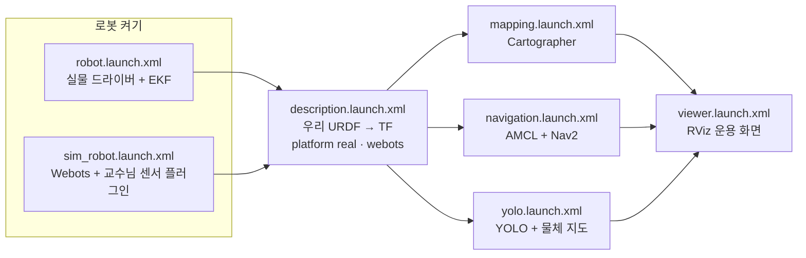

# 시뮬레이션 · 주행 · 운용 화면

Webots 에서 실물과 같은 지도 만들기·Nav2·인식을 돌리는 구조와, 그 위에서 정한 Nav2 설정·운용 화면. 맵과 물체는 [sim/webots/README.md](../sim/webots/README.md), 인식 성능은 [benchmarks](benchmarks/README.md).

## 구조: 실물과 다른 것은 로봇 켜기 하나



- 교수님 센서 플러그인(`webots_ros2_limo`)이 실물과 같은 토픽·프레임으로 `/scan` `/imu` `/odom` `/camera/*` 와 `odom → base_link`(실물은 EKF), 카메라 프레임 TF(실물은 Orbbec 드라이버)를 낸다. 그래서 그 뒤 launch 는 실물과 같은 것을 쓴다.
- 로봇 모델 TF 는 실물과 같은 우리 URDF. 실물과 Webots 모델은 카메라 장착 위치만 달라서 `platform` 인자로 고른다.
- 교수님 `robot_launch.py` 대신 Webots·드라이버를 직접 띄운다. 교수님 launch 는 드라이버가 로봇 모델을 1 초만 기다려 넘겨 두 번에 한 번꼴로 TF 가 안 나왔다.
- 시뮬 차이는 인자와 덮어쓰기 파일로만 준다. `nav2_sim.yaml` 에 있는 것:
  - `use_sim_time`: 실물 설정은 False 라 costmap 이 `/clock` 시각 스캔을 버린다.
  - `odom_topic: /odom`: 실물은 EKF 출력(`/odometry/filtered`). 틀리면 컨트롤러가 현재 속도를 0 으로 보고 한 주기 0.125 m/s 까지만 낸다.
  - AMCL 처음 위치 (0, 0, 0): 시뮬 지도는 시작 자리에서 만들어서 시작 자리가 원점이다. 2D Pose Estimate 없이 바로 주행한다.

```bash
ros2 launch limo_fire_bringup sim.launch.xml world:=limo_fire_maze                   # 저장 지도 + AMCL + Nav2
ros2 launch limo_fire_bringup sim.launch.xml world:=limo_fire_maze slam:=true        # 지도 만들기 (Cartographer)
ros2 launch limo_fire_bringup sim.launch.xml world:=limo_fire_maze perception:=true  # + YOLO·물체 지도
ros2 launch limo_fire_bringup sim.launch.xml world:=limo_fire_maze benchmark:=true   # + 인식 벤치마크
```

## Nav2 설정 (`limo_fire_navigation/config/nav2_params.yaml`, 실물·시뮬 공용)

WeGo 값으로 시작했지만 덕트호스 미로에서 막혀 바꿨다. **모두 실물 확인 필요.**

| 항목 | WeGo | 지금 | 까닭 (Webots 에서 확인) |
|---|---|---|---|
| 경로 추종 | DWB (궤적 수백 개 평가, 손튜닝 7 개) | Regulated Pure Pursuit | U 자 구간에서 제자리 좌우 회전만 하다 멈춤. RPP 는 앞쪽 한 점을 따라가고 45° 넘게 틀어지면 먼저 돈다 |
| 전역 경로 | NavFn | Smac 2D | 미로 시작 → 반대편 끝(U 자 두 번)을 "legal potential was found" 로 못 냄 |
| 팽창 반경 | 0.05 · 0.13 m | 0.45 m | 로봇 반경(0.2 m)보다 작아 경로가 벽·문틀에 붙어 부딪히고 SLAM 이 틀어짐 |
| 속도 명령 | 5 Hz | 20 Hz | 컨트롤러(20 Hz)가 계산해도 0.2 초마다 한 번만 나감 |

맵 4 개 순찰점 전부 도착(미로 13 · 사무실 14 · 창고 13 · 교수님 방 6), 미로 시작 → 반대편 끝 93 초.

지도 만들기는 실물 Cartographer 설정(`cartographer_2d.lua`, IMU 사용)을 그대로 쓴다. 교수님 시뮬 설정은 긴 직선 통로를 두 번 돌면 벽이 두 겹으로 어긋났다.

## 운용 화면 (`limo_fire_description` `viewer.launch.xml` · `rviz/limo_fire.rviz`)

지도 만들기·주행·인식·벤치마크 어디서나 이 화면 하나를 띄운다.

- 왼쪽: YOLO 탐지 영상(분할 마스크 덧칠 + 테두리), 고른 물체 사진(Selected). 오른쪽: 로봇 중심 지도, 물체 아이콘·현황판, Nav2 경로, AMCL 입자. costmap 은 Displays 에서 켠다.
- 툴바 도구:
  - **2D Pose Estimate**: 로봇 위치를 다시 잡는다 (AMCL)
  - **2D Goal Pose**: 누르고 끌어 목표와 방향을 준다 (Nav2)
  - **Publish Point**: 지도 위 물체 아이콘을 누르면 그 물체가 가장 크고 확실하게 찍힌 사진이 Selected 에 뜬다(흰 고리, 현황판에 정보). 빈 곳을 누르면 해제
- 도구를 쓴 뒤 지도를 움직이려면 Move Camera 로 돌아간다.
- 물체 아이콘·이름표는 화면 각도(`object_mapper` `view_angle`)에 맞춰 놓인다. RViz 위에서 보기 Angle 을 바꾸면 같이 바꾼다.
- 화면 갱신은 10 fps. 모니터 출력을 끈 Jetson 에서는 RViz 가 쉬지 않고 다시 그려 CPU 를 106 % 썼다(10 fps 로 76 %).

## 알려진 것

- 덕트호스(지름 0.15 m)는 라이다(높이 0.111 m)에 선으로 잘 잡힌다. 팔레트는 라이다가 맨 아래 팔레트 다리 사이를 지나가 점으로만 보인다 — 팽창 반경으로 막힌 곳이 된다.
- 시뮬 불·연기는 사진 그림판이라 YOLO 가 거의 못 잡는다 ([benchmarks](benchmarks/README.md)). 불 대응 흐름은 시뮬에서 불 위치를 직접 주거나 실물로 시험한다.
- 시뮬은 실시간의 약 0.7 배, 카메라 약 20 장/초.
