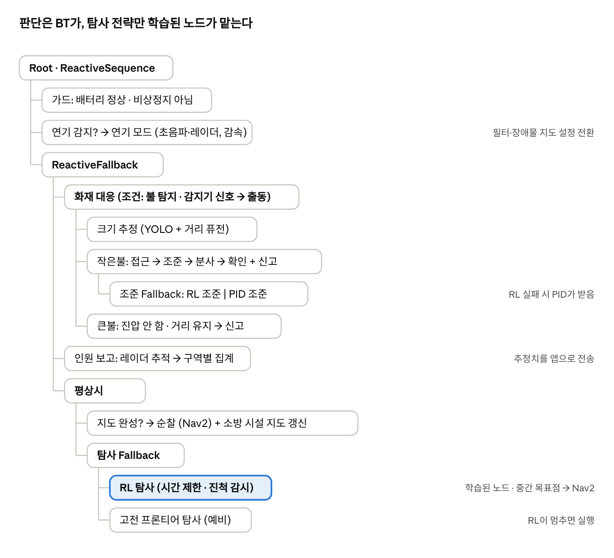

# LIMO Pro 화재 대응 로봇 — 스펙과 구현 방향

2026-10-22 · 김주영 · 부품 목록: [parts.md](parts.md)

## 하드웨어 구성

AgileX LIMO Pro 기본 센서(라이다, depth 카메라, IMU, 바퀴 엔코더)에 ESP32로 제어하는 소화·감지 모듈을 올린다. 추가 부품비 합계 95,127원(구매요청서 마감 10/22). 모듈별 실측 스펙은 [hardware.md](hardware.md).

| 부품 | 역할 | 비고 |
| --- | --- | --- |
| 열화상 GY-MCU90640 (MLX90640 BAB 55°, 32×24) | 작은불 실제 열원 확인 | 최대 300°C, UART |
| 레이더 HLK-LD2450 (24GHz) | 연기 속 사람 위치 | 최대 3명, 정지한 사람 약함, 256000baud |
| 초음파 HC-SR04 × 최대 3 (아두이노 키트) | 연기 속 장애물, 위치 보정 | 5V → Echo에 전압 분배, 하나씩 순서대로 트리거 |
| 서보 DS3218 PRO 20kg (틸트) + MG996R (팬) | 노즐 조준 | 순간 2~3A씩 |
| 펌프 DP-521 12V (0.48MPa, 3.5L/min) | 물 분사 | D4184 MOSFET으로 ON/OFF |
| LM2596 ×3, XL4015 5A, Y분배 케이블 | 전원 | 아래 확인 사항 |
| 스피커 | 음성 안내 | 미구매. LIMO Pro 내장 여부 확인 |

전원 확인 사항:

- [ ] 전원이 12V면 XL4015로 펌프용 12V를 만들 수 없음(강압은 입력 > 출력 + 약 2V) → 12V → D4184 → 펌프 직결, XL4015는 6V 서보 전용으로
- [ ] 서보 전원 단에 470~1000µF 커패시터
- [ ] 펌프 양단 플라이백 다이오드(1N5819 등), 모든 GND 공통
- [ ] 펌프·호스 아래 전자부품 방수, 물탱크·호스·노즐·ESP32 보유 확인

## 시스템 구조

임무와 판단은 Nav2의 BT(BehaviorTree.CPP v3) 플러그인으로 만들고, RL은 탐사와 조준의 잎 노드로만 넣는다. 학습이 실패하거나 시간을 넘기면 Fallback이 고전 방식으로 전환한다.

| 모드 | 언제 | 방법 | 주요 센서 |
| --- | --- | --- | --- |
| ① 첫 지도 만들기 | 처음 한 번 (평상시) | RL 탐사 | 라이다, depth, 카메라 |
| ② 점검·순찰 | 매일 밤 | Nav2 경로 계획 (만든 지도 위) | 라이다, 카메라 |
| ③ 화재 대응 | 화재 시 | Nav2 + 초음파로 다시 계획 | 초음파, 레이더, 열화상 |



ROS 통신은 연속 센서 데이터는 Topic, 크기 판단 같은 단발 질의는 Service, 탐사·조준·주행처럼 오래 걸리는 동작은 Action으로 나눈다. RL 정책은 Action 서버 노드로 감싸고 BT는 호출만 한다. ESP32는 열화상·레이더·초음파·서보·펌프를 맡고 LIMO와 시리얼로 통신한다.

**출동 트리거**: 순찰 중 직접 발견하거나, 건물 화재 감지기 신호를 받으면 그 감지기 위치를 Nav2 목표로 출동한다. 감지기 위치도 소방 시설 지도에 등록해 둔다. 시연에서는 감지기 신호를 ESP32 버튼이나 연기 센서로 흉내 내 ROS Topic으로 보낸다.

**신고 규칙**: 불을 확인하면 크기와 상관없이 즉시 소방당국에 신고한다. 작은불 진압은 신고를 대신하지 않고, 진압 결과를 후속 보고로 보낸다.

## 강화학습 탐사 (첫 지도 만들기)

강화학습은 "어디를 어떤 순서로 볼지"만 배우고, 주행과 충돌 회피는 Nav2 컨트롤러가 맡는다. 연기 없는 평상시에만 돈다.

**행동**: 0.5~1초마다 로봇 기준 중간 목표점(방향, 거리)을 출력한다. 예시로 방향 16개 × 거리 3단계(0.5·1·2m) = 48개 중 하나. 도착 전에 다음 목표점으로 갱신해 멈추지 않고 이어서 달린다. 장애물 안에 찍히면 가장 가까운 빈 칸으로 옮기고 약하게 감점한다.

**상태**: 카메라 원본 대신 로봇이 쌓은 지도를 로봇 중심·방향 기준 격자 이미지로 준다. 카메라 정보는 depth와 YOLO 결과(의미 채널)로 넣는다.

| 입력 | 내용 |
| --- | --- |
| 가까운 지도 64×64 (10cm 칸, 주변 6.4m) | 채널: 장애물, 빈 공간, 안 본 곳, 덮은 정도, 지나간 횟수 |
| 먼 지도 32×32 (축소) | 같은 채널, 맵 전체 개관 |
| depth 이미지 | 2.5D 광선 투사로 학습 환경에서 생성 |
| 의미 채널 | YOLO·SigLIP으로 찾은 소화기·출구·불 위치 (학습 시 정답 + 노이즈) |
| 숫자 벡터 | 현재 속도, 직전 목표점, 남은 시간, 전체 덮은 비율 |

**덮음의 정의**: 복셀(또는 바닥 기준 2D 칸)에 3m 이내에서 찍힌 점이 N개 이상(또는 N프레임 이상 관측)이면 덮음. 분모는 갈 수 있는 곳에서 보일 수 있는 복셀만이다. 장애물 뒤는 경로 입장에서 벽이므로 목표에서 빠진다.

| 보상 항목 | 내용 | 노리는 것 |
| --- | --- | --- |
| 새로 덮은 복셀 (+) | 이번 스텝에 기준을 넘긴 복셀 수 | 기본 탐사 |
| 구멍 (−) | 덮인 칸에 둘러싸인 미달 목표 복셀 덩어리 | 빈 곳 없이 |
| 완료 보너스 (++) | 목표 복셀 95~100% 도달 시 큰 보상 + 남은 시간 비례 | 끝까지 마무리 |
| 재방문 (−) | 이미 지난 칸을 다시 지나면 횟수 비례 | 끊김 없이 |
| 시간 (−) | 매 스텝 조금씩 | 빠르게 |
| 정지·제자리 회전 (−) | 멈칫거림 | 끊김 없이 |
| 충돌 (−) | | 안전 |

**학습 환경**: 이 과제 전용 GPU 환경을 새로 만들고 PPO·학습 뷰어(trainview)는 robot-agent에서 가져온다.

- 덕트호스 통로·박스·라바콘 맵을 수천 개 자동 생성, 방 구조·넓은 홀도 섞음. 크기는 시연장(약 6×8m 추정) 기준 1~3배
- 목표점 추종기의 속도·가속 제한을 Webots에서 잰 LIMO + Nav2 값에 맞춤
- 위치 추정 오차, 센서 노이즈, 장애물 위치를 무작위로 흔듦

**검증 단계**: GPU 학습 맵 → GPU 처음 보는 맵 → Webots + 실제 Nav2(통합) → Isaac Sim(센서·물리) → 실제 LIMO. 단계마다 같은 지표로 잰다.

| 시뮬레이터 | 쓰는 곳 |
| --- | --- |
| 직접 만드는 2.5D GPU 환경 | RL 학습(수천 개 병렬) |
| Isaac Sim 4.5 + WeGo LIMO USD | 실제와 비슷한 센서·물리 검증 |
| Webots(교수님 환경) | Nav2·SLAM·BT 통합 검증, 실제 LIMO 와 같은 토픽·프레임 |

## 불 탐지와 작은불·큰불 판단

YOLO(RGB)가 주 탐지기다. 인쇄한 큰불은 열이 없어 열화상에 안 잡히므로, 열화상은 작은불에 물을 쏘기 전 실제 열원을 확인하는 마지막 단계로 쓴다.

박스 크기만으로는 거리에 따라 달라져 판단할 수 없다. 거리를 구해 실제 크기를 계산한다.

```latex
\text{실제 폭 (m)} \approx \frac{\text{박스 폭 (px)} \times \text{거리 (m)}}{\text{초점거리 (px)}}
```

거리는 아래 순서로 구하고, 앞의 것이 안 되면 다음으로 넘어간다.

1. **depth 카메라**: 불꽃 자체는 값이 비거나 뒤 벽이 잡히므로, 박스 아래쪽(초·받침)의 유효 픽셀 중앙값을 쓴다
2. **라이다**: 박스 좌우 각도에 해당하는 빔의 거리. 2D라 한 높이만 보므로 보조용
3. **바닥 평면 가정**: 카메라 높이 + IMU 기울기로 박스 아래쪽 끝 픽셀에서 거리를 역산. 벽에 붙은 불에는 틀림

실제 폭이 기준값(예: 20~30cm) 이하면 작은불, 넘으면 큰불. 기준값은 시연용 인쇄 불 크기를 정한 뒤 확정한다. 큰불에는 물을 쏘지 않으므로 인쇄 불은 젖지 않는다.

## 계단·낙하 방지

LIMO 라이다는 바닥 위 0.111 m 를 수평으로만 보므로 **내려가는 계단·단차는 라이다에 잡히지 않는다**. 두 겹으로 막는다.

| 층 | 방법 | 역할 |
| --- | --- | --- |
| 1 | YOLO `stairs` 클래스 | 멀리서 알아보고 소방 시설 지도에 진입 금지 구역으로 등록 — 다음 순찰부터 경로에서 빠짐, 연기 속에서도 지도로 피함 |
| 2 | depth 낭떠러지 감지 | depth 점 중 바닥 평면보다 아래로 떨어지는 곳을 Nav2 장애물 지도에 표시 — 학습 모델이 놓쳐도 동작하는 최종 안전장치 |

## 조준

첫 시도는 강화학습이다(탑건 챌린지 1° 조준콘 사격 경험 활용). 방식 세부는 미정이고, 아래는 정해진 틀이다.

- **입력**: YOLO 불 박스(칼만필터로 불꽃 떨림과 로봇 움직임 보정), 불까지 거리, 현재 팬·틸트 각도
- **출력**: 팬(MG996R)·틸트(DS3218) 각도 변화
- **핵심 난제**: 거리가 멀수록 물줄기가 떨어져 더 들어 쏴야 함. 거리별 틸트 보정을 배우는 것이 RL의 몫
- **비교 대상**: 화면 오차 PID(visual servoing) + 거리별 보정표. RL이 실패하면 BT Fallback으로 이쪽이 받음
- **지표**: 명중률, 촛불 소화까지 시간, 물 사용량

미정: 카메라를 노즐과 같이 팬·틸트 위에 올릴지(화면 중앙 맞추기만 하면 됨), 몸체에 고정할지(카메라–노즐 캘리브레이션 필요).

## 연기 모드

연기 속에서는 라이다를 덜 쓰고, 저장된 지도 + 초음파 + 레이더로 움직인다. 레이더(LD2450)는 정지 물체를 걸러내므로 장애물 센서가 아니라 사람 탐지 전용이다. BT가 연기를 감지하면 필터·장애물 지도 설정을 바꾸고 속도를 낮춘다.

| 역할 | 방법 |
| --- | --- |
| 위치 추정 (기본) | 바퀴 오도메트리(거리) + IMU(방향), robot_localization EKF |
| 위치 보정 1 | 초음파 3개 거리 → 점 몇 개짜리 스캔 → AMCL. 약 15° 원뿔 폭에 점을 여러 개 찍고 측정 노이즈를 크게 |
| 위치 보정 2 | 가까운 연기 반사를 걸러낸 라이다(`laser_filters`) |
| 경로 계획 | 저장된 지도 위 Nav2 |
| 새 장애물 → 다시 계획 | 초음파를 Nav2 장애물 지도(range sensor layer)에 넣어 자동 우회. 우회 불가 시 BT 복구 노드(후진 → 다른 목표 → 보고) |
| 막힌 통로 보고 | 우회한 위치를 소방당국 보고에 포함 |

IMU만으로는 위치를 못 구한다. 가속도 오차 0.01m/s²만 있어도 두 번 적분하면 1분 뒤 약 18m가 틀어지기 때문이다. 오도메트리 + IMU만으로 충분한지는 시연 경로 주행 후 도착 오차를 재서 정한다(통로 여유 20~30cm 기준).

시연에서는 실제 연기 대신 라이다·카메라 토픽에 노이즈를 섞거나 끊는 센서 열화 주입 노드를 쓴다. Webots 실험에도 같은 노드를 쓴다.

## 인원 집계

같은 사람을 두 번 세지 않는 것이 핵심이다. 구역별 인원은 추정치로 보고하고, 마지막 확인 시각을 함께 보여준다.

| 상황 | 같은 사람 판단 |
| --- | --- |
| 연기 짙음 (레이더만) | 지도 좌표 + 칼만필터 추적, 예측 위치 근처(걸을 수 있는 거리)면 같은 사람 |
| 연기 옅음·평상시 (카메라 가능) | 위 방법 + 사람 재식별 임베딩(OSNet 등) 코사인 유사도로 가려졌다 나타난 사람을 이어 붙임 |

- **로봇 움직임 보정**: 레이더 좌표를 로봇 위치로 지도 좌표로 바꾼 뒤 추적
- **유령 필터**: 저장된 지도에서 벽·장애물 안에 찍힌 점은 버리고, 몇 프레임 연속으로 잡혀야 사람으로 인정
- **정지 유지 규칙**: 안 보인다고 지우지 않는다. 레이더 시야에 넣었는데 비어 있을 때만 지운다. 앱에는 "움직임 없음 (요구조자 가능성)"으로 표시
- **구역 판단**: 추적 대상이 지도에 미리 그린 구역 다각형 중 어디 있는지로 집계
- **한계 명시**: LD2450은 한 화면 최대 3명. 구역에 3명이 잡히면 "3명 이상"으로 표시

## 보고 앱과 음성 안내

소방당국에는 앱으로 지도와 상황을, 건물 안 사람에게는 음성으로 소화기·비상구 위치를 전달한다.

**보고 앱 (웹)**: `rosbridge_suite`로 브라우저에서 ROS 토픽을 받는다. 설치 없이 폰·노트북에서 열리고, 시연 때 심사위원이 QR로 연다.

- 지도, 로봇 현재 위치
- 불 위치와 상태(작은불 진압 완료 / 큰불 진행 중, 추정 크기)
- 구역별 인원 추정치 + 마지막 확인 시각 + 움직임 없음 표시
- 소화기·비상구 위치, 막힌 통로
- 사건 기록(시각별 발견 내용)

**음성 안내**: 인터넷이 없는 상황을 가정해 미리 녹음하거나 오프라인 TTS로 만든 문장에 숫자·방향만 끼워 넣는다.

- **비상구**: 레이더로 근처에 사람이 잡히면 가장 가까운 비상구까지 Nav2 경로를 계산하고, 로봇이 그 방향으로 몸을 돌려 "제가 바라보는 방향으로 가세요"라고 안내
- **소화기**: 작은불 근처에 사람이 있으면 가장 가까운 소화기 위치를 안내
- 미정: 사람을 발견했을 때만 할지, 이동 중 주기적으로도 방송할지

## 실험 계획과 미정 사항

운용강건성 점수는 "시험 결과로 보여주었는가"를 본다. 기능마다 비교 대상과 지표를 정해 두고, 학습 맵과 시험 맵을 분리하고 시드 여러 개로 평균·편차를 보고한다.

| 실험 | 비교 | 지표 |
| --- | --- | --- |
| 탐사 | 가장 가까운 프론티어 / 정보 이득 프론티어 / RL 바퀴 속도 직접 / **RL 중간 목표점 + Nav2** / BT+RL+Fallback | 덮은 비율 곡선, 95% 도달 시간, 이동거리, 남은 구멍, 충돌, 막혔을 때 회복률 |
| 불 크기 판단 | depth / 라이다 / 바닥 평면 가정 / 퓨전 | 실측 대비 크기 오차, 작은불·큰불 분류 정확도, 조명·거리별 탐지율 |
| 조준 | RL / PID + 보정표 | 명중률, 소화 시간 |
| 연기 위치 추정 | 오도메트리만 / + 초음파 / + 초음파 + 필터 라이다 | 도착 위치 오차, 라이다 열화 정도별 도착 성공률 |
| 인원 집계 | 레이더 원본 / 추적 / 추적 + 지도 필터 + 정지 유지 | 인원 오차, 중복 집계, 유령 수 (1~4명, 움직임/정지, 천으로 가림) |

미정 사항:

- [ ] 조준: RL 세부 방식, 카메라–노즐 배치
- [ ] 복셀 크기와 덮음 기준 N (Webots depth로 측정 후)
- [ ] 작은불·큰불 기준값, 시연용 인쇄 불 크기
- [ ] 전원 소스(LIMO 배터리 / 별도 배터리)와 배선
- [ ] 스피커, 초음파 개수(키트), 물탱크·호스·노즐
- [ ] 음성 안내 시점(발견 시 / 주기적)
- [ ] 조원 수와 역할 분담, 주차별 목표
- [ ] 덕트호스가 LIMO 라이다 높이에 걸리는지
