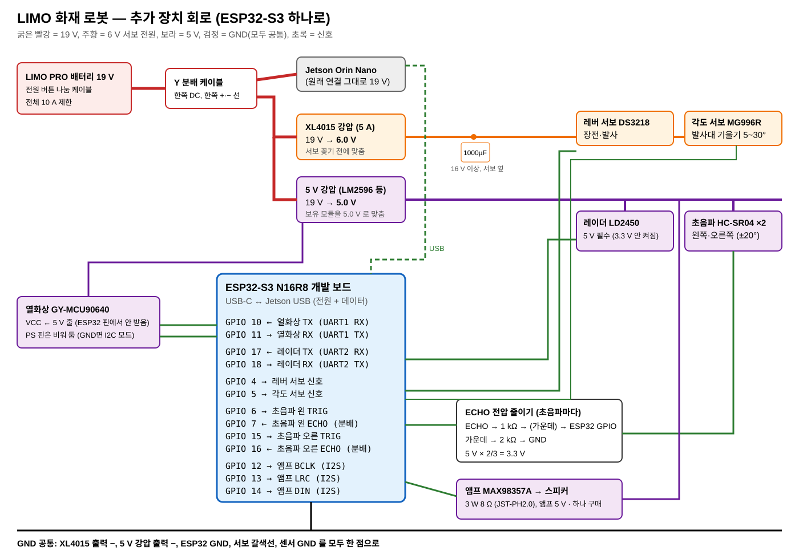
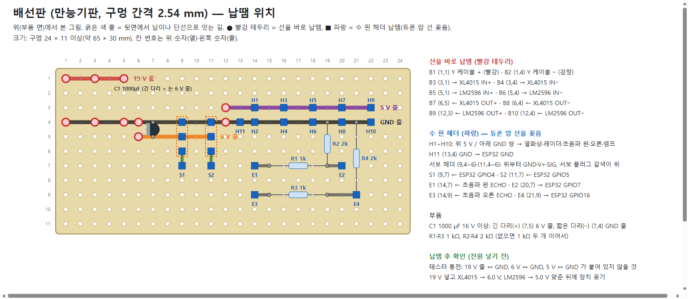

# 추가 장치 배선 (ESP32-S3 하나)

열화상·레이더·초음파 2 개·발사대 서보 2 개·스피커를 ESP32-S3 개발 보드 하나에 모은다. 보드는 USB 로 Jetson 에 꽂아 전원과 데이터를 함께 받고, 서보와 5 V 센서는 LIMO 배터리(19 V)에서 강압해 따로 먹인다. 펌웨어는 아직 실험 단계라 핀은 이 표가 기준이다.



자세한 그림은 [`hardware/wiring/`](../hardware/wiring/) 에 있다.

| 그림 | 파일 | 무엇을 보나 |
|---|---|---|
| 회로도 (KiCad 10) | [limo_sensors.png](../hardware/wiring/limo_sensors.png) · [pdf](../hardware/wiring/limo_sensors.pdf) · 원본 `limo_sensors.kicad_sch` | 핀 단위 연결. ERC 위반 0, 넷리스트로 위 핀표와 맞춤 확인 |
| 배선 (WireViz) | [harness.png](../hardware/wiring/harness.png) · 원본 `harness.yml` | 선 한 가닥씩 색·굵기, 양 끝이 납땜인지 듀폰인지 나사 단자인지 |
| 배선판 납땜 | [board.png](../hardware/wiring/board.png) | 만능기판 구멍마다 무엇을 꽂고 어디를 이어 납땜하는지 |



## 납땜할 곳 (한눈에)

| 곳 | 납땜 | 비고 |
|---|---|---|
| Y 분배 케이블 +·− 선 → 배선판 B1·B2 | 선 2 | 피복 벗긴 끝 |
| 배선판 ↔ XL4015·LM2596 입출력 | 선 8 (양 끝 16 곳) | 0.75 mm² 이상(서보 쪽), 모듈 패드 |
| 배선판 부품 | 헤더 핀 23, 콘덴서 1, 저항 4, 뒷면 줄 잇기 | 배선판 그림대로 |
| 열화상 GY-MCU90640 | 4 핀 헤더 (VIN GND RX TX) | 이미 달려 있으면 생략 |
| 앰프 MAX98357A | 7 핀 헤더 + 나사 단자대 | 받은 그대로는 따로 들어 있음 |
| 스피커 | 납땜 없음 | JST 플러그 잘라 단자대에 나사로 |
| 초음파·서보·ESP32 | 납땜 없음 | 기본 핀·플러그에 듀폰 선 |

## 왜 ESP32-S3 인가 (라즈베리파이 4 와 비교)

| | ESP32-S3 | 라즈베리파이 4 |
|---|---|---|
| 필요한 핀 10 개 | 남는 GPIO 약 20 개 | 충분 |
| 서보 PWM | 하드웨어 PWM, 떨림 없음 | 소프트웨어 PWM 은 떨림 → 서보 드라이버 보드가 더 필요 |
| 초음파 시간 재기(µs) | 정확 | 리눅스 스케줄링으로 흔들림 |
| 전원 | Jetson USB 0.1~0.3 A 로 충분 | 5 V 3 A 를 따로 만들어야 함 |
| 켜지는 시간 | 1 초 안 | 30 초 안팎 |

## 전원

| 줄 | 만드는 곳 | 먹이는 것 | 비고 |
|---|---|---|---|
| 19 V | LIMO 배터리 → 전원 버튼 나눔 케이블 → Y 분배 케이블(5.5×2.1) | 한쪽 DC 플러그 = Jetson(원래대로), 다른 쪽 = 피복 벗긴 +·− 선 → 강압 모듈 둘 | LIMO 전체 10 A 제한 |
| 6.0 V | XL4015(5 A) | 레버 서보 DS3218, 각도 서보 MG996R | 서보 꽂기 전에 출력 6.0 V 맞춤. 서보 옆에 1000 µF(16 V 이상) |
| 5.0 V | 강압 모듈 하나를 5.0 V 로(LM2596 등, 보유) | 레이더 LD2450, 초음파 HC-SR04 ×2, 스피커 앰프 MAX98357A, 열화상 GY-MCU90640 | 합 최대 약 0.75 A(앰프가 크게 울릴 때 0.5 A) → 1 A 이상 모듈. 레이더는 3.3 V 로는 안 켜짐 |
| USB 5 V | Jetson USB | ESP32-S3 보드 | 서보·센서 전원은 여기서 끌어 쓰지 않음 |

- ESP32 보드의 3V3·5V 핀에서는 아무것도 먹이지 않는다(보드 핀 전원이 약하게 나오는 것을 확인). 모든 장치는 강압 모듈에서 받고 ESP32 와는 신호선과 GND 만 잇는다.
- 열화상은 3~5 V 입력이라 5 V 줄에서 받는다. 처음 이을 때 ESP32 에 꽂기 전, 열화상 TX 선의 쉬는 전압이 3.3 V 근처인지 테스터로 한 번 잰다(5 V 가 나오면 ECHO 처럼 저항 분배).
- 피복 벗긴 +·− 선 한 쌍을 강압 모듈 둘(XL4015, 5 V)의 입력에 나눠 물린다. 꼬아 감기 대신 2 칸 단자대·레버 커넥터나 납땜 + 수축 튜브로 잇는다(진동에 풀리면 합선).
- GND 는 전부 한 점으로 묶는다: XL4015 출력 −, 5 V 강압 출력 −, ESP32 GND, 서보 갈색선, 센서 GND.
- 서보 둘이 동시에 멈추면 순간 약 5.5 A — XL4015 5 A 한도 근처라 장전과 각도 바꾸기를 겹치지 않게 명령한다.
- 5 V 줄 모듈은 장치를 꽂기 전에 19 V 를 넣고 테스터로 보며 가변저항을 돌려 5.0 V 로 맞춘다.

## ESP32-S3 핀

| GPIO | 방향 | 연결 | 비고 |
|---|---|---|---|
| 10 | 입력 | 열화상 TX | UART1 RX, 115200 baud (단독 시험과 같음) |
| 11 | 출력 | 열화상 RX | UART1 TX |
| 17 | 입력 | 레이더 TX | UART2 RX, 256000 baud |
| 18 | 출력 | 레이더 RX | UART2 TX |
| 4 | 출력 | 레버 서보 신호 | 발사대 시험 펌웨어와 같음 |
| 5 | 출력 | 각도 서보 신호 | 발사대 시험 펌웨어와 같음 |
| 6 | 출력 | 초음파 왼쪽 TRIG | |
| 7 | 입력 | 초음파 왼쪽 ECHO | 전압 분배 뒤 |
| 15 | 출력 | 초음파 오른쪽 TRIG | |
| 16 | 입력 | 초음파 오른쪽 ECHO | 전압 분배 뒤 |
| 12 | 출력 | 앰프 BCLK | I2S |
| 13 | 출력 | 앰프 LRC(WS) | I2S |
| 14 | 출력 | 앰프 DIN | I2S |

- 남는 핀: 1·2(ADC, 가스 센서 등), 8·9·21·39~42·47.
- 쓰지 않는 핀: 0·3·45·46(부팅 설정), 19·20(USB), 26~32(플래시), 33~37(N16R8 의 PSRAM), 43·44(USB-시리얼), 38·48(보드 RGB LED).
- 열화상 PS 핀은 비워 둔다(GND 에 닿으면 I2C 모드가 되고 UART 가 꺼짐).
- 초음파 두 개는 번갈아 쏜다(동시에 쏘면 서로의 소리를 받음). 측정 주기는 60 ms 이상.

## 스피커

3 W 8 Ω 미니 스피커(JST-PH2.0, 보유)를 I2S 앰프 MAX98357A(하나 구매)로 울린다. 안내 문장은 미리 녹음해 ESP32 플래시(16 MB)에 넣어 두고, Jetson 은 시리얼로 "몇 번 문장 재생" 만 보낸다(인터넷 없이 동작, spec 의 음성 안내 방식). 앰프 SD 핀은 비워 두면 켜진 상태, GAIN 핀은 비워 두면 9 dB.

## 초음파 ECHO 전압 분배

HC-SR04 는 5 V 로 먹이므로 ECHO 가 5 V 로 나온다. ESP32-S3 핀은 3.3 V 까지라 초음파마다 저항 둘로 낮춘다.

```
ECHO ── 1 kΩ ──┬── ESP32 GPIO (7 또는 16)
               2 kΩ          5 V × 2/3 = 3.3 V
               │
              GND
```

2 kΩ 가 없으면 1 kΩ 두 개를 이어 쓴다.

## 다음 할 일

- [ ] 스피커 앰프 MAX98357A 하나 마련
- [ ] `firmware/limo_fire_esp32/include/config.h` 의 초음파 핀(옛 ESP32 기준 3 개)을 위 표(ESP32-S3, 2 개)로
- [ ] 보드·모듈 실제 크기로 LIMO 위 자리 잡기(3D 출력 받침과 함께)
