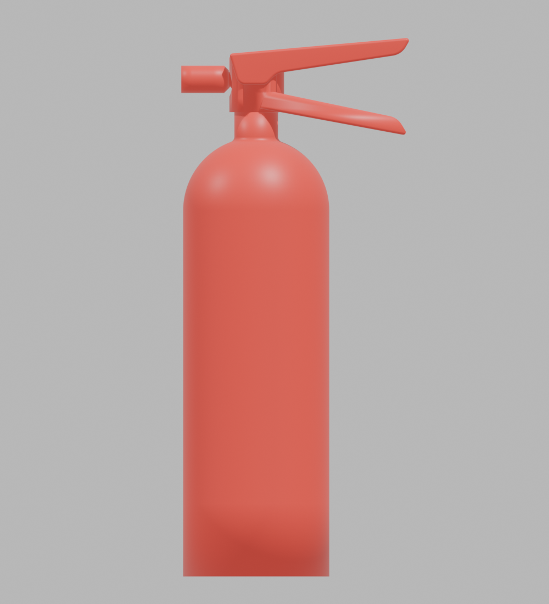

# 소화기 모형 (화재 장면 소품)

화재 시나리오에서 로봇이 소방 시설로 찾는 소화기 모형. 공개 모델을 **65 %** 로 줄여 X2D 로 출력했다.

| 파일 | 크기 (mm) | 비고 |
|---|---|---|
| `shell.stl` | 52 × 52 × 165 | 몸통. 목 안쪽이 암나사 |
| `head.stl` | 36 × 64 × 19 | 손잡이 머리. 꼭지 수나사를 몸통 목에 돌려 끼움 |
| `nozzle.stl` | 10 × 10 × 23 | 노즐. 머리 옆 구멍에 돌려 끼움 |

조립하면 높이 약 19 cm. 나사로 끼우는 구조라 접착제가 필요 없다.

## 출력 설정 (Bambu Lab X2D, 0.4 노즐, PLA)

- 층 0.2 mm, 벽 2, 내부 채움 15 %
- 서포트: 트리(자동), 임계 각도 35°
- 세 부품 한 판, 약 2 시간 33 분
- 몸통·손잡이(머리)·노즐 모두 빨간 PLA 로 뽑는다 (출력한 것과 같은 색)

## 출처·라이선스

- 원본: [Fire Extinguisher — TJ (@TAJ_Prints), Printables 186888](https://www.printables.com/model/186888-fire-extinguisher)
- 라이선스: **CC BY-NC 4.0** (출처 표시, 비상업). 이 폴더의 STL 은 원본을 65 % 로 줄인 것이다.
