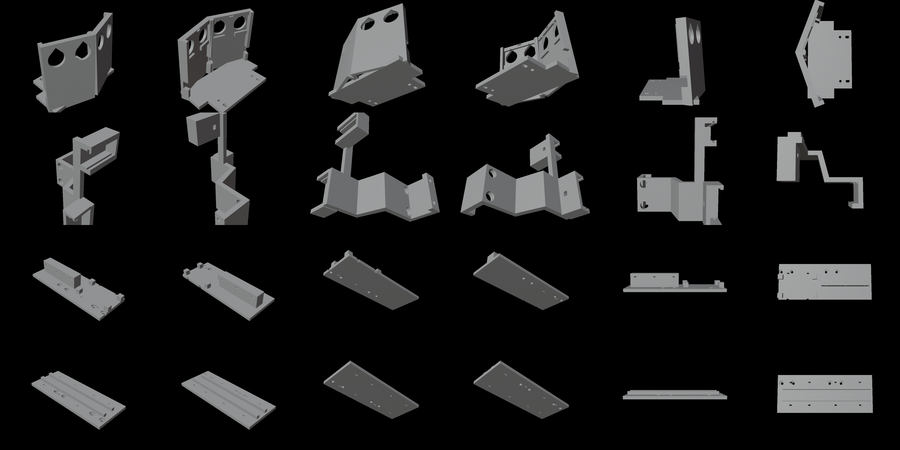

# 센서·전장 고정대 (3D 출력)

LIMO 에 원래 있는 M3 나사 구멍에만 조인다. 원본 모델·검사 스크립트는 3d-modeling 저장소 `LIMO센서/`.

| 파일 | 부품 | 붙는 곳 | 나사 |
|---|---|---|---|
| `print_sonar.stl` | 초음파 받침 (HC-SR04 ×2, 좌우 ±20°·위 5°) | 차체 밑면 앞 구멍 4 | M3×8 ×4 |
| `print_arm.stl` | 열화상(카메라 위)·레이더(카메라 오른쪽) 팔 — 옆으로 눕혀 출력 | 지붕 앞 구멍 2 | M3×5 ×2 |
| `print_pod_right.stl` | 오른쪽 전장 판: ESP32-S3, 배선판(19×11 칸) | 오른쪽 옆판 구멍 4 | M3×5 ×4 |
| `print_pod_left.stl` | 왼쪽 전장 판: XL4015, LM2596 | 왼쪽 옆판 구멍 4 | M3×5 ×4 |

- 모듈은 케이블 타이(폭 3 mm)로 묶는다(약 14 개).
- 검사: LIMO 메시·발사대(5~30°)·센서 실물 부피와 겹침 0, 공이 날아가는 길과 29.6 mm 이상, 라이다·카메라 시야 밖.
- 카메라 각도는 팔을 달기 전에 맞춘다(팔이 카메라 위 1.9 mm 로 지나감).

