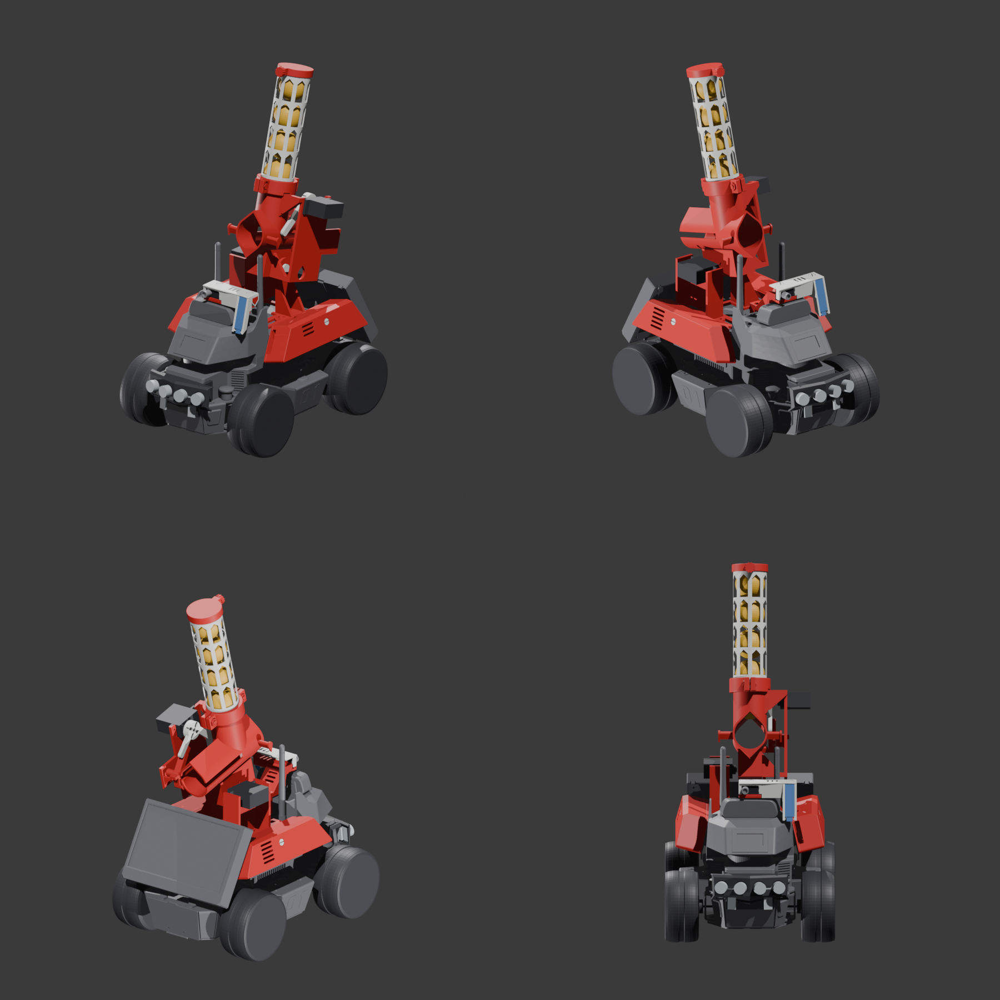
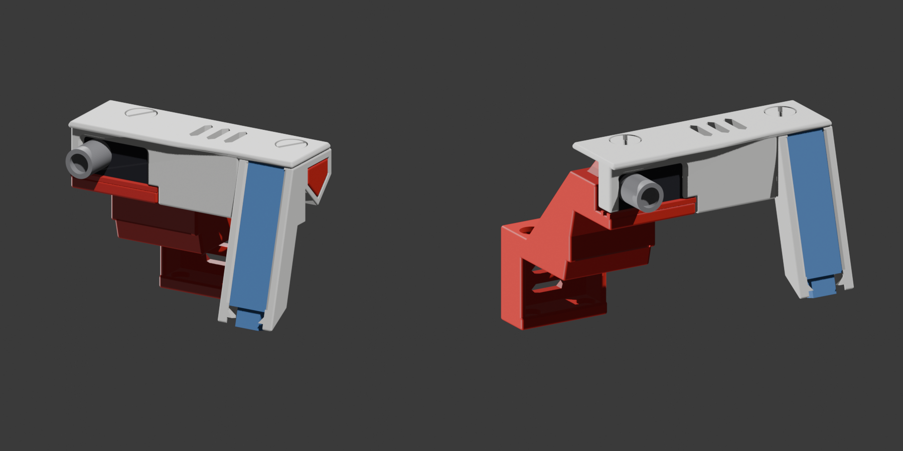

# 센서·전장 고정대 (3D 출력)

LIMO 에 붙는 곳은 LIMO 에 원래 있는 M3 나사 구멍에 금속 M3 로, 출력물끼리는 출력 M5 볼트로 잠근다. 초음파 막대만 1 mm 폼 양면테이프로 붙인다.
원본 모델·검사 스크립트·설계 문서는 [`../modeling/LIMO센서/`](../modeling/LIMO센서/) 에 있다(`설계.md` 가 기준).

열화상(검은 보드 + 긴 렌즈 통)과 레이더(파란 판)가 달린 팔:

| 파일 | 부품 | 개수 | 색 | 붙는 곳 / 조이는 나사 |
|---|---|---|---|---|
| `print_sonar.stl` | 초음파 막대 (HC-SR04 ×2, 좌우 ±10°·위 5°) | 1 | 검정 | LIMO 코에 폼 양면테이프 2 곳. 센서는 막대를 붙이기 전에 넣음 |
| `print_arm.stl` | 열화상(카메라 위)·레이더(카메라 옆) 팔 — 옆으로 눕혀 출력 | 1 | 빨강 | 지붕 앞 구멍 2, 금속 M3 × 5 |
| `print_arm_holder.stl` | 레이더 받침(15° 위로), 팔 가로대 끝에 옆에서 끼움 | 1 | 흰색 | 끼움 |
| `print_cap.stl` | 센서 뚜껑: 열화상·레이더 보드를 같이 누름 | 1 | 흰색 | `print_arm_bolt` (M5) ×2 |
| `print_pod_right.stl` | 오른쪽 전장 판: 배선판(뒤), ESP32-S3(앞, USB-C 앞으로) | 1 | 빨강 | 오른쪽 옆판 구멍 4, 금속 M3 |
| `print_pod_left.stl` | 왼쪽 전장 판: XL4015(뒤), LM2596(앞) | 1 | 빨강 | 왼쪽 옆판 구멍 4, 금속 M3 |
| `print_pod_right_lid.stl`, `print_pod_left_lid.stl` | 전장 덮개(안쪽 기둥이 보드를 눌러 고정) | 각 1 | 빨강 | 아래 걸이 2 + `print_pod_bolt` (M5) 1 |
| `print_arm_bolt.stl`, `print_pod_bolt.stl` | 출력 M5 볼트(머리가 판에 닿게 출력) | 2 + 2 | 흰색 | 손으로 조임 |

## 출력 현황 (11/14)

| 판 | 부품 | 상태 |
|---|---|---|
| 빨강 1 | 팔, 왼쪽 전장 판, 왼쪽 덮개 | 출력 시작 (층 0.2·벽 2·채움 15 %·서포트 없음, 2 시간 34 분·68 g) |
| 흰색 | 뚜껑, 레이더 받침, 볼트 4 | 아직 |
| 검정 | 초음파 막대 | 아직 |
| 빨강 2 | 오른쪽 전장 판·덮개 | 보류 — ESP32 자리가 68 × 26 인데 제조사 도면은 62.9 × 25.4. 실물 길이 확인 뒤 출력 |

## 확인한 것 / 못 한 것

- 검사(부품별 스크립트): 겹침 0, 출력 볼트는 암나사와 맞물림, 보드를 꽂고 뚜껑을 덮는 길에 걸림 없음, 레이더·열화상·초음파 시야를 가리는 것 없음, 발사대 5~30° 와 겹침 0.
- 열화상은 주문한 실물(GY-MCU90640 보드, MLX90640BAB 55° × 35°, 렌즈 통 Ø9.3 × 11.25)로 다시 검사함. 렌즈가 뚜껑 앞으로 약 7 mm 나온다.
- 못 한 것: 실물 끼움 확인 전체, ESP32 실물 크기, 열화상 렌즈가 보드 어느 쪽 끝인지(창은 보드 폭 전체로 열려 있음), LIMO M3 구멍 깊이.
- 팔 무게는 스스로 정한 한도(42.0 g)에 딱 걸려 검사 스크립트가 그 항목을 실패로 표시한다(끼움과는 무관).
- 카메라 각도는 팔을 달기 전에 맞춘다(팔이 카메라 위 1.9 mm 로 지나감).
