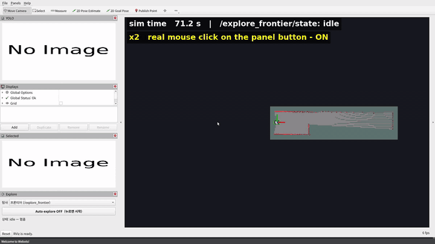

# limo_fire_bringup

실물 LIMO Pro 켜기. WeGo 대시보드 버튼이 하던 일(`~/limo_ros2_start_shortcut/bashes/*.sh` → `wego` 패키지 launch)을 우리 XML launch 로 옮겼다. 값은 WeGo 그대로다.

```bash
source ~/limo_fire_ws/env.sh                                   # 실물이면 ~/wego_ws 드라이버 + ROS_LOCALHOST_ONLY=1
ros2 launch limo_fire_bringup robot.launch.xml [viz:=true]     # 1. 센서·구동 (항상 먼저)
ros2 launch limo_fire_bringup mapping.launch.xml               # 2-a. 지도 만들기 (Cartographer + RViz)
ros2 launch limo_fire_bringup save_map.launch.xml [name:=map]  #      지도 저장
ros2 launch limo_fire_bringup navigation.launch.xml            # 2-b. 저장한 지도로 주행 (AMCL + Nav2 + RViz)
ros2 launch limo_fire_bringup sim.launch.xml world:=<맵>        # 시뮬: 1(sim_robot.launch.xml) + 2-a 또는 2-b 를 한 번에 (sim/webots/README.md)
```

매핑과 네비게이션은 동시에 켜지 않는다(둘 다 `/map` 을 낸다). 네비게이션은 RViz 에서 **2D Pose Estimate** 로 처음 위치를 찍어야 시작한다.

## 실물에서 운용 화면(RViz) 켜기



시뮬(덕트호스 미로, `sim.launch.xml slam:=true`)에서 탐사 패널 버튼을 마우스로 눌러 켬 → 끔(로봇 섬) → 다시 켬 → 지도가 닫혀 끝.
실제 걸린 시간은 시뮬 시간 약 300 초이고 GIF 는 구간마다 2 ~ 14 배로 빠르게 돌렸다(화면 위 sim time). 실물은 아래 차례로 같은 화면을 띄운다.

운용 화면은 `limo_fire_description/rviz/limo_fire.rviz` 하나다(지도·라이다·Nav2 경로·물체, 왼쪽 아래 **탐사 패널** "Auto explore ON/OFF" —
[limo_fire_rviz](../limo_fire_rviz/README.md)). 두 가지로 띄운다: (가) 노트북·PC 에서 네트워크로, (나) 젯슨에 모니터를 꽂고 젯슨에서.

### 터미널 차례

| # | 어디서 | 명령 (모두 `source ~/limo_fire_ws/env.sh` 뒤) | 무엇 |
|---|---|---|---|
| 1 | 로봇 | `ros2 launch limo_fire_bringup robot.launch.xml` | 센서·섀시·EKF (항상 먼저) |
| 2 | 로봇 | `ros2 launch limo_fire_rl explore_frontier.launch.xml stack:=true` | Cartographer + Nav2(지도 없이) + 프론티어 탐사 노드(멈춘 채) |
| 3 | PC 또는 로봇 | `ros2 launch limo_fire_description viewer.launch.xml` | 운용 화면 + 탐사 패널 |
| 4 | — | 패널 버튼 **Auto explore OFF (누르면 시작)** | 탐사 시작. 다시 누르면 Nav2 목표를 취소해 멈춤 |

- 2 를 따로 띄워도 된다: `mapping.launch.xml rviz:=false` + `navigation.launch.xml localization:=false rviz:=false` + `ros2 launch limo_fire_rl explore_frontier.launch.xml`.
  (나) 젯슨에서 RViz 까지 한 번에면 2 를 `stack:=true rviz:=true` 로 하고 3 은 건너뛴다.
- 주행 전 확인은 위 [CLAUDE.md "실물 로봇"](../../../CLAUDE.md) 그대로: 충전기 뺌, 주변 비움, 사람 곁에, 리모컨 오토 모드(SWB 위). 멈춤은 패널 버튼 또는
  `ros2 service call /explore_frontier/enable std_srvs/srv/SetBool "{data: false}"`.
- 지도를 남기려면 끝난 뒤 `ros2 launch limo_fire_bringup save_map.launch.xml name:=<이름>`.

### (가) PC 에서 네트워크로

1. **같은 네트워크**: 로봇과 PC 가 같은 Wi-Fi(같은 서브넷)에 있어야 한다. ROS 2 Humble 기본 DDS(Fast DDS)는 서로를 UDP 멀티캐스트로 찾는다.
   테일스케일(Tailscale)은 멀티캐스트를 넘기지 않아 그대로는 못 찾는다 — 테일스케일로만 이을 때는 Fast DDS 디스커버리 서버
   (`fastdds discovery -i 0 -p 11811` 를 로봇에서, 양쪽에 `export ROS_DISCOVERY_SERVER=<로봇 IP>:11811`)를 써야 한다(이 저장소에서 아직 안 해 봄 — **확인 필요**).
2. **`ROS_LOCALHOST_ONLY` 끄기 (로봇)**: `env.sh` 는 로봇(`~/wego_ws` 가 있는 컴퓨터)에서 `ROS_LOCALHOST_ONLY=1` 을 켠다(WeGo 대시보드와 같은 설정,
   [hardware.md](../../../docs/hardware.md) "기동"). 이러면 로봇 밖에서 토픽이 하나도 안 보인다. 로봇의 **1·2 터미널 모두** `env.sh` 다음에
   `export ROS_LOCALHOST_ONLY=0` 을 하고 띄운다(이미 떠 있는 노드는 껐다 다시 켜야 바뀜). 대시보드로 켠 WeGo 노드는 여전히 로봇 안에서만 보인다.
3. **`ROS_DOMAIN_ID` 맞추기**: 로봇과 PC 가 같은 값이어야 한다. 로봇이 따로 정하지 않았으면 0 (지금 로봇 값은 **확인 필요**: 로봇에서 `echo $ROS_DOMAIN_ID`).
   같은 Wi-Fi 에 다른 팀 로봇·시뮬이 있으면 둘 다 겹치지 않는 값으로(예: `export ROS_DOMAIN_ID=57`) — 1·2·3 터미널 모두.
4. **방화벽**: PC 에 ufw 가 켜져 있으면 로봇에서 오는 DDS UDP 를 막는다. `sudo ufw status` 로 보고, 켜져 있으면 `sudo ufw allow in proto udp from <로봇 IP>`.
   (DDS 포트는 도메인마다 7400 + 250 × `ROS_DOMAIN_ID` 부터 — [ROS 2 문서 "About domain ID"](https://docs.ros.org/en/humble/Concepts/Intermediate/About-Domain-ID.html))
5. **PC 빌드** (한 번): 운용 화면 설정·로봇 모델·패널이 PC 에 있어야 한다.
   ```bash
   sudo apt install ros-humble-nav2-rviz-plugins ros-humble-rviz-2d-overlay-plugins
   cd ~/limo_fire_ws && git pull --rebase --autostash && source env.sh
   colcon build --packages-select limo_description limo_fire_description limo_fire_rviz
   source install/setup.bash
   ```
6. **띄우기 (PC)**: `ros2 launch limo_fire_description viewer.launch.xml` 또는 같은 것을 직접
   `rviz2 -d $(ros2 pkg prefix limo_fire_description)/share/limo_fire_description/rviz/limo_fire.rviz`.
   (시뮬이 아니므로 `use_sim_time` 은 기본 false 그대로.)

- 영상(YOLO·Selected)·지도·costmap 이 Wi-Fi 로 오므로 화면이 늦으면 Displays 에서 안 보는 영상·costmap 을 끈다.
- PC 와 로봇 시계가 많이 다르면 TF 가 "extrapolation" 경고를 낸다 — 양쪽 `timedatectl` 로 NTP 동기화를 본다(**확인 필요**: 로봇 NTP 설정).

### (나) 젯슨에서 바로 (모니터 꽂음)

`ROS_LOCALHOST_ONLY=1` 그대로 된다(모두 로봇 안). 위 차례에서 3 을 로봇 터미널에서 띄우거나 2 를 `stack:=true rviz:=true` 로.
RViz 는 젯슨 CPU 를 많이 쓴다(화면 갱신 10 fps 에서 76 %, [docs/simulation.md "운용 화면"](../../../docs/simulation.md#운용-화면-limo_fire_description-viewerlaunchxml--rvizlimo_firerviz)) —
YOLO·탐사를 같이 돌릴 때는 (가) 를 권한다. 로봇의 `install/` 에 `limo_fire_rviz` 가 빌드돼 있어야 패널이 뜬다(`colcon build --packages-select limo_fire_rviz limo_fire_rl`).

### 볼 토픽

| 토픽 | 정상 |
|---|---|
| `/scan` | 약 10 Hz (`ros2 topic hz /scan`) |
| `/map` | 1 초마다 (Cartographer, `ros2 topic hz /map`) |
| TF `map → odom → base_link` | `ros2 run tf2_ros tf2_echo map base_link` 가 값을 냄 |
| `/explore_frontier/state` | `idle` → 버튼 → `running` → 끝나면 `done` |
| `/explore_frontier/status` | 목표·프론티어 수·지도 넓이 한 줄 |
| `/cmd_vel` | 탐사 중 Nav2 가 냄, 끄면 0 |

### 안 될 때

- **패널이 안 보임**: Panels → Add New Panel 에 `limo_fire_rviz/ExplorePanel` 이 없으면 그 터미널이 `install/setup.bash` 를 안 읽었거나 `limo_fire_rviz` 를 안 빌드한 것. 있으면 추가하고 File → Save Config.
- **`/map` 이 없음 · 지도가 안 그려짐**: PC 에서 `ros2 topic list` 에 `/map` 이 없으면 네트워크 문제(위 1~4: `ROS_LOCALHOST_ONLY`·`ROS_DOMAIN_ID`·방화벽·같은 Wi-Fi). 로봇에서도 없으면 2 번 터미널(Cartographer) 로그를 본다.
- **TF 없음 (Global Status: Error, Fixed Frame map 없음)**: 1 번(EKF `odom → base_link`)과 2 번(Cartographer `map → odom`)이 떠 있는지. `/scan` 이 와야 Cartographer 가 `map` 을 낸다.
- **버튼이 꺼져 있음 · "노드 없음"**: `ros2 service list | grep enable` 에 `/explore_frontier/enable` 이 있어야 한다. 없으면 2 번에 탐사 노드가 안 떴거나 네트워크 문제.
  있는데 눌러도 안 움직이면 `ros2 topic echo /explore_frontier/status` 를 본다("Nav2 navigate_to_pose 서버 없음" → Nav2 가 안 떴음, "TF 없음" → 위 TF).
- **로봇이 안 움직임 (상태는 running, `/cmd_vel` 은 나옴)**: 리모컨 오토 모드(SWB 위)인지.

## 키보드로 조종 (teleop)

바퀴만 움직이면 되면 섀시 드라이버 `limo_fire_base` 만 켠다. 센서도 필요하면 대신 `robot.launch.xml` 을 켠다(둘 다 `/dev/ttylimo` 를 열어서 같이 켜면 안 된다. 대시보드의 WeGo `limo_base` 와도 마찬가지).

```bash
source ~/limo_fire_ws/env.sh
ros2 run limo_fire_base limo_fire_base --ros-args -r __ns:=/limo --params-file $(ros2 pkg prefix limo_fire_bringup)/share/limo_fire_bringup/config/limo_base.yaml   # 섀시 (/cmd_vel 받음, WeGo limo_base 와 같은 동작)

# 새 터미널 — 키 입력을 받으므로 이 창이 선택돼 있어야 한다
source ~/limo_fire_ws/env.sh
ros2 run teleop_twist_keyboard teleop_twist_keyboard --ros-args -p speed:=0.2 -p turn:=0.5
```

기본 속도(0.5 m/s, 1.0 rad/s)는 실내에서 빨라 낮춰 시작한다. `i`/`,` 앞뒤, `j`/`l` 제자리 회전, `u` `o` `m` `.` 대각선, **`k` 정지**, `q`/`z` 속도 ±10 %, `Ctrl+C` 종료. 다른 창을 누르면 마지막 명령이 남을 수 있으니 먼저 `k`.

## WeGo 와 대응

| 대시보드 버튼 | WeGo | 우리 |
|---|---|---|
| 센서 | `wego/teleop_launch.py` | `robot.launch.xml` |
| 맵 | `wego/cartographer_launch.py` | `mapping.launch.xml` |
| 맵 저장 | `save_map.sh` | `save_map.launch.xml` |
| 네비게이션 | `wego/navigation_diff_launch.py` | `navigation.launch.xml` |
| 차선 인식 | `limo_ros2_application/track_application_launch.py` | `lane_tracking.launch.xml` (로봇이 움직임) |
| 딥러닝 주행 | `dl_ros2_application/dl_track_application.launch.py` | `dl_tracking.launch.xml` (로봇이 움직임, `conda activate dl_env` 필요) |

나머지 버튼은 명령 한 줄이라 launch 를 따로 만들지 않았다.

| 버튼 | 명령 |
|---|---|
| 사진 찍기 | `ros2 run dl_ros2_application take_a_picture` |
| 사진 저장 (TensorFlow용 / YOLO용) | `ros2 service call /photoshoot dl_ros2_msgs/srv/PhotoShoot "{chalkak: true}"` / `false` |
| YOLO 라벨링 | `ros2 run dl_ros2_application yolo_labeler` |
| TensorFlow → TensorRT | `ros2 run dl_ros2_application tf_to_trt <.h5>` (dl_env) |
| YOLO → TensorRT | `ros2 run dl_ros2_application yolo_to_trt <.pt>` (dl_env) |

| 파일 | 원본 |
|---|---|
| `config/ydlidar.yaml` | `ydlidar_ros2_driver/params/ydlidar.yaml` |
| `config/ekf.yaml` | `robot_localization/params/limo_ekf.yaml` |
| `config/orbbec_dabai_dc1.yaml` | `orbbec_camera/launch/astra_stereo_u3.launch.py` 의 인자 기본값 |
| `limo_fire_navigation/config/nav2_params.yaml` | `wego_2d_nav/params/diff_navigation_params.yaml` |
| `limo_fire_navigation/config/cartographer_2d.lua` | `wego/config/limo_lds_2d.lua` |
| `limo_fire_description/rviz/{sensors,mapping,navigation}.rviz` | `wego/rviz/{display,cartographer,navigation}.rviz` |
| `limo_fire_navigation/maps/map.*` | 2026-10-26 실험실에서 만든 지도 (9.4 × 6.1 m) |

WeGo 와 다른 점 (성능 측정은 limo_fire_perception README·2026-10-28 측정):
- 로봇 모델은 WeGo `limo_four_diff.xacro` + 카메라 틸트 `static_transform_publisher` 3 개 대신 우리 `limo_fire_description/urdf/limo_fire.urdf.xacro` 하나로 낸다(`camera_driver_tf:=true`). 몸통·라이다·IMU 값은 같고, `base_link → camera_link` 는 WeGo (0.23, 0.05, 0.06) → 실측 (0.15, −0.005, 0.06). `camera_mount`·`camera_rotate` 프레임은 없어졌다. 틸트 인자 이름은 `degree` → `camera_pitch` (라디안). `camera_link` 아래 color·depth 프레임은 지금처럼 Orbbec 드라이버가 공장 값으로 낸다
- `robot.launch.xml` 이 시작할 때 `sudo -n jetson_clocks` 로 CPU·GPU·메모리 클럭을 최대로 고정한다 (`max_clocks:=false` 로 끔, 재부팅하면 풀림).
  카메라처럼 33 ms 마다 한 장이면 장 사이에 GPU 클럭이 내려가 YOLO 가 21 ms 걸리고, 고정하면 11 ms. 대신 대기 전력이 는다
- `orbbec_dabai_dc1.yaml`: 아무도 안 쓰는 포인트 클라우드 2 개·IR 영상을 껐다. 드라이버 CPU 42 → 35 %, 깊이 영상 19 → 30 Hz (카메라만 띄워 30 초씩 잼)
- `cartographer_2d.lua`: 회전 움직임 필터 0.1° → 0.5° (CPU -20 %, 궤적 차 1.5~1.8 cm), 자세 발행 5 → 20 ms (TF 트래픽). 파일 머리 주석에 비교 방법
- `save_map.launch.xml` 의 지도 대기 시간을 2 초 → 10 초로 늘렸다. 2 초로는 `/map`(1 초마다 발행)을 못 받고 실패하는 일이 있었다 — 대시보드 "맵 저장"이 파일을 안 바꾼 원인으로 보인다. 저장 위치는 WeGo 처럼 src 와 install 두 곳이라 다시 빌드하지 않아도 네비게이션이 새 지도를 연다.

섀시는 우리 `limo_fire_base`, 나머지 드라이버(`orbbec_camera`, `ydlidar_ros2_driver`, `robot_localization`, `limo_description`, `limo_msgs`)는 로봇의 `~/wego_ws` 에 빌드된 것을 쓴다. 대시보드로 켠 것과 동시에 켜면 같은 장치를 두 번 열어 실패하니 한쪽만 쓴다.

## 검증 (2026-10-26, 실물)

- `robot.launch.xml`: WeGo 와 같은 노드 12 개, `/scan` 10 Hz · `/imu` 94~100 Hz · `/odom` 50 Hz · `/odometry/filtered` 30 Hz · 컬러 29 Hz · 깊이 28 Hz, `base_link → camera_link` (0.23, 0.05, 0.06) 로 WeGo 와 같음. 기동 때 찍히는 오류 두 줄(EKF `differential`·`relative`, 카메라 `Failed to setup devices`)도 WeGo 와 같고 동작에는 지장 없음.
- `navigation.launch.xml`: Nav2 노드 11 개 컨테이너에 올라감, 처음 위치를 주면 전부 active, `map → base_link` 나옴.
- `mapping.launch.xml`: `/map` 1 Hz. `save_map.launch.xml`: 두 곳 모두 저장 성공.
- 2026-10-28 우리 URDF 로 바꾼 뒤: 노드는 위에서 static TF 3 개만 빠짐. `tf2_echo` 로 `base_link →` `camera_link` (0.15, −0.005, 0.06) · `camera_color_optical_frame` (0.15, −0.035, 0.06) · `laser_link` (0.103, 0, −0.034) · `imu_link` (0, 0, −0.1), `/tf_static` 발행자는 `robot_state_publisher` 와 카메라 드라이버 둘.

## 그대로 옮겨서 남은 것

WeGo 값을 바꾸지 않았기 때문에 아래는 아직 그대로다 ([hardware.md](../../../docs/hardware.md) 참고).

- 카메라 장착 z (0.06) 는 WeGo 틸트 TF 값 그대로다. x·y 는 실측(0.15, −0.005)으로 고쳤지만 z 는 아직 안 쟀다.
- EKF 설정 충돌(`odom0_differential`·`odom0_relative` 둘 다 true), IMU 공분산 1e-6.
