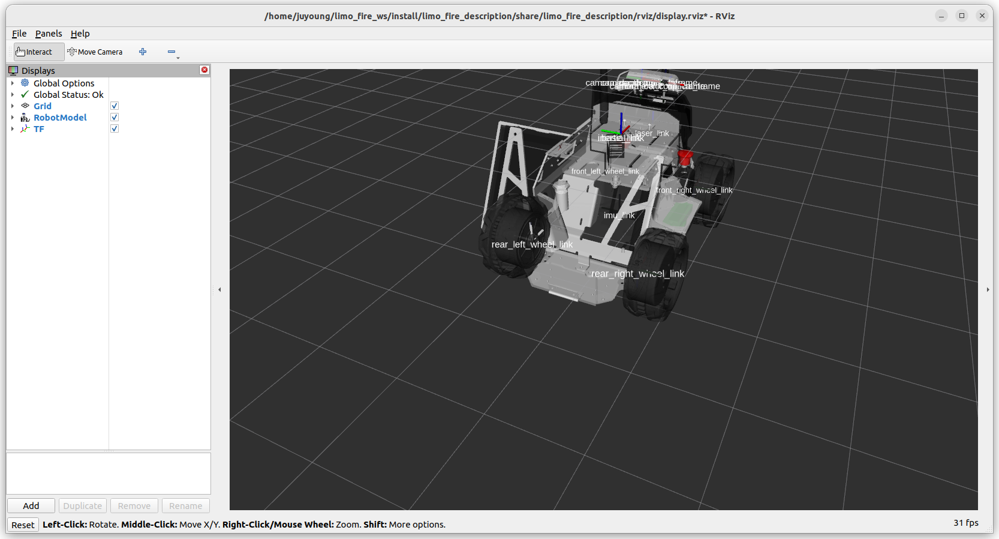

# limo_fire_description

화재 대응 LIMO Pro 로봇 모델. 기본 몸체(바퀴 4 개 차동 + 라이다 + IMU + depth 카메라)와 탁구공 발사대 v5(`launcher_v5.xacro`).
열화상·레이더·초음파는 배치가 정해지면 `urdf/` 에 모듈 xacro 로 더한다.

```bash
source ~/limo_fire_ws/env.sh
ros2 launch limo_fire_description display.launch.xml          # RViz + 관절 슬라이더
ros2 launch limo_fire_description display.launch.xml gui:=false rviz:=false   # TF 만
```



## 값과 출처

| 프레임 (부모 base_link) | 위치 (m) | 출처 |
|---|---|---|
| `laser_link` | (0.103, 0, −0.034) — 바닥에서 0.111 | WeGo `limo_four_diff.xacro` = 교수님 Webots 모델 |
| `imu_link` | (0, 0, −0.100) | WeGo = Webots |
| 바퀴 4 개 | (±0.100, ±0.065, −0.100), 반지름 0.045 | WeGo = Webots |
| `camera_link` | (0.096, 0.015, 0.030) | 교수님 Webots `robot_launch.py`(몸통 메시 카메라 자리에 맞춘 값). WeGo 차동 모델에는 카메라 없음 |
| `camera_color_frame` | camera_link + (0.00015, −0.03, 0.00002) | Webots `limo_sensors.py` (Orbbec 드라이버 프레임) |
| `camera_*_optical_frame` | 회전 (−90°, 0, −90°), z 앞 | ROS 관례(REP-103) |
| `launcher_pivot` | (−0.0399, 0, 0.065), 회전 0 — 발사대 상하 회전축. 조준 노드가 이 TF 로 장착 위치를 읽는다 | z: 실측 회전축 높이 0.210 − 0.145 (2026-11-20). x·y·yaw: 주영 CAD v5 값을 장착값으로 씀(줄자 측정 안 함, 2026-11-20 결정). CAD 높이는 0.0575 로 7.5 mm 다름 |
| `launcher_link` | launcher_pivot 에서 `launcher_pitch_joint`(−y 축, 5~30°, + 면 총구가 들림) | CAD `build_cradle.py`·펌웨어 범위. 각도 센서가 없으면 joint_state_publisher 가 17.5° 로 그림 |
| `launcher_muzzle` | launcher_link + (0.0657, 0, 0.045) | CAD `params.json` 축 AX(−40, −45 mm)·총구 X_MUZ 25.7 mm |

base_link 는 바닥에서 0.145 m. `base_footprint` 는 두지 않는다(실물 드라이버에 없음).

## 검증 (2026-10-23)
1. `check_urdf`: 통과, 루트 base_link, 프레임 13 개(WeGo 매크로의 재질 이름 경고만 있음)
2. TF 숫자: 헤드리스로 띄워 `tf2_echo base_link <프레임>` — 위 표의 값과 모두 같음, 광학 프레임 회전 (−90°, 0, −90°)
3. RViz: 몸통·바퀴·프레임 표시 확인(위 그림)

## 발사대 확인 (2026-11-20, PC — ROS 없이)
xacro 를 풀어(외부 LIMO 매크로는 빈 껍데기로 대신) 프레임을 계산했다: `launcher_pivot` (−0.0399, 0, 0.065), 5°·15°·30° 에서 `launcher_muzzle` 이 CAD 식(`sim_full.py` launcher_pose, 회전축 높이만 실측으로)과 0.5 mm 안에서 같고, + 각도에서 총구가 위로 향함. `check_urdf`·`tf2_echo`·RViz 확인은 아직(ROS PC 에서).
