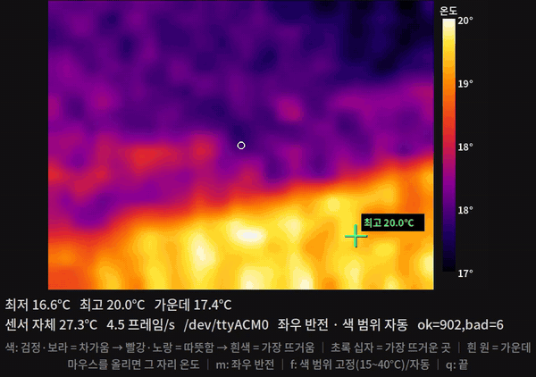

# sensor_view — ESP32 시험 코드 화면 (열화상 · 레이더)

[firmware/sensor_check](../../firmware/sensor_check/README.md) 의 시험 코드가 USB 시리얼로 내는 줄을 PC 화면에 그린다. C++ · Qt5, ROS 아님.
받은 줄 종류로 화면이 바뀐다 — 열화상 `F,…` 이면 색 지도, 레이더 `T,…` 이면 시야 부채꼴.



## 빌드·실행

```bash
sudo apt install qtbase5-dev            # 없으면 (Ubuntu)
cmake -S tools/sensor_view -B tools/sensor_view/build
cmake --build tools/sensor_view/build -j
tools/sensor_view/build/sensor_view                 # /dev/ttyACM* 첫 번째, 921600 baud (열화상 시험 코드)
tools/sensor_view/build/sensor_view /dev/ttyACM1 --baud 115200   # 포트·속도 지정 (레이더 시험 코드)
```

- 리눅스는 `dialout` 그룹이어야 포트를 연다. 보드가 빠졌다 다시 꽂히면(포트 번호가 바뀌어도) 1 초 안에 다시 연다.
- 보드의 USB 직결 포트(ESP32-S3 "USB", C3 SuperMini)는 속도를 무시한다. S3 의 COM(UART) 포트는 시험 코드와 같은 속도여야 한다.
- 다른 프로그램(시리얼 모니터, 업로드)과 포트를 같이 쓰지 않는다 — 업로드 전에 창을 닫는다.

## 열화상 화면

| 표시 | 뜻 |
|---|---|
| 색 | 검정·보라 = 차가움 → 빨강·노랑 = 따뜻함 → 흰색 = 가장 뜨거움 (오른쪽 막대에 온도) |
| 초록 십자 | 가장 뜨거운 칸과 그 온도 |
| 흰 원 | 화면 가운데 |
| 아래 글줄 | 최저·최고·가운데·마우스 자리 온도, 모듈 자체 온도, 체크섬 통과/실패 수, 프레임/s |

- 키: `m` 좌우 반전(기본 켬 — 매뉴얼상 첫 점이 그림 오른쪽 위) · `f` 색 범위 15~40 °C 고정/자동 · `q` 끝.
- 그림만 2×2 이웃 평균으로 그린다. MLX90640 은 화소 절반씩(체스판) 번갈아 읽어 두 묶음 사이에 0.1~0.3 °C 차가 나고, 그대로 그리면 바둑판 무늬가 보인다(2026-11-11 실측). 숫자는 원래 값.
- 좌우 방향은 아직 실물로 확인하지 않았다 — 손을 한쪽에 대 보고 반대로 나오면 `m`.

## 레이더 화면

노란 점이 레이더(앞면 = 금색 패치 쪽), 부채꼴이 시야(±60°, 6 m — LD2450 매뉴얼 2.1), 색 점이 표적(최대 3). 아래 글줄에 x·y(mm)·거리·각도·속도(cm/s).
레이더 화면은 가짜 데이터(매뉴얼 예 x = −782 mm, y = 1713 mm → 1.88 m, −24.5°)로만 확인했다.
