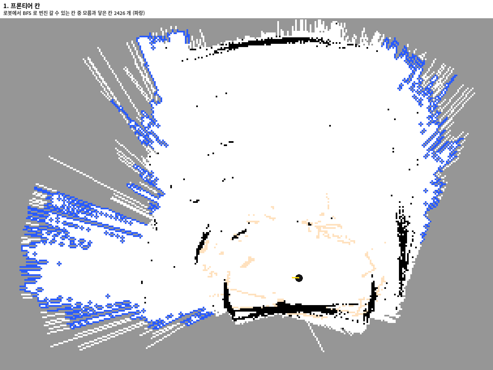
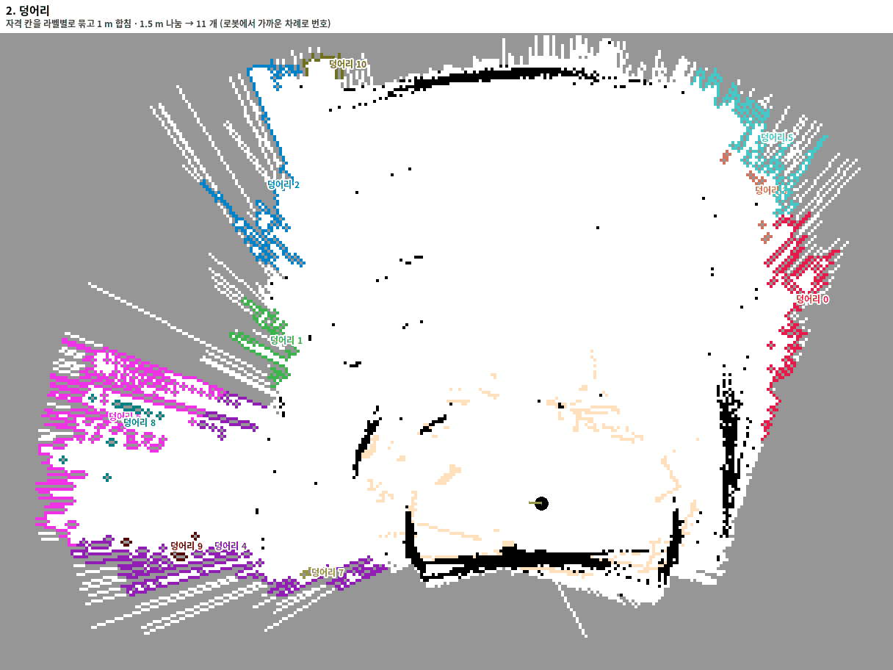
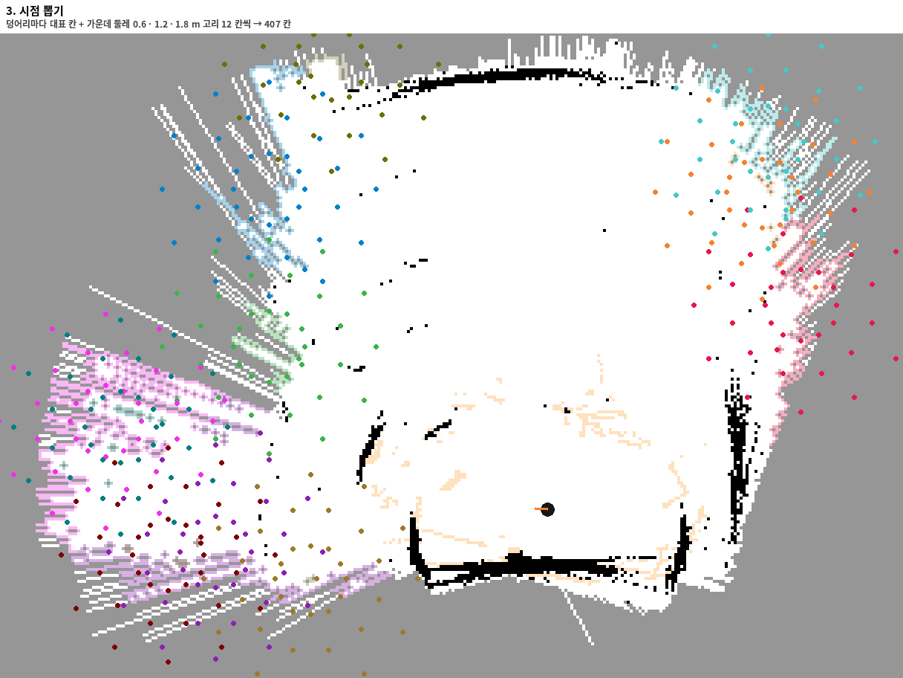
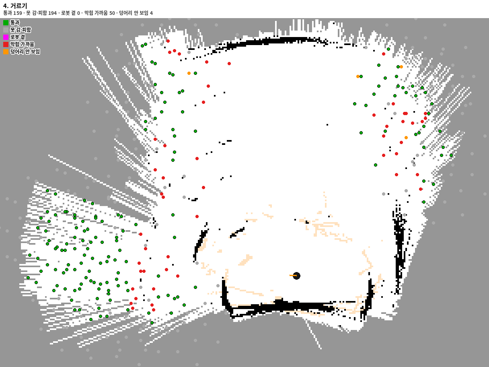
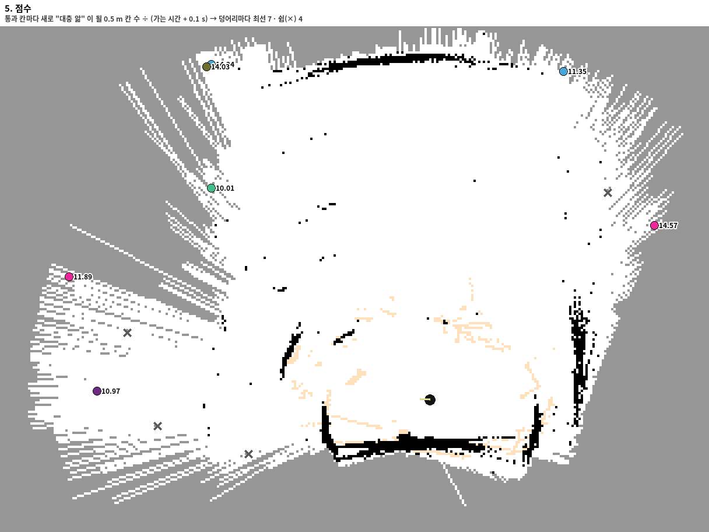
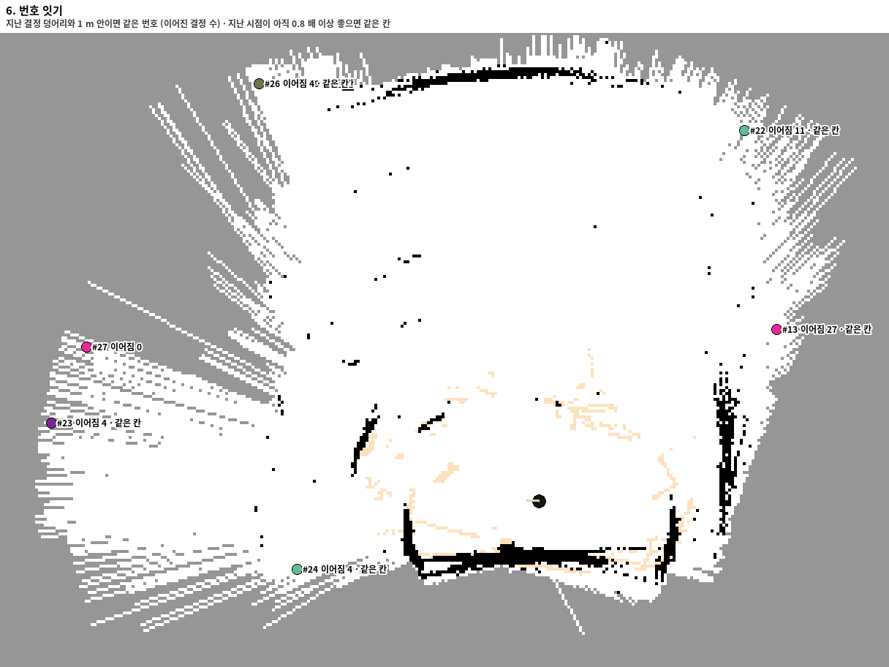
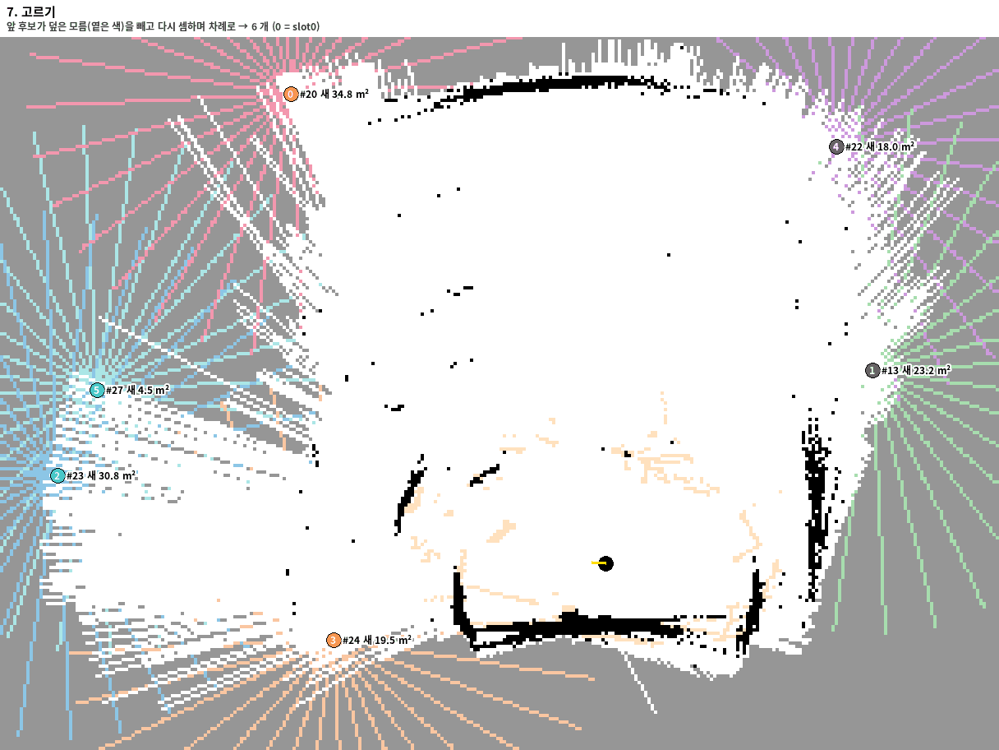

# scripts — 실행 파일

| 파일 | 내용 |
|---|---|
| `frontier_run.cpp` | 프론티어 탐사 기준선을 장면 × 판으로 돌려 뷰어 실행 폴더(`run.json kind: baseline`)로 쓴다. 빌드·옵션은 [baselines/frontier](../baselines/frontier/README.md) · `--modes slot0`(·`slot0_nosafe`) 는 계층형 규칙 정책(늘 0 번 후보)을 같은 판으로 |
| `oracle_run.cpp` | **측정 도구 — 정답을 씀.** 학습 맵 단계마다 정답 격자 경로·참 자세·정답 사람 위치로 모는 oracle(`--policy oracle`, 목표는 로봇 지도 굵은 프론티어, 성공 정의 그대로)과 slot0 규칙 정책을 같은 판으로 돌려 성공 상한을 잰다(`--stage 0..3 --people on\|off --out 판.tsv`). 시뮬은 env_api 로만 몰고 정답은 러너 안에서만 — 학습 환경·관측과 무관. 빌드는 baselines/frontier, 결과는 [mdp/README](../mdp/README.md) "커리큘럼" |
| `combine_run.cpp` | 두 층을 한 판에서 합쳐 탐사를 끝까지: 위층(slot0 · fuel · 판단 모델 · cand_tsp · random) + 아래층 규칙 추종기(A* + 경로 추종 — 실물 노드 `low_rl` 과 같은 길). 막힘 신호(`LowRl::stall`)를 받아 그 칸을 한동안 피하고 다시 고른다. 빌드는 이 폴더 `CMakeLists.txt` |
| `fuel_upper.h` · `low_explore_ctl.h` · `low_decider.h` · `cand_rules.h` | 위층 규칙(fuel · slot0 · 판단 모델 · 후보 규칙)과 목표 넘기기 — 시뮬 도구와 실물 노드가 같이 씀 |
| `decider.h` · `decider.cpp` | 판단 모델 서버(llama.cpp `/v1/systemone`)에 묻는 쪽: 요청 글·사진 만들기, 여러 요청 한꺼번에 보내기, 점유 격자만으로 남은 프론티어 세기(`grid_open_frontier`). 설정 글은 `config/decider.yaml` |

탐사 강화학습 실행기(학습기 `train.cpp` · 아래층 정책 측정 `low_policy_run`/`low_run.cpp` · `hybrid_eval.cpp` · 판정 `tools/judge_low.py`)는 2026-11-16 에 그만두고
[archive/rl](../../../archive/rl/README.md) 로 옮겼다. 그때의 이 README(학습기 옵션·아래층 판정 포함)는 `archive/rl/train/explore/scripts/README.md`.
아래 결과 표에 나오는 "아래층 low_w3 36000"·"아래층 RL" 은 그때 기록이다.

## combine_run — 위층 fuel (`--upper fuel`, `fuel_upper.h`, 2026-11-15)

가장 가까운 후보(slot0) 대신 FUEL(Zhou et al., RA-L 2021, arXiv 2010.11561) 틀로 목표를 고른다. 로봇 지도·지도 자세·오도메트리 속도만 쓰고(정답 격자 안 씀) CPU 한 스레드에서 돈다.

- 비용 = 식 1 시간 하한 `max(길이 / v_eff, 머리각 차 / ω_eff)` (길이 = 로봇 지도 설 수 있는 칸 위 8 이웃 모따기 거리). 식 3·4(속도 어긋남 w_c)·첫 회전 항은 옵션.
- 순회 = 식 5 (`M(k, 0) = 0`) 의 열린 ATSP — 덩어리 ≤ 12 개면 정확한 동적 계획법, 넘으면 최근접 이웃 + 2-opt · Or-opt (논문은 LKH). 덩어리는 합침(1 m)·주성분 나눔(1.5 m)·상한 20 개.
- 시점 = 덩어리 가운데 둘레 0.6 · 1.2 · 1.8 m 고리 36 칸 + 가장 가까운 칸 중 (예상 새로 보이는 모름 넓이, `frontier.h cand_gain_ray`) ÷ (로봇에서 시간 + t0) 가 가장 큰 칸 (덩어리 칸이 막힘에 안 가리고 보여야).
- v_eff · ω_eff 는 `--leg-log` 로 잰 slot0 도착 구간 2781 개 맞춤(학습 장면 10 개 · 씨앗 11 · 12, 아래층 low_s4 18806): `t = L / 0.98 + |Δθ| / 3.23 − 0.59` (R² 0.89, 절편은 통과 반경 0.5 m 몫).
- 끄면(기본) 다른 위층 방식의 판 결과는 비트까지 그대로 (학습 장면 10 개 × slot0 · cand_tsp 의 판 tsv 가 고치기 전 빌드와 같음).

학습 장면 측정 (ProcTHOR 가구 없는 판 8 + HSSD 학습 2, 씨앗 11 · 12 × 12 판, 아래층 RL low_s4 18806 + `SIM_PATH_FALLBACK=1`, 사람 0).
같은 시작 칸끼리 짝 지어 둘 다 성공한 판의 끝 시간 차 (± 표준오차):

| 위층 | 성공 | slot0 대비 끝 시간 | 결정당 CPU |
|---|---|---|---|
| slot0 | 0.887 | — | — |
| cand_v2 + cand_tsp (stick 0.3 · turn 1.5) | 0.879 | +0.3 % ± 1.0 | — |
| fuel 순회만 (BFS 거리, 후보 8 개) | 0.925 | +2.6 % ± 0.8 | 8 ms |
| + 시간 비용 | 0.887 | +1.6 % ± 0.8 | 11 ms |
| + 전역 순회 | 0.900 | +2.4 % ± 0.9 | 11 ms |
| **+ 시점 고르기 (고른 조합)** | 0.917 | **−1.4 % ± 0.9** | 12 ms |
| + 붙들기 0.2 | 0.946 | −0.2 % ± 1.0 | 12 ms |
| + 방 마무리 | 0.904 | −0.8 % ± 0.9 | 36 ms |
| 시간 + 시점 (전역 끔) | 0.942 | −0.2 % ± 0.9 | 11 ms |

- 결정 하나만 바꿔 보는 갈래 굴리기(20 째 결정에서 유효 후보 0~4 째, 4 장면 × 12 판): 가장 가까운 것 81.7 s · 가장 좋은 것 76.3 s · 평균 82.5 s. 같은 판에서 고른 후보마다 끝 시간이 표준편차 5.7 s 로 흩어져
  "가장 좋은 것" 의 −6.6 % 는 잡음에서 고른 몫과 구별이 안 된다 — 결정 하나 단위로는 가장 가까운 것이 거의 최선.
- 순서를 짜는 부품(순회·시간 비용)은 가장 가까운 것보다 같거나 조금 나쁘고, 이득은 덩어리마다 서는 자리(시점)에서만 났다. 모든 차이가 1~2 표준오차 안.
- CPU 시간은 x86 한 스레드(시뮬과 같이 돌며 잰 값).

시험 (2026-11-15, 통과 기준은 결과 보기 전에 정함): bookstore · small-house · 두 낮은 상자판(`scene_lowobs`), 씨앗 4 · 5 × 12 판, 사람 0, 아래층 RL low_s4 18806 + `SIM_PATH_FALLBACK=1`.
끝 시간 = 장면마다 성공 판 평균의 장면 평균 (씨앗 4 · 5).

| 위층 · 아래층 | 끝 시간 s (4 · 5) | 성공 (4 · 5) | 충돌 판 / 96 | 목표 바뀜 / 분 | 결정당 CPU |
|---|---|---|---|---|---|
| slot0 · RL | 119.5 (121.3 · 117.7) | 0.667 (0.667 · 0.667) | 13 | 33 | — |
| cand_v2 + cand_tsp · RL | 116.6 (119.3 · 114.0) | 0.708 (0.750 · 0.667) | 15 | 32 | — |
| fuel (시간 + 전역 + 시점) · RL | 117.8 (118.4 · 117.2) | 0.812 (0.812 · 0.812) | 8 | 44 | 27 ms |
| slot0 · 규칙 추종기 | 150.9 (153.1 · 148.8) | 0.760 (0.812 · 0.708) | 4 | 28 | — |
| fuel · 규칙 추종기 | 153.1 (157.3 · 148.9) | 0.792 (0.750 · 0.833) | 4 | 42 | 26 ms |

- 같은 시작 칸끼리 짝 지은 끝 시간 (둘 다 성공한 판): fuel · RL −4.3 % (58 판, −5.0 ± 2.6 s), cand_tsp · RL −2.8 % (53 판, −3.2 ± 2.2 s), fuel · 규칙 추종기 −0.2 %.
- 미리 정한 통과 기준 4 개 중 성공(fuel 0.812 대 slot0 0.667)·충돌(8 대 13)은 넘고, "장면 평균 끝 시간이 cand_tsp 보다 짧음"(117.8 대 116.6)·"4 장면 중 3 장면 이상 slot0 보다 짧음"(2 장면)은
  **못 넘었다**. 낮은 상자판 두 곳에서 fuel 이 더 많이 끝내는데, 더 끝낸 판이 긴 판이라 성공 판 평균이 올라간 몫이 섞여 있다(짝 비교로는 짧음).
- 사람 2 (씨앗 4): 성공 0.646 대 slot0 0.604, 충돌 판 9 대 12, 짝 끝 시간 −2.3 % (21 판).
- 판단 모델 (`--upper decider --decider-mode choice --decider-input all`, d1-3B Q8_0, 같은 조건): 117.8 s (115.8 · 119.8) · 성공 0.667 · 충돌 판 13 · 짝 끝 시간 −1.5 % (47 판) ·
  요청 지연(16 개 동시) 중앙값 3.4 s · p95 5.9 s (시뮬 시계에 안 들어감).
- 최종 아래층(넓은 지도 + GRU, w2 반복 7702, `SIM_LOW_WIDE=1 SIM_LOW_GOALONLY=1 SIM_LOW_OBS_MOV=1`)으로 다시: slot0 148.0 s · 성공 0.500 · 충돌 판 18, fuel 151.3 s · 0.583 · 15,
  짝 끝 시간 −3.8 % (38 판, −5.3 ± 5.3 s — 잡음 안).
- 정답 지도를 다 아는 순회(`--gt-bound --gt-tile 0.5`, 시뮬 전용, v 0.98 · ω 3.23): 시험 장면 70.5 · 53.8 · 77.8 · 79.7 s — fuel 의 처음 닫힌 시각은 그 1.37~1.69 배(평균 1.53, slot0 1.56),
  학습 장면 평균 1.25 배(slot0 1.32). 0.98 m/s 는 도착한 구간의 실효 속도라, 판 평균 속도(0.69 m/s)로 셈하면 시험 장면 약 1.1 배·학습 장면 몇 곳은 1 배 밑 — 엄밀한 하한이 아니다.
- 학습 위층(슬롯 고르기)으로 fuel 을 이길 수 있나 — 행동 공간부터 잼(학습 장면 10 곳, fuel 결정 4711 개): fuel 이 고른 덩어리는 시뮬 후보 8 개(v2) 안에 99.2 %, 그런데 fuel 목표 칸이 그 후보 칸
  0.5 m 안인 것은 26~38 % (평균 0.85 m 떨어짐). 슬롯 고르기는 후보 칸으로만 가므로 fuel 을 그대로 따라 해도 "덩어리 고르기" 만 얻고, 그것만으로는 slot0 보다 +2.4 % (위 사다리) —
  이득은 서는 자리에서 나왔다. 그래서 BC → RL 미세조정은 돌리지 않았다(행동이 시점까지 담아야 의미가 있음).
- 결정당 시간, 로봇 CPU (Jetson Orin Nano 8GB, 한 스레드, 저장한 결정 상태 32 개): 평균 27.8 ms · 최대 64 ms (x86 11.2 · 27.7 ms), 결정 결과는 x86 과 같음. 대부분 frontier_search 와 시점마다 다익스트라.
- 위층 RL 견줌 (규칙 추종기 hier 환경, 같은 시작 칸 `--eval-seed`): explore_h5 반복 3350(후보 v1 · 사람 0~3 커리큘럼 · 학습 맵에 HSSD 포함 · 가치망 정답 입력은 `ckpt_drop_priv` 로 뺌)
  157.4 s · 성공 0.740 · 충돌 판 3, 같은 환경 slot0 150.2 s · 0.771 · 5.

### 실물 1116 진단과 고침 (2026-11-16 — 붙들기 · 시점 자격 · 라이다 닫힘 옵션)

실물 `1116_fuel_rl_1`(사무실 약 7 × 8 m, 아래층 low_w3 36000)에서 목표가 1 s 마다 먼 곳끼리 뛰고, 27 s 부터 목표 없음, 39 s 에 "닫힘 + 진척 없음" 성공으로 끝났다.
노드 녹화를 `sim/tools/low_explore_replay` 로 RobotEnv + 위층만 다시 돌리면 녹화 관측과 비트 같고(389 / 389) 목표 차례도 RViz 에 찍힌 것과 같다. 까닭:
1. 붙들기 없음 — 노드 기본 `fuel_hyst 0`. 지금 목표 순회 값이 가장 좋은 순회보다 0.6 % 만 커도 바꿨다(`fuel_upper.h` 붙들기 비교, 예: 13 s 29.84 대 29.67).
   아래층이 거의 안 움직여(걸음의 77 % v ≈ 0) 첫 구간 값의 머리각 항이 돌 때마다 흔들려 순회 첫 덩어리가 마주 보는 두 곳을 오갔다 — 0~27 s 결정 31 개에 목표 13 곳, 바뀔 때 평균 3.3 m.
2. 로봇 곁 시점 — 덩어리의 가장 가까운 칸은 통과 반경(0.5 m) 안이어도 시점이 될 수 있었다(옛 규칙의 예외). 몸 둘레·라이다 뒤 사각지대의 모름이 0.3 m 앞 프론티어를 만들어,
   내자마자 "통과" → 다시 결정이 되풀이(실물 slot0 `1116_slot0_1`: 9 s 에 결정 25 · 통과 15, 목표가 로봇에서 0.27~0.41 m — 시뮬 후보 문턱 `kCandMinDist` 0.3 m < 통과 반경 0.5 m).
3. 깊이 카메라 층이 로봇을 둘러쌈 — 27 s 부터 로봇 지도(라이다)로는 닿는 막는 칸이 2384 개인데, 닫힘·후보 번지기가 깊이 층 막힘도 팽창해 번진 곳이 로봇 둘레 주머니뿐 →
   덩어리 없음(목표 없음 결정 32 %) · 닫힘. 깊이 층 표시점은 높이 0.03~0.25 m 에 고르게 퍼져(바닥 숙임 오차라면 낮은 칸에 몰림) 바닥 오인보다는 가구 다리·옆판과,
   시야 밖에서 안 지워지는 표시(Nav2 VoxelLayer 꼴)가 쌓인 것으로 보인다 — 빠르게 돌 때 깊이 영상과 자세의 시각 차로 번진 몫은 확인 못 함(녹화에 깊이 시각이 없음).
   시뮬은 판 중간 목표 없음이 0 (시험 4 장면 × 씨앗 4 · 5, 결정 2844 개: 판 시작 3 s 안 25 · 닫힌 뒤 100 — 같은 표를 `low_explore_check --log` 로).

고침 (시뮬·실물 같은 코드 — `fuel_upper.h` · `low_explore_ctl.h` · `combine_run.cpp`, 노드 기본은 `limo_fire_rl/config/low_rl.yaml`):
- 붙들기 `--fuel-hyst 0.2` (위 표의 "+ 붙들기 0.2"). FUEL 은 1.5 s 마다 다시 짜되(저자 저장소 `algorithm.xml` `fsm/thresh_replan3 1.5`) 속도 어긋남 벌점(식 3·4)으로 이어 가고,
  덮였거나(`isFrontierCovered`) 궤적 끝이면 바로 다시 짠다. 여기서는 지금 목표 덩어리가 사라졌거나(덮임)·목표 칸이 못 가게 됐거나·통과·막힘이면 바로, 아니면 새 순회가 20 % 넘게 좋을 때만 바꾼다.
- 시점 자격 `--fuel-vp-min 0.75 --fuel-vp-clear 0.21` (FUEL `frontier/min_candidate_dist 0.75` · `min_candidate_clearance 0.21`): 로봇에서 0.75 m 안 시점은 안 쓰고(가장 가까운 칸도),
  시점 둘레 0.21 m 안에 모름이 없어야 한다(없으면 거리 문턱만으로 다시). 시점이 없는 덩어리는 순회에서 뺀다(FUEL 의 dormant). 모든 덩어리가 빠지면 목표 없음(`fu::kNone` — 제자리 회전, slot0 로 안 떨어짐).
  덩어리 없음·시작 칸 없음은 전처럼 slot0 차례 — 이것까지 목표 없음으로 하면 성공 0.71 → 0.39.
- 옵션 `--close-lidar` (노드 `close_lidar`, `EnvCfg::low_explore 2`, **기본 끔**): 합친 탐사의 닫힘·후보 번지기를 라이다 지도만으로 (`mdp/frontier.h` 머리글, `obs_ref.h` · `env_kernel.cu` reach_block).
  닫힘(성공)은 지도에 대한 판정이라 지나간 표시가 남는 위험 층으로 하지 않는다는 뜻 — 깊이 층에만 막힌 프론티어는 "안 닫힘" 으로 남아 진척 없음(실패)으로 끝난다.
  켜면 아래층 규칙 + slot0 성공 0.938 → 0.719 (진척 없음 끝 1 → 26 — 후보가 라이다 지도로만 닿아 계획기가 못 감), 아래층 RL + fuel 끝 시간 +6.9 s 라 기본은 옛 규칙.

시험 장면(bookstore · small-house · 두 낮은 상자판, 씨앗 4 · 5 × 12 판, 사람 0, 아래층 low_w3 36000, fuel v 0.981 · ω 3.232 · t0 0.10). 짝 = 같은 시작 칸 둘 다 성공한 판의 끝 시간 차 ± 표준오차:

| 위층 | 성공 | 끝 시간 s | 끝 (성공 · 벽 · 진척 없음) | 목표 바뀜 / 분 | 목표 없음 결정 | 짝 (고치기 전 fuel 대비) | 짝 (닫힘만 바꾼 fuel 대비) |
|---|---|---|---|---|---|---|---|
| fuel 고치기 전 | 0.708 | 130.3 | 68 · 5 · 23 | 25.4 | 0.063 | — | — |
| **붙들기 0.2 + 시점 자격 (노드 기본, 옛 닫힘)** | **0.792** | 134.9 | 76 · 3 · 17 | **14.9** | 0.061 | +7.0 ± 5.0 (57) | |
| 아래 줄들: `--close-lidar` 켬 | | | | | | | |
| 닫힘만 바꿈 | 0.698 | 137.3 | 67 · 4 · 25 | 25.1 | 0.044 | +6.9 ± 4.3 (53) | — |
| + 붙들기 0.2 + 시점 자격 | 0.708 | 139.6 | 68 · 4 · 24 | 14.7 | 0.054 | +12.4 ± 4.6 (54) | +4.2 ± 3.8 (54) |
| + 시점 자격만 (붙들기 0) | 0.656 | 129.7 | 63 · 5 · 28 | 22.5 | 0.053 | +3.2 ± 4.9 (51) | −2.5 ± 4.0 (51) |
| + 붙들기 0.2 만 | 0.646 | 143.6 | 62 · 9 · 25 | 15.8 | 0.039 | +10.5 ± 5.4 (48) | +3.9 ± 4.9 (50) |
| + 붙들기 0.2 + 거리 문턱만 | 0.573 | 137.8 | 55 · 8 · 33 | 14.8 | 0.036 | — | +1.8 ± 4.2 (46) |
| slot0 고치기 전 | 0.667 | 130.6 | 64 · 6 · 26 | 26.8 | 0.055 | | |
| slot0 (닫힘 바꿈) | 0.625 | 139.2 | 60 · 5 · 31 | 27.5 | 0.058 | | |
| slot0 + 시점 (`--fuel-first 1 --fuel-global 0 --fuel-time 0` + 시점 자격) | 0.531 | 151.9 | 51 · 7 · 38 | 21.0 | 0.028 | | slot0 대비 +19.6 ± 4.6 (42) |
| slot0 + 거리 문턱만 (`--fuel-vp 0 --fuel-vp-min 0.75`) | 0.573 | 159.3 | 55 · 9 · 32 | 19.5 | 0.033 | | slot0 대비 +14.0 ± 4.0 (50) |

아래층 규칙 추종기(`--policy` 없음 = 실물 `lower:=rule`), 같은 장면·씨앗 (짝은 531e7fc 같은 위층 대비):

| 위층 | 531e7fc | 이 고침 (옛 닫힘) | `--close-lidar` |
|---|---|---|---|
| slot0 | 0.938 · 153.0 s · 끝 90 · 5 · 1 · 29.2 / 분 | **같음 (판 tsv 그대로)** | 0.719 · 165.8 s · 69 · 1 · 26 · 짝 +12.6 ± 3.2 s |
| fuel | 0.969 · 153.1 s · 93 · 3 · 0 · 25.8 / 분 | 0.875 · 153.5 s · 84 · 9 · 3 · 14.1 / 분 · 짝 −1.0 ± 2.4 s (81) | — |

- `upper:=decider` + `lower:=rule`(현장 구성): fuel 을 안 부르므로 이 고침과 무관 — `low_explore_check --lower rule --upper decider`(가짜 응답기, 지연 2.6 s)·`--upper slot0` 를 4 장면 × 씨앗 4 · 5,
  6000 걸음씩 돌린 표준출력·판 끝 기록(`--ep-log`)이 531e7fc 빌드와 16 / 16 바이트까지 같음. 진짜 서버(`--dec-url`)로 한 판 짝 비교는 판당 수 분이라 15 판에서 멈춤.
- 아래층 규칙 + fuel 은 새 기본(붙들기 · 시점 자격)에서 성공이 떨어지고 벽 충돌 판이 3 → 9 — 그 조합을 쓰면 `fuel_hyst:=0.0 fuel_vp_min:=0.0 fuel_vp_clear:=0.0` 이 시뮬에서 낫다.

- 옛 닫힘에서 노드 기본은 성공 0.708 → 0.792(진척 없음 끝 23 → 17), 짝 끝 시간 +7.0 ± 5.0 s(1.4 표준오차), 목표 바뀜은 절반.
- slot0 를 시점으로 바꾸면 시뮬에서 나빠져 노드 `slot_vp` 기본은 끔 (실물 A/B 에서만 켬). 시뮬은 로봇 곁 목표가 곧 "통과" 되어 손해가 작다.
- 실물 녹화 다시 돌리기(지도·궤적은 녹화 그대로, 위층만 다시 — "그 자리에서 이 위층이면"): `1116_fuel_rl_1` 첫 판 0~27 s 목표 바뀜 13 → 2 · 통과 4 → 0,
  `1116_slot0_1` 9 s 통과 15 → 0(fuel 기본) · 0(slot0 + 시점). 그때 설정(`--fuel-hyst 0 --fuel-vp-min 0 --fuel-vp-clear 0`)으로는 두 녹화 다 관측 비트 같음(659 / 659 · 86 / 86, 531e7fc 위).
  27 s 뒤(깊이 층에 갇힘)는 옛 닫힘이라 여전히 목표 없음 → 닫힘 성공으로 끝난다. `close_lidar` 를 켜면 닫힘으로 안 끝나지만 fuel 이 slot0 차례로 떨어져 라이다 지도로만 닿는 후보에서
  "경로 없음" → 피하기가 되풀이된다(25 결정에 경로 없음 12). 깊이 층 표시가 실물에서 왜 쌓이는지는 따로 봐야 한다.
- `low_explore_check` (시뮬 == RobotEnv 비트): fuel · slot0 · slot0 + 시점 · 판단 모델 · 아래층 규칙 · `--close-lidar` × bookstore · small-house × 씨앗 1~3 모두 같음
  (`LOW_CHECK_VERBOSE=1` 이면 갈린 걸음의 명령·속도 다듬기 상태·지도·깊이 층을 찍음).
- 위 시뮬 수치와 녹화 다시 돌리기는 531e7fc 위에서 잼. 그 뒤 2a17a5a(깊이 늦음·바닥 구멍 맞춤)가 `EnvHostCfg` 크기를 바꿔 1116 녹화는 지금 소스의 `low_explore_replay` 로 안 읽힌다(머리 검사).

## 후보 뽑기 (`cand_view.h`, 위층 cand · slot0 · 판단 모델이 고르는 ≤ 8 곳)

로봇 지도 한 장 → 목표 후보 ≤ 8 개. 시뮬(`combine_run` · `low_explore_check`)과 실물 노드(`low_rl_node`)가 같은 함수
`cand::build` 를 부르고, 정수 · 정해진 차례만 써서 같은 지도면 비트까지 같은 결과다. `build` 는 아래 일곱 단계를 차례로
부르는 짧은 함수이고, 각 단계는 `detail::Run` 의 함수 하나다. 상수는 `cand::Opt` 한 곳에 단위 · 출처(FUEL · TARE 논문,
잰 값, 잠정)와 함께 있다.

그림은 실물 녹화 `1116_fuel_rl_1`(사무실 약 7 × 8 m) 30 s 쯤 결정 한 번을 단계별로 그린 것이다 (지도 0.05 m 칸, 회색 모름 ·
흰 빈 칸 · 검정 막힘 · 살구색 깊이 카메라 층, 검은 원 = 로봇).
다시 그리기: `low_explore_replay ~/limo_bags/1116_fuel_rl_1_node.bin --cand-stages 300 <앞이름>` → `<앞이름>.tsv`(단계별 칸) ·
`<앞이름>_map.ppm`(지도) — `sim/tools/cand_quality.h dump_stages` 가 `build` 와 같은 단계 함수를 불러 적는다.

| 단계 | 하는 일 | 왜 |
|---|---|---|
| 1. 프론티어 칸 | `frontier_search` — 로봇에서 BFS 로 번진 갈 수 있는 칸 · 거리 · 모름과 닿은 칸 라벨 (fuel 과 같은 버퍼·닫힘 규칙). 번진 칸 둘레 상자 안만 막힘까지 거리 지도 · 방 | 갈 수 없는 곳의 프론티어는 후보가 될 수 없음. 상자 밖은 안 봄 (FALCON: 바뀐 곳만) |
| 2. 덩어리 | 자격 칸(거리 · 크기 · 아직 안 본 칸)을 라벨별로 묶고 1 m 합침 · 1.5 m 나눔, 로봇에서 가까운 차례 | 칸 하나하나가 아니라 "가 볼 곳" 단위로 (FUEL 프론티어 덩어리) |
| 3. 시점 뽑기 | 덩어리마다 가장 가까운 칸 + 가운데 둘레 0.6 · 1.2 · 1.8 m 고리 12 칸씩 | 프론티어 칸 자체가 아니라 그것이 잘 보이는 "서는 자리" (FUEL 고리 시점) |
| 4. 거르기 | 갈 수 있음 · 피하는 칸 아님 · 로봇에서 0.75 m 밖 · 막힘에서 몸통 + 0.25 m 밖 · 덩어리 대표 칸이 막힘에 안 가림. 없으면 0.05 m 로 한 번 더, 그래도 없으면 쉼 | 로봇 지도에 없는 낮은 물체 곁에는 못 섬 (0.25 m 로 정답 격자 갈 수 있음 0.72~0.79 → 0.88~0.91). 로봇 곁은 몸 · 뒤 사각 (FUEL min_candidate_dist) |
| 5. 점수 | 새로 "대충 앎"(0.5 m 칸의 아는 몫 ≥ 0.5)이 될 칸 수 ÷ (가는 시간 + 0.1 s), 덩어리마다 최선 하나. 이미 대충 아는 칸 안의 작은 구멍은 0 → 쉼 | 목표는 공간을 대충 빨리 앎. 가는 시간 = 길 / 0.98 m/s + 첫 회전 / 3.23 rad/s (실물 맞춤) |
| 6. 번호 잇기 | 지난 결정 덩어리와 대표 칸 1 m 안 → 같은 번호, 지난 시점이 아직 0.8 배 이상 좋으면 같은 칸 | 판단 모델 · 기억(실패 수 · 보낸 수)이 결정 사이 같은 곳을 가리킴 (TASG-Explore). 7 의 같은 점수 가르기에 번호를 쓰므로 고르기보다 먼저 |
| 7. 고르기 · 기억 | 앞 후보가 덮은 모름을 빼고 다시 셈하며 차례로 ≤ 8 개 (0 번 = slot0) → 판단 모델 값 · 실패 기억, 최근 실패한 후보는 맨 뒤 | 덮음은 겹치므로 한 방향에 몰리지 않게 (TARE) |

| | |
|---|---|
|  프론티어 칸 2426 개 |  덩어리 11 개 |
|  뽑은 시점 407 칸 |  통과 159 · 못 감·피함 194 · 막힘 가까움 50 · 안 보임 4 |
|  최선 7 · 쉼 4 (모두 구멍) |  7 개 중 6 개가 지난 번호를 이어 같은 칸 |
|  6 개 고름 — 7 번째(#26)는 앞 후보들이 다 덮어 빠짐 | |

재 보고 끈 잣대 (2026-11-17 코드에서 뺌 — 값은 기본 끔이었고 결과 같음):
시점 둘레 모름 간격 0.21 m (FUEL 3D 값 — 2D 에서는 프론티어 가에 서야 가장 많이 봐 정답 견줌 0.77 → 0.30),
광선마다 모름 깊이 1 m 까지만 (0.75 → 0.30, bookstore 씨앗 4), 길 위 모름 간격, 빔 사이 가는 모름 줄 빼기 (0.1 m 차이 없음).

## combine_run — 위층을 판단 모델에 맡기기 (`--upper decider`, 실험 중)

두 층 탐사(위층 1 Hz 후보 고르기 + 아래층 RL 10 Hz)에서 위층의 "어느 후보로 갈까"를 바깥 판단 모델 서버에 묻는다(`decider.h` · `decider.cpp`).
모델은 글을 만들지 않고 선택지·예/아니오·점수 단계의 확률만 낸다. 미세조정 없이(제로샷) 붙인 것이고, **지금까지 규칙(늘 가장 가까운 후보)보다 나아진 것은 없다** — 아래 "결과".

### 준비: 모델과 서버 (저장소에 없음)

- **모델 가중치는 저장소에 넣지 않는다.** LiquidAI d1-3B 의 GGUF 두 파일을 각자 받는다: <https://huggingface.co/LiquidAI/d1-3B-GGUF> 의
  `d1-3B-Q8_0.gguf`(2.9 GB) · `mmproj-d1-3B-Q8_0.gguf`(0.6 GB, 사진 입력용). 이 PC 는 `~/models/decision/d1-3b/` 에 뒀다.
- **라이선스**: LFM Open License v1.0 (받은 폴더의 `LICENSE`). 쓰기 전에 본문을 직접 읽는다 — 조건을 여기 옮겨 적지 않는다.
- **서버**: llama.cpp(<https://github.com/ggml-org/llama.cpp>) 의 `llama-server`. `/v1/systemone` 길이 있는 판이어야 한다(이 PC 는 커밋 `31953bc`, CUDA 빌드).

```bash
llama-server -m ~/models/decision/d1-3b/d1-3B-Q8_0.gguf --mmproj ~/models/decision/d1-3b/mmproj-d1-3B-Q8_0.gguf \
  --host 127.0.0.1 --port 8171 -ngl 99 -c 32768 -np 16
```

`-np 16` 은 한꺼번에 받는 요청 수(`--decider-parallel` 과 맞춤), `-c` 는 그 16 칸이 나눠 쓰는 문맥 길이. RTX 3060 12 GB 에서 서버 약 4.0 GB, 시뮬과 합쳐 4.7 ~ 5.2 GB.
빌드에는 libcurl · zlib · nlohmann_json 개발 패키지(`libcurl4-openssl-dev` · `zlib1g-dev` · `nlohmann-json3-dev`), 녹화에는 `ffmpeg` 가 있어야 한다.

### 돌리기

```bash
cmake -S train/explore/scripts -B <빌드> -DCMAKE_CUDA_COMPILER=/usr/local/cuda-13.0/bin/nvcc -DCMAKE_CUDA_ARCHITECTURES=86
cmake --build <빌드> -j8 --target combine_run scene_lowobs
cd train/explore/sim
T=../scenes/test
# 기준선 (위층 규칙)
<빌드>/combine_run --people 0 --scenes $T/bookstore.scene $T/small-house.scene --episodes 24 --seed 1 --out <접두사>
# 판단 모델: 막힌 후보만 건너뛰기 (prune) · 후보 하나 고르기 (choice)
<빌드>/combine_run --people 0 --scenes $T/bookstore.scene $T/small-house.scene --episodes 24 --seed 1 \
  --decider-url http://127.0.0.1:8171 --decider-input all --decider-mode prune --decider-ask-m 2 --decider-timeout-ms 120000 --out <접두사>
# 한 판을 영상으로 (환경 0, 위에서 본 지도 + 카메라 그림 + 두 층의 출력 글)
<빌드>/combine_run --people 0 --scenes $T/small-house.scene --episodes 1 --seed 1 \
  --decider-url http://127.0.0.1:8171 --decider-input all --decider-mode prune --decider-ask-m 2 --decider-timeout-ms 120000 --video <접두사>
```

모델에 가는 것(`--decider-input all`): 로봇 카메라 자리에서 본 장면 그림, 위에서 본 로봇 지도 사진(후보에 글자 A~H), 후보 표(경로 거리·방향·폭·예상 관측량).
카메라 그림은 장면 형상을 참 자세에서 그린 것이지 진짜 컬러 영상이 아니다. 서버 오류·시간 끝·답 꼴 오류면 그 결정은 규칙으로 떨어지고 그 수를 출력에 적는다.
**판단에 걸린 시간은 시뮬 시계에 안 들어간다**(로봇이 기다리지 않는 것으로 셈) — 닫힘까지 시간은 지연 0 가정이다.

### 옵션

공통(위층 방식과 무관):

| 옵션 | 기본 | 뜻 |
|---|---|---|
| `--scenes a.scene …` | (필수) | 장면 파일들. 장면마다 따로 돌리고 따로 적는다 |
| `--episodes` · `--seed` · `--people` | 256 · 1 · 0 | 판 수(= 환경 수, 환경마다 첫 판) · 씨앗 · 사람 수 |
| `--eval-seed` | 끔 | 장면 씨앗을 학습기 평가와 같은 식으로 |
| `--out <접두사>` | 없음 | `<접두사>_<장면>.tsv` 에 판마다 한 줄 |
| `--env` · `--model` · `--frontier` | sim/config 의 env.yaml · sensor_model.yaml, 프론티어 기준선 설정 | 시뮬·센서·후보 설정 파일 |
| `--no-avoid` | 끔 | 막힘 신호가 선 칸을 피하지 않음 |
| `--no-redecide` | 끔 | 도착·경로 실패 때 바로 다시 고르지 않음 |
| `--no-stick` | 끔 | 고른 후보 덩어리가 지금 목표를 품어도 목표 칸을 새로 잡음 |
| `--stall-s <초>` | 0 | 막힘 판정 시간을 이 값으로 (0 = env.yaml 값, 실험용) |
| `--auto` | 끔 | 위층 규칙을 호스트 대신 환경이 돌림(그만둔 학습 때와 같은 길). slot0 규칙만, 판단 모델과는 같이 못 씀 |
| `--gt` · `--gt-base a0.scene …` | 끔 | **셈 전용 — 정답 지도를 씀.** 후보까지 참 길이 바탕 장면(낮은 장애물 없는 원본)보다 3 m · 1.5 배 넘게 길거나 없으면 "막힌 후보"로 센다(문턱 잠정). 고르기·판 결과에는 안 쓴다 |
| `--video <접두사>` · `--video-env` · `--end-hold <초>` | 없음 · 0 · 3 | 환경 하나의 판을 `<접두사>_<장면>.mp4` 로(시뮬 시계 실시간). 판이 끝나면 리셋 없이 명령 0 으로 `--end-hold` 초 더 찍는다(0 = 끔, 값 잠정) |

위층 방식:

| 옵션 | 기본 | 뜻 |
|---|---|---|
| `--upper slot0\|random\|decider\|cand_tsp` | slot0 | slot0 = 유효 후보 가운데 번호가 가장 작은 것(기준선) · random = 아무거나(하한) · decider = 판단 모델 · cand_tsp = 후보를 모두 도는 가장 짧은 차례의 첫 후보(`cand_rules.h`, 로봇 지도만 — 고른 후보가 피하는 칸이면 slot0) |
| `--rule-stick <x>` · `--rule-turn <m>` | 0 · 0 | cand_tsp: frontier_run 과 같은 뜻(지금 목표보다 1 + x 배 넘게 좋을 때만 바꿈 · 방향 1 rad 어긋남마다 더하는 거리). 후보 v2 는 환경 변수 `SIM_CAND_V2=1` |
| `--upper fuel` + `--fuel-time 0\|1` · `--fuel-global 0\|1` · `--fuel-vp 0\|1` · `--fuel-hyst <x>` · `--fuel-room 0\|1` | 모두 0 | 프론티어 덩어리 순회의 첫 시점(`fuel_upper.h`, 로봇 지도·지도 자세만, CPU). 부품: 시간 비용(FUEL 식 1 — 길이/v_eff 와 머리각 차/ω_eff 중 큰 것) · 지도 전체 덩어리 순회(끄면 후보 K 개) · 덩어리마다 시점 고르기(예상 새로 보이는 모름 넓이 ÷ 시간) · 지금 목표 붙들기 여유 · 방 마무리(좁은 곳에서 나눈 로봇 방의 덩어리를 먼저). 결과는 아래 "fuel" |
| `--fuel-v` · `--fuel-w` · `--fuel-t0` | 0.70 · 1.0 · 1.0 | 시간 비용의 실효 속도(m/s)·회전(rad/s)·시점 점수 분모에 더하는 시간(s) — `--leg-log` 맞춤 값을 넣는다 |
| `--fuel-vp-min` · `--fuel-vp-clear` · `--fuel-first` | 0 · 0 · 0 | 시점 자격(로봇에서 최소 거리 m · 모름까지 간격 m — 켜면 시점 없는 덩어리는 쉼, 모두 쉬면 목표 없음) · 순회 대신 덩어리 차례의 첫 것(slot0 를 시점으로). 실물 노드 기본은 0.75 · 0.21 · 끔 (위 "실물 1116") |
| `--fuel-turn` · `--fuel-wc` · `--fuel-nodes` · `--fuel-merge` · `--fuel-split` · `--fuel-room-pen` · `--fuel-door` | 0 · 0 · 20 · 1.0 · 1.5 · 10 · 0.45 | 첫 회전 항 배수 · FUEL 식 3 속도 어긋남 w_c · 순회 덩어리 상한(넘으면 가까운 순 2/3 = 13 개 + 나머지에서 큰 순 7 개) · 합치는 거리(m) · 나누는 주성분 표준편차(m) · 방을 떠나는 구간 벌점(s) · 좁은 곳 문턱(m) — 모두 잠정 |
| `--leg-log <접두사>` | 없음 | 도착한 목표 구간마다 처음 계획 길이·첫 회전각·걸린 시간 (`<접두사>_<장면>.tsv`, 기록만 — fuel 시간 비용 맞춤용) |
| `--branch-dec <d>` · `--branch-k <k>` | 끔 | 갈래 굴리기. `--decider-cand fuel` 이면 fuel 후보 k 째(−1 = fuel 이 고른 것)로 — 위층 판단 모델 결과 기반 학습의 선호 쌍용. `--branch-reseed r` 은 갈래를 딴 결정에서 그 환경 난수만 섞어 같은 결정 상태에서 뒤 우연만 다르게 여러 번 굴림. `--decider-cand fuel` 과만 (slot0 갈래는 아래층 RL 과 함께 뺌 — 2026-11-16부터 갈래도 아래층 규칙 추종기가 몲) |
| `--upper rich` · `--rich-w "opp=1,ab=1,clear=1,people=1,depth=1,room=1,hyst=0.2"` | 모두 0 | fuel 후보(덩어리마다 시점, 예상 관측량 ÷ 시간 큰 순) 가운데 점수 최대 — 가중이 모두 0 이면 예상 관측량 ÷ 시간 최대. 가중은 떠나는 값·포기 수·좁은 틈·사람·틈 너머 트임·같은 방·붙들기 (잠정, `combine_run.cpp RichW`) |
| `--decider-cand fuel` · `--cand-cap 16` | sim · 16 | 판단 모델에 시뮬 후보 8 개 대신 fuel 후보(수 가변, 상한 16 은 잠정 — 예상 관측량 ÷ 시간 큰 순 12 개 + 나머지에서 틈 큰 순 4 개(`--cand-big`, 잠정), 지금 목표·fuel 이 고른 것은 늘 넣음)와 특징 표(가는 시간·예상 관측량·떠나는 값·틈 너머 트임·같은 방 후보 수·좁은 틈·가구 밀도·사람·시도/포기)를 줌. 지도·카메라 그림에 글자 표시. 입력 all · choice 만 |
| `--decider-log <폴더>` · `--decider-url none` | 없음 | fuel 후보 결정마다 요청 본문(그림 포함)·후보 특징·라벨(fuel 이 고른 것·예상 관측량 ÷ 시간 최대)·모델 답·로봇 지도 아는 칸 수, 판 끝에 끝 코드·시각 (`<장면>_s<씨앗>.jsonl` + `*.request.json`) — 위층 판단 모델 학습 데이터. `none` 이면 서버 없이 fuel 이 몰며 모음 |
| `--gt-bound` · `--gt-tile <m>` | 끔 · 1.5 | **시뮬 전용 진단 — 정답 지도를 씀.** 장면마다 정답 지도를 다 아는 순회(`cand_rules.h gt_tour`: 타일 닻 탐욕 덮기 + 최근접 이웃·2-opt, 360°)의 길이·회전·시간(`--fuel-v`·`--fuel-w`)을 찍음. 판에는 안 씀. 엄밀한 하한 아님 |
| `--rule-cell` | 끔 | 규칙 추종기에 후보 번호 대신 목표 칸을 줌 — fuel 규칙 추종기 판과 같은 길로 slot0 을 견줄 때 |
| `--decider-url <주소>` | 없음 | 서버 주소. 주면 `--upper decider` |
| `--decider-input text\|image\|both\|all` | text | 모델에 주는 것: 후보 표 글 · 지도 사진 · 둘 다 · 카메라 그림까지(all). `prune` · `--decider-finish` 는 all 만 |
| `--decider-mode choice\|prune\|score` | choice | choice = 후보 하나를 고름 · prune = 규칙 차례는 그대로 두고 "그 길이 막혔나"만 물어 막혔다는 후보를 건너뜀 · score = 후보마다 "가면 지도가 얼마나 더 채워지나"를 5 단계로 물어 기대 점수가 가장 높은 후보로 (아래 "점수 방식") |
| `--decider-prompt 1\|2\|3` | 1 | 질문 글 판(실험용, `decider.cpp` 에 글자 그대로). 입력 all 은 1 · 2: 2 는 "카메라에 보이는 장애물" 을 따로 일러 줌. 3 은 글 입력에서 상태를 JSON 으로 |
| `--decider-ask-m` | 4 | prune: 규칙 차례 앞에서 이 수만큼만 묻는다 (잠정) |
| `--decider-veto-thr` | 0.5 | prune: "막혔다" 확률이 이 값 이상이면 건너뜀 (잠정) |
| `--decider-finish` | 끔 | 판 끝을 모델이 선언 — 아래 "끝 선언". choice · score 만 (prune 과 같이 주면 오류) |
| `--decider-config <yaml>` | `scripts/config/decider.yaml` | 임무 문장 · 점수 질문 글과 단계 · 문턱을 읽는 설정 파일. score 방식이나 `--decider-finish` 일 때만 읽는다 |
| `--decider-mission "<글>"` | 없음 | 설정 파일의 임무 문장을 실행할 때 덮어씀 |
| `--decider-left-hold <N>` | 설정 파일 `left_hold` (2, 잠정) | choice 끝 선언: "더 넣을 게 없다" 답이 이 수만큼 이어진 결정에서 선언 |
| `--decider-score-margin <x>` | 설정 파일 `score_margin` (0.25, 잠정) | score: 최고 기대 점수에서 이 안이면 비긴 것으로 (지금 목표 · 가까운 후보 차례) |
| `--decider-score-finish <x>` | 설정 파일 `score_finish_below` (−1) | score 끝 선언: 모든 후보의 기대 점수가 이 값 아래면 끝. 음수면 "모든 후보의 가장 그럴듯한 단계가 0" |
| `--decider-timeout-ms` | 10000 | 요청 하나의 시간 한계. 넘으면 규칙으로 떨어짐. 환경 여러 개를 한꺼번에 물으면 줄 서는 시간이 들어가므로 넉넉히 |
| `--decider-parallel` | 16 | 한꺼번에 보내는 요청 수 (서버 `-np` 와 맞춤). 1 이면 하나씩 — 지연을 잴 때 |
| `--decider-px` | 384 | 지도 사진 한 변 픽셀 |
| `--decider-cam-h` · `--decider-cam-div` | 480 · 2 | 카메라 그림 높이(실물 컬러 영상 640 × 480) · 줄이는 배수 (잠정) |
| `--decider-shuffle` | 끔 | 후보 글자를 번호와 무관하게 섞음 (글자 자리 쏠림 확인용) |
| `--decider-compact 0\|1\|2` | 0 | fuel 후보 표 꼴: 0 = 후보마다 JSON, 1 = 압축 표(열 이름 한 줄 + 후보마다 값 한 줄, 프롬프트 798 + 57 × 후보 수 토큰 — JSON 은 707 + 231 ×), 2 = 1 에서 extra 열(값이 새는 열) 뺌, 3 = 후보마다 JSON 객체에 짧은 키(755 + 155 × 후보 수), 4 = 3 에서 extra 뺌. 기본 모델 fuel 맞춤(두 차례 평균): JSON 0.785 · 압축 표 0.523(검증 302 결정), 같은 100 요청에서 JSON 0.76 · 짧은 키 0.70 — 그래서 학습은 JSON(0) 그대로 |
| `--decider-dump <폴더>` · `--decider-dump-n` | 없음 · 6 | 요청(JSON) · 사진(PNG) · 답을 장면마다 이 수만큼 남김 |

### 점수 방식 (`--decider-mode score`)

요청 하나에 후보마다 score 질문 하나를 넣는다("그 후보로 가면 지도가 얼마나 더 채워지나" — 0 전혀 · 1 조금 · 2 꽤 · 3 많이 · 4 새 구역이 열림).
질문 글과 단계는 `scripts/config/decider.yaml` 의 `score_question` · `score_level_0…` 에서 읽는다(단계 수는 2 ~ 10, 서버 한계).
기대 점수(Σ 단계 × 확률)가 가장 높은 후보로 가고, 최고에서 `score_margin` 안이면 비긴 것으로 보아 지금 목표가 그 안에 있으면 그대로, 아니면 경로가 가까운 후보로 간다.

뒤에 학습 정답으로 쓸 기록 두 파일을 남긴다(둘 다 로봇 지도만으로 만든 값):

- `<접두사>_<장면>_score.tsv` — 결정 · 후보마다 단계 확률 `p0…`, 기대 점수, 고른 후보인지, 끝 규칙에 걸렸는지.
- `<접두사>_<장면>_gain.tsv` — 고른 목표마다: 그 목표로 정한 걸음부터 도착(`arrived`) · 포기(`abandoned`) · 다른 목표로 바꿈(`switched`) · 판 끝(`episode_end`)까지
  로봇 지도에서 새로 알게 된 칸 수(`cells_gained`)와 걸린 시간(`elapsed_s`), 그때 모델이 낸 단계 확률.

### 끝 선언 (`--decider-finish`, 기본 끔)

끄면 판은 규칙으로만 끝난다: 로봇 지도가 닫히고 10 초 동안 지도가 안 늘면 성공. 켜면 모델이 그보다 먼저 끝을 선언할 수 있고, 선언한 걸음에 판이 끝난다
(위층 멈춤 · 아래층 정책 꺼짐 · 명령 0). 규칙은 그대로 살아 있어 모델이 선언하지 않아도 판은 끝난다. 옵션을 끄면 요청 글과 출력은 본 측정 때와 글자까지 같다.

- **choice 방식(주 설계)**: 고르기 질문은 그대로 후보 A~H 만 고른다(FINISH 선택지 없음). **같은 요청**에 score 질문 하나를 더한다 —
  "로봇이 갈 수 있는 곳에서 지도에 더 넣을 수 있는 게 얼마나 남았나(갈 수 없는 모르는 곳은 세지 않음)", 0 더 없음 … 4 새 구역 하나.
  글과 단계는 설정 파일 `left_question` · `left_level_0…`. 가장 그럴듯한 단계가 0 인 답이 `left_hold`(기본 2, 잠정) 결정 이어지면 끝을 선언한다
  (`left_finish_below` 를 0 이상으로 주면 "기대 점수가 그 값 아래"로 바뀜). 후보가 2 개보다 적은 결정에는 score 질문만 보낸다.
  `<접두사>_<장면>_left.tsv` 에 결정마다 choice 확률, 단계 확률, 기대 점수, 그때 로봇 지도의 아는 칸 수와 **그때부터 판 끝까지 로봇 지도가 는 칸 수**(뒤에 이 점수의 학습 정답)를 남긴다.
- **score 방식**: 모든 후보의 가장 그럴듯한 단계가 0 이거나 후보가 하나도 없으면(가다 포기해 잠깐 뺀 후보도 없을 때) 끝을 선언한다.
- **임무 문장은 설정에서**: `mission`(기본 "map the whole floor as fast as possible"). `--decider-mission` 으로 바꿀 수 있다.
- **모델이 받는 것 — 전부 로봇이 스스로 아는 값**: 지금 후보 수, 가다 포기해 뺀 후보 수, 로봇 지도가 닫혔는지, 지도가 마지막으로 늘어난 뒤 시간(초), 지금까지 포기한 목표 수, 판 시간,
  그리고 후보마다 이 판에서 그 자리를 목표로 삼은 횟수와 가다가 포기한 횟수(진행 없음 시간 초과 · 경로 잃음). 정답 지도에서 나온 값은 넣지 않는다.
- **채점도 로봇 지도만으로**(실물에서 같은 식으로 잴 수 있어야 하므로): 선언한 걸음에 로봇 지도가 닫혀 있으면 "맞음"(판 끝 코드 1), 갈 수 있는 프론티어가 남아 있으면 "이른 선언"(코드 4).
  닫힘 정의는 `mdp/frontier.h` 머리글(출발 칸에서 설 수 있는 칸으로 번져 닿는, 4 칸 이상 프론티어 덩어리가 없음 + 라이다가 가까이서 이미 본 틈은 안 침).
  이 정의는 로봇이 쌓는 "가 본 칸 · 가까이서 본 칸" 겹도 쓰므로, **점유 격자 한 장만으로** 같은 판정을 하는 함수(`decider.h` `grid_open_frontier` — ROS `nav_msgs/OccupancyGrid`
  꼴: −1 모름, 65 이상 막힘)도 같이 돌려 tsv 에 적는다. 둘이 다르면 다른 대로 적는다.
- **정답 덮음은 시뮬 전용 진단**으로만 출력 한 줄에 따로 적는다("시뮬 전용 진단" 이라 표시). 판정·모델 입력에 안 쓴다.
- tsv 에 붙는 칸(켰을 때만): `ended_by_model`(1 = 모델 선언으로 끝남, 0 = 규칙 · 충돌 · 진행 없음 등) · `finish_questions` · `decl_p`(선언 때 "남은 탐사" 기대 점수, score 방식은 후보 기대 점수 가운데 최고, 후보가 없어 끝내면 −1)
  · `decl_idle_s`(선언 때 지도 안 늘어난 시간) · `decl_map_closed`(frontier.h 닫힘) · `decl_grid_open_cells` · `decl_grid_clusters`(격자만으로 남은 프론티어 칸 · 덩어리).

### 결과 (2026-11-14, 제로샷 — 미세조정 없음)

조건: 아래층은 같은 RL 체크포인트, 사람 0, 시험 맵 bookstore · small-house 와 그 낮은 장애물 변형, 씨앗 1 · 2 · 3, 씨앗마다 24 판, d1-3B Q8, RTX 3060.
"돕는다"의 기준은 측정 전에 정해 두었고(변형 장면마다 실패 판이 규칙보다 적고 닫힘 시간이 규칙의 씨앗 범위 안, 원본 장면마다 성공률 · 닫힘 시간이 규칙의 씨앗 범위 안 — 넷 다),
결과를 본 뒤 바꾸지 않았다. **두 방식 모두 기준을 못 채웠다 — 규칙(slot0)보다 낫다고 할 수 없다.**

세 씨앗 합 · 평균 (실패 판 = 벽 충돌 판 + 진행 없음 판, 72 판 가운데 / 닫힘까지 시간은 성공 판 평균의 세 씨앗 평균, 판단 지연 0 가정):

| 장면 | slot0 규칙 | choice | prune (앞 2 후보) |
|---|---|---|---|
| bookstore | 실패 2 · 127.7 s | 실패 2 · 124.8 s | 실패 3 · 128.0 s |
| small-house | 실패 3 · 95.4 s | 실패 2 · 100.8 s | 실패 0 · 99.9 s |
| bookstore-lowobs | 실패 16 · 141.0 s | 실패 12 · 137.3 s | 실패 8 · 143.3 s |
| small-house-lowobs | 실패 2 · 121.2 s | 실패 12 · 119.8 s | 실패 7 · 120.6 s |

- choice 는 small-house-lowobs 에서 실패가 규칙보다 많고(12 대 2), 원본 small-house 에서 닫힘 시간이 규칙의 씨앗 범위를 넘었다(100.8 s 대 한도 100.0 s).
- prune 은 small-house-lowobs 에서 실패가 규칙보다 많다(7 대 2). "막혔다"는 답은 잡음에 가깝다: 낮은 장애물이 없는 원본에서도 장면 · 씨앗마다 800 ~ 1000 번 막혔다 했고(정답 막힘 0),
  변형에서 "막혔다 한 것 가운데 정답 막힘"(0.030 ~ 0.083)은 물은 후보 전체의 정답 막힘 비율(0.026 ~ 0.081)과 거의 같고, small-house-lowobs 두 씨앗에서는 오히려 낮다.
- 프롬프트 판 2 는 씨앗 1 · 변형 두 장면에서만 돌렸다: choice 2 는 성공 0.750 · 0.917(판 1 은 0.708 · 0.750), prune 2 는 거의 모든 후보를 막혔다 해 성공 0.458 · 0.458 로 떨어졌다.
- 지연: 요청을 하나씩 보내면 choice 283 ms, prune(질문 2 개) 322 ms (중앙값). 측정에서는 환경 16 개를 한꺼번에 물어 요청마다 2.3 ~ 3.7 s 였다. 서버가 못 답해 규칙으로 떨어진 결정은 0.
  판단 시간은 시뮬 시계에 안 넣었다 — 실물에서는 그만큼 늦은 결정이 된다.
- 시험 장면의 한계: 낮은 상자 자리는 손으로 고른 값(잠정)이고, 아래층 RL 이 낮은 상자에 더 자주 부딪혀 위층 고르기와 무관한 실패가 섞인다. 판 수 24 는 씨앗 사이 흔들림이 크다.

**끝 선언 (2026-11-14, 제로샷)** — choice + "남은 탐사" score(주 설계)를 씨앗 1 의 두 판(small-house-lowobs: 47.1 s 에 벽 충돌 · 원본 small-house: 95.0 s 에 규칙으로 성공)과
씨앗 4 의 세 장면 × 12 판(성공 bookstore 0.917 · small-house 1.000 · small-house-lowobs 0.917)에서 돌렸다.

- **모델 끝 선언은 한 번도 없었다** — 모든 판을 규칙(또는 충돌)이 끝냈다. 물은 결정 4492 개 모두에서 가장 그럴듯한 단계가 2 또는 3 이었고 0("더 없음")은 0 번,
  기대 점수는 2.4 ~ 2.6 에서 거의 안 움직였다. 지도가 다 차 판 끝까지 몇 칸밖에 안 느는 마지막 결정들에서도 2.4 안팎이다.
- 결정마다 점수와 "그때부터 판 끝까지 로봇 지도가 는 칸 수"의 상관: 씨앗 4 세 장면 0.07 · 0.16 · 0.18, 씨앗 1 두 판 −0.04 · −0.40.
  지금 꼴로는 끝 판단에 쓸 수 없다 — 이 기록(`_left.tsv`)을 정답으로 가르치는 것이 다음 일이다. 문턱은 시험 장면을 보고 바꾸지 않았다.
- 요청 하나의 지연(환경 1 개, 하나씩): choice 만 283 ms, choice + score 질문 하나 367 ms.
- 씨앗 4 의 대조(slot0 · choice 만 · 후보마다 점수 방식 · `--upper cand_tsp`)는 **측정 대기** — GPU 를 아래층 학습에 먼저 쓰느라 멈춤.

### 시험 장면: 라이다에 안 보이는 낮은 장애물 (`scene_lowobs`)

판단 모델이 도울 수 있는 경우(지도에는 길이 뚫려 보이는데 실제로는 막힌 곳)를 만들려고, 시험 맵에 높이 0.09 m 턱·상자를 더한 변형 장면을 쓴다.
라이다 평면(0.111 m) 아래라 로봇 지도에 안 찍히지만 몸통과는 부딪히고 카메라에는 보인다. 만드는 법은 [scenes/README](../scenes/README.md) "낮은 장애물 변형".
